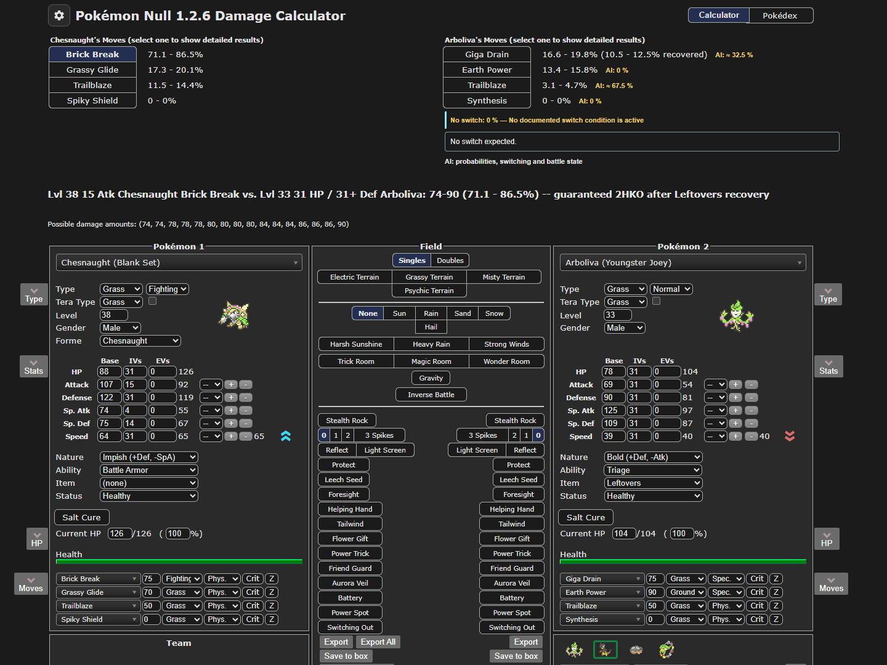
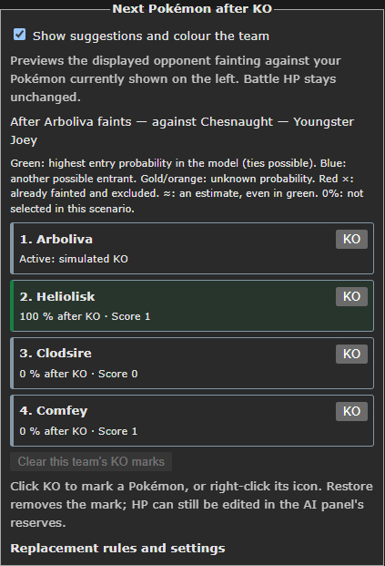
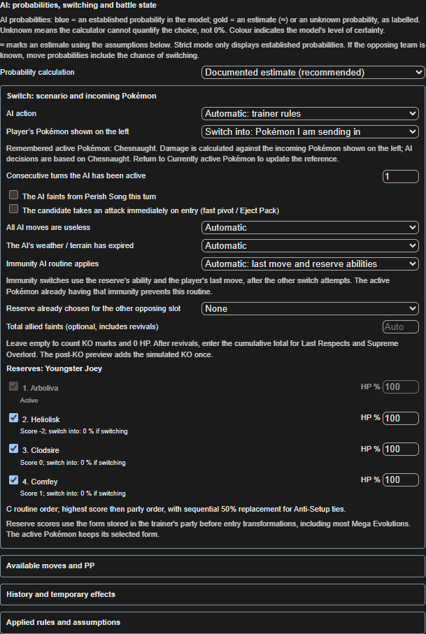
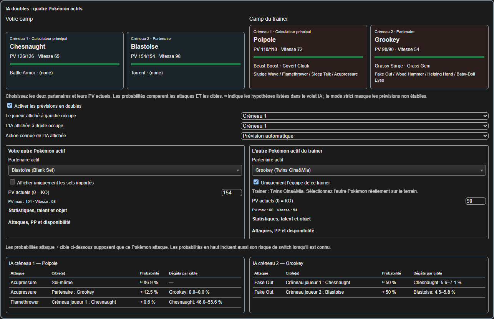
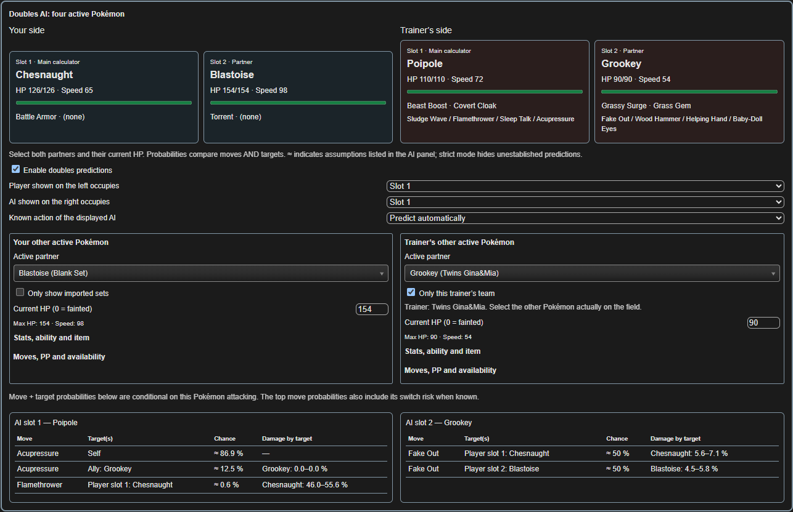
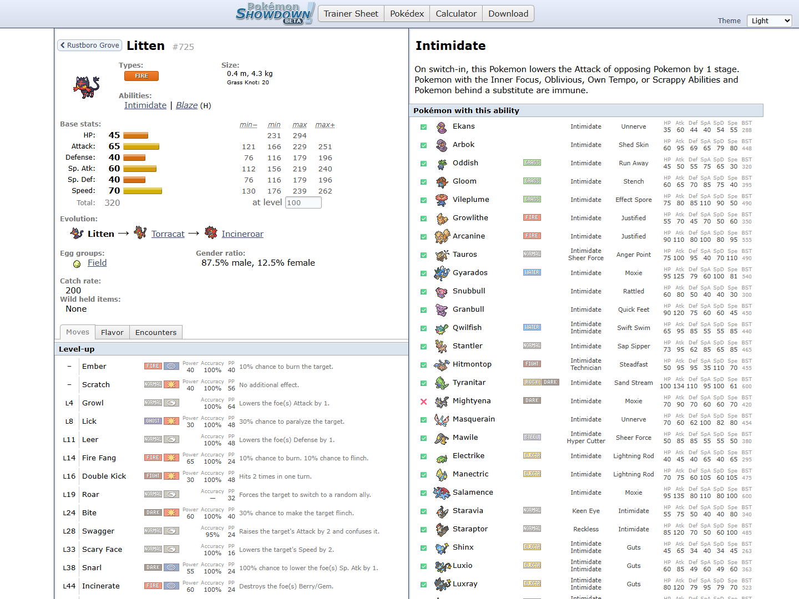

# Pokémon Null Calculator

**Damage calculator · AI move probabilities · Switching · Doubles**  
**Pokémon Null 1.2.6 · 🇫🇷 / 🇬🇧**

[🇫🇷 Français](#francais) · [🇬🇧 English](#english) · [⬇️ Download / Télécharger](../../releases/latest) · [📖 Guides](#guides)

## 🇫🇷 Présentation

Une évolution du calculateur de dégâts de **Pokémon Null**, enrichie pour préparer les combats et mieux comprendre les décisions de l'IA : **attaques, switches pendant le combat et Pokémon envoyé après un KO**.

Le projet part du [calculateur Null de NathanMelons](https://nathanmelons.github.io/Null-1.2-Damage-Calc/) et d'une archive modifiée. Il conserve les équipes historiques des trainers et leur superpose les corrections vérifiées pour la ROM **1.2.6**. Les sources, tests et explications pour les prochains développeurs sont inclus.

### Ce qui a été ajouté

| Fonction | Ce qu'elle permet |
| --- | --- |
| **Remplaçant après KO** | Le panneau en bas à droite simule le KO de l'adversaire affiché, classe les réserves du trainer et colore les entrants possibles. Les PV du combat restent inchangés. |
| **Marques KO** | Bouton **KO** ou clic droit sur une icône pour exclure un adversaire déjà battu ; **Restore** le réactive. |
| **Switch pendant le combat** | Règles automatiques du trainer, réserves disponibles, PV, PP et contexte du tour. Des scénarios **No switch**, **Guaranteed switch-in** et **Probably switch** permettent aussi de tester des hypothèses explicites. |
| **Switch into** | Simule votre propre changement de Pokémon : l'IA garde comme référence le Pokémon actif mémorisé, tandis que les dégâts se recalculent sur celui que vous faites entrer. |
| **Combats doubles** | Vue avec **quatre Pokémon actifs**, partenaires, créneaux, attaques et cibles. Les actifs sont exclus des réserves ; les propriétaires des réserves sont distingués pour les combats à deux trainers vérifiés. |
| **Données et mécanique** | Adaptation à la ROM 1.2.6, formes de réserve avant l'entrée, seuils de KO natifs retrouvés, Trick Room, historiques d'attaques et de KO pris en charge. |
| **Imports et confort** | Plusieurs individus d'une même espèce, customs numérotés, nettoyage complet des customs, panneau IA anglais/français et légendes des couleurs. |
| **Pokédex intégré** | Interface du Pokédex officiel, recherches et rencontres complétées avec priorité aux données vérifiées de la ROM. Le clic molette ouvre un nouvel onglet. |

### Télécharger et démarrer

1. Ouvrir la [dernière release](../../releases/latest) et télécharger **Null-1.2.6-Calculateur-Complet-EN-FR.zip**.
2. **Extraire entièrement** le ZIP.
3. Ouvrir le dossier extrait et double-cliquer sur **CALCULATEUR.html** dans Chrome, Edge ou un navigateur compatible.
4. Garder les dossiers à côté du HTML. **TUTORIEL.html** contient le guide français.

Vous pouvez aussi utiliser **Code → Download ZIP** sur GitHub : extraire le dépôt et ouvrir le même fichier. Aucune installation, ROM ou émulateur n'est nécessaire pour utiliser le calculateur. Les calculs et les données principales fonctionnent hors ligne ; certaines animations, les cris du Pokédex et les liens externes nécessitent Internet.

<strong>🇫🇷 Prise en main : simples, switches et doubles</strong>

**Combat simple.** Choisir votre Pokémon à gauche et le trainer à droite. Renseigner les niveaux, IV/EV, talents, objets, PV, statuts, boosts et terrain. Ouvrir **AI: probabilities, switching and battle state** pour les PP, historiques, hypothèses et règles appliquées. La roue des paramètres permet de passer le panneau IA en français.

**Après KO.** Lire **Next Pokémon after KO**, en bas à droite. Vérifier les PV et la disponibilité des réserves ; marquer les adversaires déjà KO. La simulation concerne le KO du Pokémon de droite face au Pokémon actuellement affiché à gauche.

**Pendant le combat.** Dans le volet IA, laisser le switch sur **Automatic: trainer rules** pour le modèle automatique. Les autres scénarios sont des hypothèses choisies par l'utilisateur. Pour votre propre switch, sélectionner **Switch into avant** de changer le Pokémon de gauche ; revenir à **Currently active Pokémon** pour actualiser la référence.

**Doubles.** Cliquer sur **Doubles** dans **Field**, puis sélectionner les deux partenaires dans le panneau supérieur. Vérifier les quatre actifs, leurs PV et leurs créneaux. Le filtre de gauche retrouve les sets importés ; celui de droite propose l'équipe du trainer courant. Un contexte incomplet peut empêcher de chiffrer la prédiction.

**Couleurs.** Pour les attaques, bleu = probabilité établie dans le contexte du modèle ; doré/orange = estimation ou inconnue, selon le libellé. Après KO, vert = probabilité d'entrée la plus élevée du modèle, bleu = autre entrant possible, croix rouge = déjà KO. **≈** indique une estimation, même en vert. **Indeterminate** signifie « non déterminé », pas 0 %.

### Références et limites

La priorité est **ROM fournie → documentation officielle → références historiques**. Le travail s'appuie sur la lecture des tables et de fonctions compilées de la ROM 1.2.6, le Lua de correspondance, les notes de patch, la [documentation officielle](https://drive.google.com/drive/folders/10H1Pm-1dhEgc0QmjsnA9A9PY6nNRXtoJ), les [règles IA documentées](https://docs.google.com/document/d/1KwkghD6eOZ026HR81C7yToDD_7fPwL2Iccc_XNL-G48/edit), le [code C partagé](https://playcode.io/c-playground--019ec228-a451-75f9-8be6-c7b68df3784a) et les situations observées en jeu.

Le calculateur **ne lit pas l'émulateur** et ne rejoue pas tous les événements d'un tour. PV, PP, partenaires, effets temporaires et historiques restent à renseigner. Il ne prédit pas le prochain tirage RNG et ne certifie pas une reproduction intégrale de l'IA. Un 100 % dans le modèle dépend du contexte saisi et des règles couvertes. Les lacunes restent signalées.

### Captures

| Après KO | Switch pendant le combat |
| --- | --- |
|  |  |

---

## 🇬🇧 Overview

An expanded **Pokémon Null damage calculator** for battle preparation and understanding AI decisions: **move choices, switching during battle and replacements after a KO**.

This project builds on [NathanMelons' Null calculator](https://nathanmelons.github.io/Null-1.2-Damage-Calc/) and a modified archive. Historical trainer teams are preserved, with verified **ROM 1.2.6** corrections applied through an additional data layer. Editable sources, tests and developer documentation are included.

### Main additions

| Feature | What it does |
| --- | --- |
| **Post-KO replacement** | The bottom-right panel previews the displayed opponent fainting, ranks the trainer's reserves and colours possible replacements without changing battle HP. |
| **KO tracking** | Use **KO** or right-click a team icon to exclude an already defeated Pokémon. **Restore** makes it available again. |
| **In-battle switching** | Automatic trainer rules account for available reserves, HP, PP and entered battle context. **No switch**, **Guaranteed switch-in** and **Probably switch** also let you test explicit assumptions. |
| **Switch into** | For your own switch, the AI keeps a remembered active Pokémon as its decision reference while damage is recalculated against the incoming Pokémon. |
| **Double battles** | A dedicated **four-battler view**, partners, slots, moves and targets. Active Pokémon are excluded from reserves; verified two-trainer battles keep separate reserve ownership. |
| **Data and mechanics** | ROM 1.2.6 adjustments, reserve forms before entry, recovered native KO thresholds, Trick Room and supported move/faint histories. |
| **Imports and usability** | Multiple individuals of the same species, numbered custom sets, complete custom-set reset, an English/French AI panel and colour legends. |
| **Embedded Pokédex** | The official dex interface with completed searches and encounters, prioritising verified ROM data. Middle-click opens a separate tab. |

### Download and run

1. Open the [latest release](../../releases/latest) and download **Null-1.2.6-Calculateur-Complet-EN-FR.zip**.
2. **Extract the entire ZIP**.
3. Open the extracted folder and double-click **CALCULATEUR.html** in Chrome, Edge or a compatible browser.
4. Keep the accompanying folders next to the HTML file. Read the [English user guide](documentation/USER_GUIDE_EN.md).

Alternatively, use GitHub's **Code → Download ZIP**, extract the repository and open the same file. No installation, ROM or emulator is needed to use the calculator. Calculations and core data work offline; some Pokédex animations, cries and external links require Internet.

<strong>🇬🇧 Quick tutorial: singles, switching and doubles</strong>

**Singles.** Select your Pokémon on the left and the trainer's set on the right. Match levels, IVs/EVs, abilities, items, HP, status, stat stages and field conditions. Open **AI: probabilities, switching and battle state** for PP, histories, assumptions and applied rules. AI controls default to English; the settings wheel also offers French.

**After a KO.** Read **Next Pokémon after KO** at the bottom right. Check reserve HP and availability, and mark previously fainted opponents. This previews the right-side Pokémon fainting against the currently displayed left-side Pokémon.

**During battle.** Leave **Automatic: trainer rules** selected for automatic switching. Other scenarios are user assumptions. To preview your own switch, choose **Switch into before** changing the left-side Pokémon. Return to **Currently active Pokémon** to refresh the reference.

**Doubles.** Click **Doubles** in **Field**, then select both partners in the upper panel. Check all four active Pokémon, their HP and slot assignments. The player-side filter lists imported sets; the opponent-side filter offers the current trainer's team. Incomplete context may prevent numerical predictions.

**Colours.** Move probabilities use blue for an established result within the model, and gold/orange for estimates or unknown values as labelled. Post-KO suggestions use green for the highest modelled entry probability, blue for another possible replacement and a red cross for fainted Pokémon. **≈** means estimated, even in green. **Indeterminate** does not mean 0%.

### References and limitations

The reference order is **supplied ROM → official documentation → historical references**. Work uses read-only inspection of ROM 1.2.6 data and selected compiled functions, the Lua ID mapping, patch notes, [official documentation](https://drive.google.com/drive/folders/10H1Pm-1dhEgc0QmjsnA9A9PY6nNRXtoJ), [documented AI rules](https://docs.google.com/document/d/1KwkghD6eOZ026HR81C7yToDD_7fPwL2Iccc_XNL-G48/edit), [shared C code](https://playcode.io/c-playground--019ec228-a451-75f9-8be6-c7b68df3784a) and battles reported from the game.

The calculator **does not read emulator memory** or replay every event of a turn. Enter current HP, PP, partners, temporary effects and relevant history yourself. It cannot predict the next RNG draw or certify full native AI parity. A modelled 100% depends on the supplied context and implemented rules. Missing information remains visible.

<strong>Pokédex / Pokédex intégré</strong>

## 📖 Guides & development / Documentation et développement

| Audience | Start here / Commencer ici |
| --- | --- |
| 🇫🇷 Joueurs | [Guide français](documentation/TUTORIEL_SOURCE.txt) · ouvrir **TUTORIEL.html** après extraction |
| 🇬🇧 Players | [English user guide](documentation/USER_GUIDE_EN.md) |
| Developers / agents | [Developer entry point](documentation/GUIDE_AGENTS.md) · [Current architecture](documentation/DOCUMENTATION_COMPLETE.md) |
| ROM audit | [1.2.6 migration and coverage](documentation/MISE_A_JOUR_1.2.6.md) · [Native KO thresholds](documentation/SEUILS_KO_ROM.md) |
| History / Historique | [Consolidated history](documentation/HISTORIQUE.md) |

The verified application build passed **325 automated tests** on both source and distribution, plus browser scenarios and a 16-snapshot comparison. Results: [verification/unified-validation.json](verification/unified-validation.json). This validates the covered cases, not all possible battles.

Les sources modifiables, fixtures et preuves utiles restent dans la même version téléchargeable. Les anciens rapports et captures de validation redondants sont exclus des archives. Les nouvelles captures ci-dessus servent au tutoriel.

For development, see the developer guide for Node, Python and Playwright prerequisites. **Players do not need these tools.** From the project root:

    npm test
    npm run release

## Credits / Remerciements

- [NathanMelons / Null-1.2-Damage-Calc](https://github.com/NathanMelons/Null-1.2-Damage-Calc): starting Null calculator.
- [ForwardFeed / runbuncalc](https://github.com/ForwardFeed/runbuncalc) and [Smogon damage-calc](https://github.com/smogon/damage-calc): calculator lineage and damage engine, including Honko and contributors.
- [Pokémon Showdown](https://github.com/smogon/pokemon-showdown-client), [Porydex / lhearachel](https://github.com/lhearachel/porydex) and the [official Null dex](https://nulldex.pokemon0null.workers.dev/): dex components and interface.
- Pokémon Null's creators and documentation authors: game, data and published mechanics.
- Player-reported battles: regression cases and corrections refined against the ROM. Development was assisted by Codex.
- [Sykless / PokemonNullDisplay](https://github.com/Sykless/PokemonNullDisplay): inspiration for the bilingual project presentation, not the source of this calculator's AI logic.

Modified and documented for this project through **2 November 2026**. The Porydex-derived code and this project's additions are distributed under [AGPL-3.0](LICENSE); the damage engine retains its [MIT notice](licenses/MIT-damage-calc.txt). Existing third-party notices remain in their files. Pokémon artwork and other third-party assets retain their respective ownership.

## 🇫🇷 Mises à jour · 🇬🇧 Updates

**🇫🇷** Le projet pourra recevoir des mises à jour : nouvelles versions du jeu, corrections de règles, retours de combats et améliorations de l'interface. Pour signaler un écart, indiquer la version de la ROM et du calculateur, le trainer, les quatre Pokémon en doubles, les PV après le coup, les KO précédents et les effets du terrain ; joindre une capture si possible.

**🇬🇧** Updates may follow: new game versions, rule corrections, battle reports and interface improvements. When reporting a mismatch, include the ROM/calculator version, trainer, all four battlers in doubles, HP after the move, previous KOs and field effects; attach a screenshot when possible.
