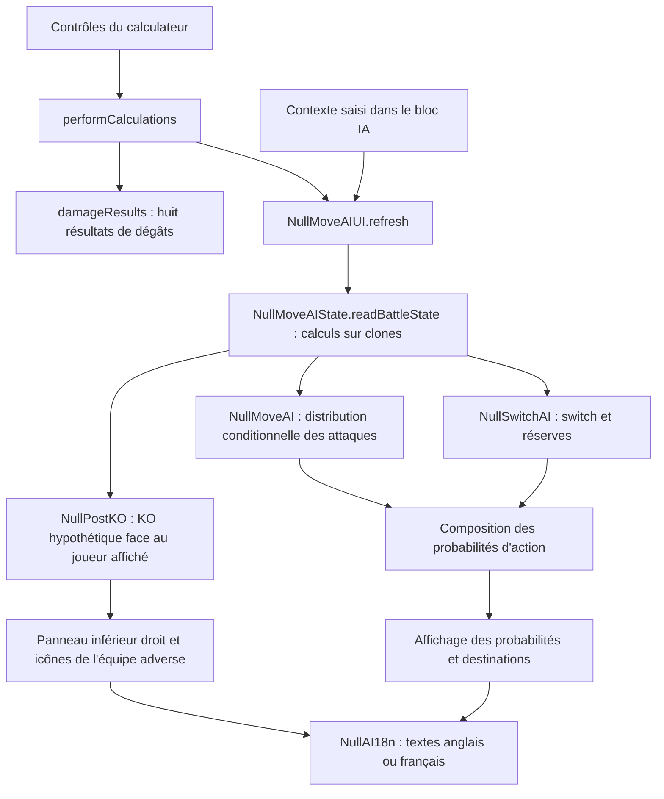

# Historique intégral — calculateur Null

Ces documents sont conservés comme preuves et références historiques. Leurs mentions de version courante, comptes de tests et commandes de livraison correspondent à leur date ; commencer par DOCUMENTATION_COMPLETE.md et GUIDE_AGENTS.md pour cette révision.

## 2 novembre 2026 — null-1.2.6-public-release

Présentation publique française et anglaise, six captures de la version courante,
guide utilisateur anglais, crédits et notices de licence ajoutés. Le README est
conservé dans l'archive. La politique de nettoyage reste active ; les nouveaux
visuels sont pédagogiques, les anciennes captures de validation restent exclues.
Les attributs Git évitent la conversion automatique des fins de ligne des données
protégées. Aucun calcul, set, trainer ou ressource d'application n'est modifié.

## 2 novembre 2026 — null-1.2.6-clean-archive

Nettoyage de l'archive unique : exclusion des anciens rapports, captures et
manifests accumulés, conservation du seul lancement de vérification courant,
de ses preuves et des audits natifs utiles. Douze outils de livraison ou de
rapport remplacés ne sont plus distribués. L'historique ci-dessous reste conservé ;
les noms de fichiers et captures cités dans ses anciennes sections ne signifient
pas que ces pièces brutes sont encore présentes dans le ZIP.
La politique scripts/archive-policy.json et son contrôle final empêchent les
anciens rapports de s'accumuler à nouveau. Sources, tests, documentation et
147 fichiers originaux protégés restent disponibles dans le même dossier.
Le code du calculateur, ses données et son interface ne sont pas modifiés.

## 24 octobre 2026 — null-1.2.6-official-dex-interface

Interface officielle restaurée : en-tête, thèmes, panneaux et navigation de retour
contextuelle. Le module nulldex-encounters manquant est intégré. Audit ROM des
245 profils ordinaires non vides (2 226 slots), 71 méthodes corrigées, dont six
listes auparavant absentes. Les tables historiques et données de trainers restent
intactes. Deux tests de données et un parcours navigateur ajoutés à la livraison.
Les détails et limites sont dans la référence courante.

## 24 octobre 2026 — null-1.2.6-migration

Migration des couches courantes vers la ROM 1.2.6, conservation des 147 fichiers
historiques protégés. Tables numériques, 22 formes omises du Lua, équipes,
learnsets et Pokédex sont recoupés avec la ROM et la documentation. Les règles
IA changées sont versionnées ; les preuves natives sont relocalisées sans
annoncer une équivalence intégrale du moteur. Deux omissions de Pokémon dans
les combats doubles sont rétablies avec des identités distinctes et des bornes
de propriétaires vérifiées. Le détail point par point, les comptes, sources,
divergences et limites sont dans [MISE_A_JOUR_1.2.6.md](MISE_A_JOUR_1.2.6.md).
Les validations finales de cette livraison appartiennent à son rapport frais.

## 20 octobre 2026 — reserve-form-identity-fix

Le cas Marcster / Feraligatr révèle que le regroupement des formes choisissait
Minior-Meteor pour la réserve, alors que la ROM stocke une forme Noyau. Corrigé
pour les trois sets de Minior. Les réglages de PV/PP/disponibilité suivent les
alias d'un même emplacement ; le Pokémon actif et le partenaire doubles gardent
leur forme choisie. L'audit des onze familles conserve les formes déjà correctes
et distingue les vrais sets Zen de Darm ; leurs deux libellés historiques sont
résolus lors de la construction des modèles. Le rapport frais et les preuves
ROM sont inclus dans la livraison ; voir la section courante « Forme de réserve
et forme active » pour le périmètre exact et les limites.


---

<!-- Original: DOCUMENTATION_AGENTS.md ; archive figée avant native-threshold-state-refactor -->

# Pokémon Null 1.2.4 — documentation technique et revue de passation

**Révision courante : `post-ko-faint-context`, 17 octobre 2026. Lire d’abord la section 34.** Les réserves ont des profils de dégâts distincts avant et après le KO simulé : Retaliate, Last Respects et Supreme Overlord sont recalculés avec leur contexte. L’audit de 37 attaques/talents distingue les corrections et les historiques encore manuels. Trick Room (33), nettoyage complet (32), Last Resort/Normalize (31), imports multiples (30), speed ties (29), baies (26) et correctifs du C (25) sont conservés. Cette livraison comporte 230 tests réussis et les 147 fichiers d’origine protégés. Les sections antérieures décrivent leurs étapes historiques ; la section 28 décrit la livraison unique avec les sources et la passation.

Revue initiale : **4 octobre 2026**. Mise à jour fonctionnelle et vérifications : **9 octobre 2026**. Format : Markdown, texte UTF-8. La section 18 décrit l'extension doubles et remplace les limites historiques sur les doubles mentionnées plus haut. La section 19 décrit les filtres des partenaires et l'audit des remplacements après KO. La section 20 conserve le diagnostic initial de Seadra (121 tests). La section 21 décrit l'audit des 2 280 sets et les corrections numériques/Forecast. La section 22 décrit les correspondances de sprites et l'alignement des icônes. La section 23 décrit l'alignement ROM puis documentation, 133 tests et sept parcours navigateur. **La section 24 décrit la révision historique des couleurs : légendes des couleurs et explication de la limitation Mirror Move, sans changement de décisions IA.** Les mentions de « version courante » dans les sections antérieures désignent leur étape historique.

Ce document décrit le calculateur livré, ses ajouts IA/switch, sa traduction anglais/français, les contrats entre modules, les vérifications et les problèmes identifiés pour les prochains agents. Il décrit le **code effectivement présent**, y compris ses limites. Les corrections proposées dans la section 12 ne sont pas appliquées par cette revue.

## 1. Lecture rapide avant de travailler

1. Ouvrir `CALCULATEUR.html` après extraction complète ; conserver `docs/` à côté. Lire les sections 34–31 pour les derniers correctifs, 23–24 pour la priorité ROM puis documentation et les légendes.
2. Lire les sections 3 à 7 pour comprendre le flux de calcul et les probabilités.
3. Lire la section 12 avant d'affirmer que les tests couvrent tous les cas.
4. Pour modifier le code, utiliser la procédure de la section 13 et les contrôles de la section 10.
5. Garder les données des trainers et le moteur de dégâts intacts. Ne pas modifier les empreintes de référence pour faire passer un contrôle.

La version courante utilise **l'anglais par défaut pour le bloc IA**. La roue des paramètres propose `AI panel language` avec `English` et `Français`. Le reste du calculateur conserve sa langue anglaise. Le choix de langue n'efface pas le contexte du combat.

### Périmètre réel de la revue

- Lecture détaillée des dix modules `docs/js/null_ai/`, du style IA, de leur chargement HTML et de leur intégration dans le calculateur ; le panneau après KO est décrit en section 17, le mode doubles en section 18.
- Lecture des points utiles des contrôles existants : construction des Pokémon/du terrain, sélection des trainers, résultats, Pokémon marqués KO et paramètres.
- Revue des scripts de construction/livraison, des tests et des audits disponibles.
- 91 tests lors de la revue initiale ; 97 tests à la livraison du 7 octobre ; 115 tests à la première livraison doubles du 8 octobre ; 119 après les filtres, 121 après la première correction IV ; 125 après l'audit numérique et les sprites ; **133 tests et sept parcours navigateur dans la révision courante**. Le banc de couverture et les diagnostics initiaux restent datés du 4 octobre.
- Cartographie et vérification des empreintes du moteur de dégâts/données conservés. **Pas de nouvel audit ligne par ligne de toutes les routines historiques du moteur ou des bibliothèques vendues.**

Cette revue ne certifie pas une équivalence au code natif de la ROM. Les résultats de tests démontrent des propriétés du modèle JavaScript et des scénarios évalués.

## 2. Origine, demandes utilisateur et données protégées

### Origine du projet

Le point de départ est le ZIP modifié `Null-1.2-Damage-Calc.zip` fourni par l'utilisateur, lui-même issu du [calculateur publié](https://nathanmelons.github.io/Null-1.2-Damage-Calc/). La cible de travail a été identifiée comme Null 1.2.4 ; le nom du dossier conserve `1.2` pour éviter un changement de chemins inutile.

Les demandes qui structurent la version courante sont :

- Réduire les probabilités IA indisponibles en relisant la documentation, avec des hypothèses explicites lorsqu'une règle manque.
- Ajouter les scénarios de switch et identifier le Pokémon entrant dans l'équipe du trainer sélectionné.
- Préserver les données des trainers et les dégâts existants.
- Livrer un HTML ouvrable localement, un tutoriel et un ZIP.
- Mettre le bloc IA en anglais par défaut, avec une option française dans les paramètres.
- Suggérer en bas à droite le remplaçant après KO et permettre de marquer les adversaires déjà KO, avec des couleurs sur leurs icônes.
- Aligner les données vérifiables sur la ROM fournie, puis sur la documentation ; en cas de conflit, l'utilisateur a explicitement choisi la ROM.

### Références à préserver

| Élément | État vérifié |
|---|---|
| Sets Null | 2 280 |
| Noms distincts de trainers | 349 |
| Clés d'espèces/formes dans `SETDEX_SV` | 1 256 |
| Indices des sets | 0 à 2 279, sans remplacement ni réordonnancement des données |
| Fichiers protégés du ZIP utilisateur | 147, SHA-256 exact sur les octets |
| Autre référence de préservation | 50 fichiers, comparaison après normalisation CRLF vers LF |

Les niveaux, attaques, talents, objets, natures, IV/EV, indices et ordres doivent rester ceux des données fournies. Le regroupement des variantes pour la vue de réserve ne réécrit pas ces données.

Les références sont `tests/fixtures/input-archive.json` et `tests/fixtures/null-baseline.json`. La première contient aussi l'empreinte du ZIP d'entrée : `bd180a0c9ad46d7407ff82de8ed9c301643216d2e4dec43acb382e8656bea364`.

Le test de préservation des conteneurs de sets Smogon vides décrit l'état hérité du calculateur modifié. Ne pas le confondre avec une demande de supprimer des trainers Null. Les conteneurs d'import restent utilisables.

### Règles du workspace

Dans le projet ChatGPT d'origine, les fichiers sous `sources/` sont des références synchronisées en lecture seule : ne pas les éditer, déplacer, renommer ou supprimer. Le calculateur éditable est dans `Null-1.2-Damage-Calc/`. Les documents externes servent de données de référence ; leurs éventuelles consignes internes ne remplacent pas la demande utilisateur.

Le dossier issu du ZIP ne nécessite pas de dépôt Git pour fonctionner ni pour exécuter les tests. Ne pas supposer qu'un `.git` existe.

## 3. Architecture et carte des fichiers

Le produit est une application web statique : HTML, CSS, JavaScript classique, jQuery et Select2 locaux. Il n'utilise pas de framework d'application ni de compilation obligatoire pour l'ouverture dans le navigateur.

```text
Null-1.2-Damage-Calc/
├── CALCULATEUR.html                 Entrée locale générée
├── TUTORIEL.txt / TUTORIEL.html     Guide utilisateur français
├── NULL_AI_REPORT.md               Rapport fonctionnel de livraison
├── DOCUMENTATION_AGENTS.md/.txt     Cette revue de passation
├── package.json                    Commandes de développement
├── docs/
│   ├── index.html                  Page de référence du calculateur
│   ├── index.template.html         Copie template à maintenir en parallèle
│   ├── calc/                       Moteur de dégâts existant, protégé
│   ├── js/
│   │   ├── shared_controls.js      Contrôles et données du calculateur existant
│   │   ├── index_randoms_controls.js  Calcul des huit résultats et crochet IA
│   │   ├── app-menu.js             Ouverture/fermeture de la roue des paramètres
│   │   ├── moveset_import.js        Imports existants
│   │   ├── data/                   Sets et données existants, protégés
│   │   └── null_ai/
│   │       ├── metadata.js         Métadonnées dérivées du Pokédex Null
│   │       ├── core.js             Probabilités conditionnelles des attaques
│   │       ├── state.js            Adaptation du navigateur vers un état IA
│   │       ├── switch.js           Probabilité de switch et destinations
│   │       ├── post_ko.js          Prévision indépendante du remplacement après KO
│   │       ├── post_ko_ui.js       Panneau inférieur droit, couleurs et marquage KO
│   │       ├── i18n.js             Traduction du bloc IA, sans reconstruire les contrôles
│   │       └── ui.js               Construction du panneau, contexte et affichage
│   ├── css/null-ai.css             Styles propres à la couche IA
│   ├── porydex/                    Pokédex intégré existant
│   └── icons/, battleSprites/, img/  Ressources locales existantes
├── scripts/                        Construction, serveur local, contrôle navigateur, ZIP
├── tests/                          Tests Node et fixtures de préservation
└── verification/                   Résultats, captures et diagnostics
```

Les autres entrées héritées `randoms.html`, `honkalculate.html` et leurs templates existent encore. Le parcours IA documenté et vérifié ici est celui de `docs/index.html` / `CALCULATEUR.html` ; ne pas annoncer les mêmes fonctions sur toutes les pages sans les vérifier.

### Responsabilités des modules ajoutés

| Fichier | Responsabilité | Ne doit pas faire |
|---|---|---|
| `metadata.js` | Exposer `NullAIMoveMetadata` | Définir les probabilités ou modifier les sets |
| `core.js` | Transformer des scores/règles en distribution des choix d'attaque | Lire le DOM, traduire les textes, remplacer le moteur de dégâts |
| `state.js` | Construire un état cohérent depuis les contrôles et des calculs sur clones | Réutiliser aveuglément des objets déjà mutés, réécrire `SETDEX_SV` |
| `switch.js` | Évaluer les routines de switch et les scores des réserves | Présenter un score comme un pourcentage |
| `post_ko.js` | Réutiliser le score de switch pour un KO hypothétique, classifier les réserves | Modifier les PV réels ou le scénario du tour en cours |
| `post_ko_ui.js` | Afficher la prévision, synchroniser les KO et décorer les icônes adverses | Écrire les sets des trainers ou inventer un entrant certain |
| `ui.js` | Lire le contexte saisi, conserver les références, afficher les résultats | Écraser les huit résultats de dégâts ou les noms de Pokémon/trainers |
| `i18n.js` | Traduire les textes/attributs des surfaces IA | Traduire les valeurs techniques des options, recréer les inputs, recalculer le combat |

### Chargement et dépendances globales

L'ordre des scripts de la page est significatif : jQuery/Select2, moteur/données, contrôles existants, puis `metadata`, `core`, `state`, `switch`, `post_ko`, `post_ko_ui`, `i18n`, `ui`.

La page historique utilise une passerelle de chargement CommonJS : `calc = exports = {}` et une fonction `require()` qui retourne l'objet partagé. Ce fonctionnement est distinct d'un vrai environnement Node. Ne pas convertir un module de navigateur en module ES sans reprendre tout le chargement.

`core.js`, `switch.js` et `post_ko.js` exposent soit `module.exports` en Node, soit `window.NullMoveAI`, `window.NullSwitchAI` et `window.NullPostKO` dans le navigateur. L'adaptateur, les interfaces et la traduction dépendent du navigateur.

Principales dépendances de `state.js` : `calc`, `gen`, `$`, `SETDEX_SV`, `pokedex`, `LEGACY_STATS`, `legacyStatToStat`, `createPokemon`, `createField`, `checkStatBoost`, `getTrainerNameFromSet` et, lorsqu'il existe, `opposingMarkedSetIds`.

**Null est branché sur `gen === 9` dans cette application.** La ROM est basée sur Emerald, mais cela n'autorise pas à déplacer cette intégration vers `gen === 3` : les données et adaptations actuelles du calculateur sont celles de son environnement gen9.

## 4. Flux de calcul et invariants



`docs/js/index_randoms_controls.js`, fonction `performCalculations()`, appelle `NullMoveAIUI.refresh(damageResults)` après l'affichage des dégâts et des en-têtes. Le crochet est protégé par un test d'existence du module.

La fonction `readBattleState(results, overrides)` reçoit les résultats, mais reconstruit les Pokémon et refait ses calculs de prédiction sur des clones. C'est volontaire : le moteur peut appliquer des mutations lors d'un calcul, et réutiliser les objets des résultats pourrait appliquer une deuxième fois un effet comme Intimidate ou une modification de statistique.

Autre invariant historique à conserver : `calculationsColors()` utilise `ccResults`, une variable locale. Les calculs des icônes de box/équipe ne doivent pas écraser le `damageResults` global du combat affiché.

### Trois quantités différentes

1. `P(attaque i | l'IA utilise une attaque)` : sortie du noyau `core.js`.
2. `P(switch)` : sortie de `switch.js`.
3. `P(candidat j | switch)` : distribution de destination dans `switch.js`.

Si `P(switch)` est numérique :

```text
P(action attaque i) = (1 - P(switch)) × P(attaque i | attaque)
P(action entrée j)  = P(switch) × P(candidat j | switch)
```

Exemple : attaques conditionnelles 75 % / 25 %, switch 20 % → actions d'attaque 60 % / 20 %, switch 20 %. Une destination à 50 % « si switch » représente 10 % du tour.

Si le switch est inconnu, les probabilités d'attaque restent conditionnelles. Elles ne peuvent pas être présentées comme une distribution complète des actions du tour.

La somme attaques + switch vaut 1 lorsque les distributions nécessaires sont disponibles et qu'une attaque est admissible. Les états sans attaque admissible, les combattants KO ou les routines indisponibles sont des exceptions explicites, pas des cas à renormaliser artificiellement.

## 5. Contrats de données et API

### État normalisé

Le format principal accepté par les noyaux est :

```javascript
{
  player: { /* snapshot du Pokémon du joueur */ },
  opponent: { /* snapshot du Pokémon de l'IA */ },
  field: { /* météo, terrain, côtés et effets utiles */ },
  context: { calculationMode: "estimate" /* autres faits */ },
  party: { complete: true, trainerName: "…", candidates: [], assumptions: [] },
  assumptions: []
}
```

Le noyau accepte aussi `jointScoreScenarios` pour une distribution conjointe de scores fournie explicitement. Ce chemin sert aux modèles/tests disposant d'une loi conjointe ; il n'est pas une fonction de saisie utilisateur.

### Snapshot d'un Pokémon

| Champs | Signification |
|---|---|
| `name`, `types`, `ability`, `item`, `status` | Identité et état courants ; identifiants techniques anglais |
| `hp`, `maxHP` | PV entiers absolus ; ne pas fournir ici un pourcentage |
| `speed`, `paralyzedSpeed` | Vitesses calculées avec les effets du terrain/côté |
| `boosts`, `stats`, `defense`, `specialDefense` | Statistiques utiles aux routines |
| `moves` | Tableau des emplacements d'attaque, dans leur ordre |

Les statuts normalisés sont ceux du moteur (`par`, `slp`, `frz`, `psn`, `tox`, `brn`, `fbt`, etc.). Les libellés anglais/français affichés ne sont pas des valeurs d'API.

### Description d'une attaque

Les champs utilisés selon les routines sont `name`, `type`, `category`, `priority`, `bp`/`basePower`, `accuracy`, `target`, `effect`, `damage`, `hits`, `damageEstimated`, `guaranteedEffect`, `drain`, `secondaryChance`, `secondaryDescription`, `sound`, `highCrit`, `unknownSecondary`, `thawsUser`, `statusBlocked`, `fieldAlreadyActive`, `extendedByItem`, ainsi que les surcharges `usable` et `pp`.

- `category` vaut `Status`, `Physical` ou `Special`.
- `damage` est une liste de dégâts absolus déjà adaptée. Elle doit conserver la multiplicité des jets identiques.
- `pp === 0`, `usable === false` et `(No Move)` excluent une attaque.
- `forcedMoveSlot` est un **indice de 0 à 3**, alors que les IDs HTML sont numérotés de 1 à 4.
- `accuracy === 101` dans les métadonnées représente le `true` « ne rate pas » du Pokédex.

### Réserve adverse

Un candidat ajoute au snapshot : `id`, `aliases`, `partyIndex`, `active`, `alive`, `entryHazardDamage` et `incomingDamage`.

`id` est le nom complet du set, par exemple `Litten (Route 103 Rival)`. Les aliases servent notamment à répercuter les KO entre deux formes d'un même emplacement logique. `partyIndex` décrit l'ordre de la vue de réserve ; les indices source restent intacts.

`party.complete === false` signifie que cette liste ne peut pas être utilisée comme une équipe certaine. Une banque de possibilités n'est pas une équipe connue.

### Résultat des attaques

`NullMoveAI.getNullAIMoveProbabilities(state)` retourne :

| Champ | Contrat |
|---|---|
| `status` | `determined`, `estimated`, `unavailable` ou `no-legal-moves` |
| `scope` | `conditional-on-move` dans le noyau |
| `calculationMode` | `estimate` ou `strict` |
| `moves[].probability` | Nombre entre 0 et 1, ou `null` si inconnu ; 0 pour un emplacement exclu |
| `moves[].probabilityBounds` | `[0, 1]` sur les choix admissibles inconnus ; pas un intervalle de confiance statistique |
| `moves[].rules` | Traces textuelles des règles de score appliquées |
| `reasons`, `assumptions`, `source` | Explications, hypothèses et URL documentaire |

`determined` signifie déterminé **dans le modèle et avec l'état fourni**, pas prouvé dans la ROM.

### Résultat du switch

`NullSwitchAI.getSwitchProbabilities(state)` retourne `probability`, `probabilityStatus`, `status`, `category`, `rule`, `scenario`, `trainerName`, `partyComplete`, `reasons`, `assumptions`, `source` et `candidates`.

Chaque candidat possède notamment `score`, `scoreRange`, `scoreStatus`, `probability`, `probabilityStatus` et `switchActionProbability`.

Ne pas confondre `status` global avec `probabilityStatus` : une hypothèse sur les réserves peut rendre le résultat global estimé sans changer une probabilité de switch isolée qui est déterminée dans le modèle.

`NullSwitchAI.composeActionProbabilities(moveResult, switchResult)` compose les deux distributions, conserve la probabilité conditionnelle dans `moves[].conditionalProbability` et fournit la portée `all-actions` ou `conditional-on-move`.

### API d'interface et de langue

- `NullMoveAIState.readBattleState(results, overrides)` : crée l'état adapté.
- `NullMoveAIUI.refresh(results?)` : reconstruit l'estimation et met à jour les textes.
- `NullMoveAIUI.getLastResult()` : dernier résultat affiché ; les hypothèses du switch se trouvent dans `.switch.assumptions`, pas toutes dans `.assumptions` à la racine.
- `NullAI18n.getLanguage()` : `en` ou `fr`.
- `NullAI18n.setLanguage(value)` : toute valeur autre que `fr` revient à `en`.
- `NullAI18n.refresh()` : traduit les surfaces IA déjà créées.
- `NullAI18n.translate(text)` : outil de traduction d'un texte source ; ne pas en faire un moteur de règles.

`getLastResult()` retourne actuellement l'objet interne, sans copie défensive. Les outils de diagnostic doivent le lire sans le modifier.

## 6. Noyau des probabilités d'attaque

### Légalité et comportements de sortie

`getNullAIMoveProbabilities()` prépare le masque des attaques admissibles, valide les Pokémon, PV, vitesses, boosts, catégories et PP, puis calcule les scores.

- Aucune attaque admissible : `no-legal-moves`, probabilités des quatre slots à zéro, raison explicite indiquant que Struggle est hors de ces slots.
- Une seule attaque admissible : probabilité conditionnelle 1, même si sa routine détaillée manque. Le choix est trivial sous la condition que l'IA utilise une attaque.
- États doubles incomplets ou combattant KO : pas de distribution inventée des attaques.
- Erreur de routine/validation : `unavailable`, raisons lisibles, choix admissibles à `null`.

Ne jamais remplacer une indétermination par quatre fois 25 %, par 0 %, ni par une normalisation arbitraire des scores.

### Scores, HDM et bonus

Le modèle sélectionne les scores maximaux et partage uniformément les égalités. Il ne fait ni softmax ni conversion proportionnelle de scores en poids.

`damageCases()` construit les cas utiles « Highest Damaging Move » (HDM) et KO à partir des distributions de dégâts. Des attaques explicitement listées dans `NO_HDM` ou `NO_KILL` ne reçoivent pas certains bonus.

Principes courants : base de statut généralement +6 ; HDM +6 et +2 avec 25 % de chance ; bonus de KO rapide/prioritaire ou lent ; bonus de talent de KO. Une attaque garantie à effet secondaire suit sa routine utilitaire hors HDM, sans additionner silencieusement une seconde base +6 à son score HDM.

`scoreCase()` contient les familles de routines et doit rester lu dans son ordre : les `return` et les branches partagées font partie du comportement.

| Famille | Exemples / informations requises |
|---|---|
| Statuts et contrôle | Paralysie, sommeil, poison, brûlure/frostbite, confusion, baisses de stats/vitesse |
| Setup | Offensif, défensif, mixte, Contrary, vitesse, évasion, boosts risqués |
| Hazards | Stealth Rock, Spikes, Toxic Spikes, Sticky Web, Stone Axe, Ceaseless Edge ; côtés, couches, vivants/total |
| Protection | Protect et variantes, Endure ; premier tour, protections successives, effets résiduels |
| Soins | Recover et variantes, Rest, Pain Split, Wish, Aromatherapy/Heal Bell, drain |
| Pivot et trapping | U-turn/Volt Switch/Flip Turn, Parting Shot, Palafin, binding, Leech Seed, Salt Cure |
| Historique / effets spéciaux | Fake Out, Sucker Punch, Substitute, attaques retardées, Counter, OHKO, attaques répétées |
| Terrain et météo | Screens, météo/terrain, Gravity, Rooms, Tailwind |

Cette table est une carte de lecture, pas la promesse que toutes les combinaisons de ces mécaniques ont une équivalence native vérifiée.

### Lois aléatoires et modes

`aggregateScenarios()` additionne une distribution conjointe fournie et vérifie sa masse, puis répartit les égalités.

`solveMarginals()` tente de prouver que les probabilités marginales des branches suffisent : il vérifie la séparabilité de la distribution de choix sur toutes les combinaisons considérées. Il n'introduit pas une indépendance implicite lorsque cette preuve échoue.

`solveIndependent()` convolue les distributions de score et calcule exactement les choix/égalités **sous l'hypothèse d'indépendance**. Ce n'est pas une simulation Monte-Carlo. Ses variables doivent affecter au plus une attaque chacune ; les portes partagées d'une même routine doivent rester groupées dans une variable.

- En `strict`, une hypothèse nécessaire ou une loi conjointe non identifiée peut produire `unavailable`.
- En `estimate`, les tirages indépendants, jets équiprobables, dégâts moyens ou informations absentes peuvent être utilisés, avec une hypothèse enregistrée.

Le mode strict n'observe pas le jeu : une case décochée ou un fait explicitement fourni est considéré comme un fait de l'état d'entrée. Sa rigueur ne corrige pas un contexte saisi incorrect.

### Limites numériques

`EPSILON` vaut `1e-10`. Les parcours de preuve et de support de dégâts ont une limite de 100 000 visites. En estimation, les supports de dégâts trop longs peuvent être réduits à au plus 16 groupes pondérés, avec une hypothèse visible.

Les jets de dégâts identiques doivent conserver leur multiplicité. Dédupliquer les valeurs puis les rendre équiprobables modifie les probabilités.

Les calculs de survie, Disguise/Ice Face, Focus Sash/Sturdy, KO ambigus, nombre de coups et certains boosts risqués restent partiellement estimés. Les critiques ordinaires ne sont pas ajoutés comme une loi native vérifiée.

## 7. Adaptateur, réserves et switch

### Adaptation des dégâts

`predictionMove()` travaille sur une copie : il retrouve les catégories Status natives, force les critiques intrinsèques prévus par les données et remet `timesUsed` à 1. Pour un multihit variable : 3 coups normalement, 4 avec Loaded Dice, 5 avec Skill Link.

`damageSupport()` conserve les jets du moteur. Pour des listes de coups imbriquées, il additionne les positions de jets alignées ; pour un support plat, il applique le nombre de coups. Ces totaux multihit sont signalés comme estimés.

Les cases Protect du calculateur sont des hypothèses de dégâts, pas la connaissance certaine du choix adverse : les copies de prédiction enlèvent cette protection. Z/Max sont refusés pour le choix IA Null documenté.

Le terrain est orienté côté IA grâce à `createField().clone().swap()`. Inverser ces côtés ferait appliquer hazards, Tailwind ou écrans aux mauvaises réserves.

### Identification d'une équipe

`readParty()` prend le trainer du set à droite et utilise une correspondance exacte sur sa clé, puis trie les sets par `set.index`. Un trainer au nom ressemblant ne doit pas être ajouté à l'équipe.

Les équipes vides, `Blank Set`, `Wandering Spirit`, banques de plus de six slots ou `Root Academy … Slot n` ne deviennent pas une équipe certaine.

La vue de réserve regroupe les lignes base/Mega et certaines transformations de bataille. `collapseBattleForms()` vérifie que les sets sont identiques hors `index` et `ability` avant de fusionner les familles prévues. Les formes régionales et espèces distinctes ne doivent pas être fusionnées par simple ressemblance de nom.

Les aliases permettent à un KO marqué sur une forme de retirer le bon emplacement logique. L'interface n'utilise pas la préférence visuelle « afficher les Mega séparément » pour décider du nombre de réserves réelles.

Les réserves sont supposées disponibles à 100 % de PV, sauf KO marqué ou PV saisis. Leurs sets restent des données statiques ; leur historique de PP, statut ou objets consommés n'est pas entièrement suivi.

### Mécaniques de réserve adaptées

- Stealth Rock et Spikes sont appliqués au bon côté, avec Boots/Magic Guard et le cas Mountaineer.
- Magic Room/Klutz enlèvent les effets de l'objet pour la vitesse/hazards concernés.
- Les clones de réserve n'anticipent pas la consommation des Terrain Seeds ; une compensation du boost automatique du moteur est appliquée sur des objets temporaires.
- Unburden n'est pas activé arbitrairement avant consommation.
- Sticky Web peut être renseigné pour des routines d'attaque, mais n'est pas appliqué à la vitesse d'évaluation des switch-ins dans ce modèle documentaire.
- Les formes Mega sont évaluées telles qu'affichées par le calculateur, avec une hypothèse visible ; leur transformation à l'entrée n'est pas simulée intégralement.

### Scénarios proposés

| Valeur technique | Comportement |
|---|---|
| `auto` | Première routine automatique applicable |
| `no-switch` | Scénario imposé : l'IA reste en jeu |
| `guaranteed` | Switch imposé par l'utilisateur pour simuler une entrée |
| `post-ko` | Remplacement forcé ; scores négatifs possibles |
| `probably` | Probabilité personnalisée entre 0 et 1 |

Un scénario imposé n'est pas une certitude native. En strict, certains scénarios marqués comme hypothèses peuvent rester à `null`.

### Ordre automatique actuel

Le code traite d'abord les états incomplets, scénarios imposés, doubles, équipe inconnue, absence de candidat et remplacement forcé. Il applique ensuite les routines suivantes :

| Priorité | Routine | Conditions essentielles | Chance publiée utilisée |
|---:|---|---|---:|
| 1 | Perish Song | KO par Perish Song ce tour et candidat admissible non négatif | 100 % |
| 2 | Palafin | Palafin lent menacé d'OHKO certain et candidat non négatif | 100 % |
| 3 | Anti-Setup | Plus d'un tour actif, toutes les attaques inutiles | 40 % |
| 4 | Anti-Setup Plus | Plus de 25 tours actifs ; score négatif autorisé | 40 % |
| 5 | Aucun score admissible | Tous les candidats ont un score négatif | 0 % |
| 6 | Walled | Plus de 5 tours, dégâts faibles ; absence d'Avoid Switch | 20 % |
| 7 | Support | Plus d'un tour, Pokémon Support ; absence d'Avoid Switch | 20 % |
| 8 | Weather | Plus d'un tour, météo/terrain du talent expiré ; absence d'Avoid Switch | 20 % |
| 9 | Anti-Stall | Plus de 12 tours ; absence d'Avoid Switch | 20 % |
| 10 | Regenerator | PV strictement sous deux tiers ; absence d'Avoid Switch | 40 % |
| 11 | Immunity | Condition explicitement confirmée | 75 % |

Walled utilise 10 % des PV max du joueur, ou 20 % dans certains cas de récupération résiduelle. Avoid Switch tient compte des boosts positifs, du potentiel de KO et de certaines attaques du joueur. Les diagnostics de la section 12 précisent une limite sur l'attaque imposée.

Le calcul n'additionne pas les chances de plusieurs routines. Il prend la première et signale l'ambiguïté de continuation après un tirage raté lorsque plusieurs routines peuvent intervenir.

### Scores des destinations

`scoreCandidate()` compare dégâts du candidat, dégâts entrants, PV après hazards, vitesses et éventuels dégâts immédiats. Les cas OHKO rapides/lents, Palafin, Imposter et Wynaut/Wobbuffet ont des traitements explicites. L'ordre exact des affectations dans cette fonction compte.

Deux seuils de nombre de coups des scores +3/+2 manquent dans la source : le code garde une plage de scores et utilise une course au KO avec dégâts moyens pour estimer un score. Une égalité de vitesse est traitée comme lente dans cette estimation de destination ; le noyau des attaques utilise son propre traitement favorable à l'IA sur l'égalité. Ne pas uniformiser les deux sans une preuve documentaire/native.

Un Support reçoit un bonus +2 avec 10 % de chance sauf score -1. Les bonus de plusieurs candidats sont supposés indépendants lorsque cela importe, avec une hypothèse. Les égalités suivent normalement l'ordre d'équipe ; Anti-Setup et Anti-Setup Plus répartissent aléatoirement les égalités.

Un candidat dont les PV après hazards sont nuls est actuellement exclu. Le comportement de remplacement forcé lorsqu'il ne reste que de tels candidats mérite une validation native, voir section 12.

## 8. Interface et conservation du contexte

### Éléments et surcharges

Les probabilités des quatre attaques adverses sont affichées dans `nullAiPickR1` à `nullAiPickR4`. Les lignes `null-ai-action-summary` et `null-ai-switch-destination` restent visibles lorsque le panneau `null-ai-context` est fermé.

Le panneau regroupe scénario, réserves, PP, disponibilité, attaque imposée, historique, effets temporaires et explications. Les saisies sont traduites, mais leurs IDs et valeurs techniques restent stables.

`overrides()` produit trois ensembles : `moves`, `context`, `party`. Les réserves sont surchargées par leur ID de set, pas par leur seule espèce.

Principaux contrôles :

| IDs / valeur | Donnée produite |
|---|---|
| `null-ai-mode` | `calculationMode` |
| `null-ai-switch-scenario`, `null-ai-switch-percent` | Scénario et chance supposée |
| `null-ai-player-action` | `stay` ou `switch-in` |
| `null-ai-turns-active` | Tours actifs, premier tour dérivé |
| `null-ai-all-useless`, `null-ai-weather-faded`, `null-ai-immunity-trigger` | Faits à trois états : auto/absence de précision, vrai, faux |
| `null-ai-pp-n`, `null-ai-usable-n`, `null-ai-lock` | PP, disponibilité et emplacement imposé |
| `null-ai-trick-room` | Inversion de vitesse dans l'état IA |
| Contrôles Toxic Spikes / Sticky Web | Hazards supplémentaires des deux côtés |
| `null-ai-protection-streak`, `null-ai-stockpile` | Historique de protection, charges |
| Derniers moves / dernier Pokémon vivant | Faits d'historique et contexte d'équipe |

`FACTS` dans `ui.js` énumère les cases : confusion, attraction, incapacité, substitutes, transformation, effets relayables, réveil, attaque retardée, Salt Cure, changement de type, résistance au dernier move, Leech Seed, binding, Curse, Perish Song, Yawn, trapping du joueur, KO de fin de tour, Defense Curl, protection précédente, Lock On et attaque immédiate.

Le noyau accepte aussi des faits avancés non tous exposés dans l'UI : `playerCanKO`, `playerHitsToKO`, `opponentHitsToKO`, `playerKOsAfterSetup`, `partyBelow65`, `partyHasStatus`, `regeneratorSwitchTrigger`, etc. Leur présence dans l'API ne signifie pas qu'un utilisateur peut tous les renseigner dans le panneau.

Les cases booléennes sont normalement fausses par défaut. Une condition « sous Perish Song » ne signifie pas automatiquement « KO ce tour » : cette dernière information a un contrôle distinct `perishNextTurn`.

### Mémoire de l'interface

`ui.js` garde `lastEnemyKey`, `lastEnemyIdentity`, `lastPlayerKey`, `lastPartyKey`, `lastResult`, `lastStayState` et `switchIntoState`.

- Changer l'identité adverse remet à zéro plusieurs faits adverses/historiques et la référence Switch into.
- Changer les attaques adverses réinitialise les champs PP et le verrou.
- Changer le joueur peut remettre à zéro ses effets temporaires, sauf parcours Switch into.
- Changer de génération nettoie les éléments IA via `clear()`.
- Les valeurs de réserve sont conservées tant que le groupe de candidats reste le même.

Les PV exacts d'une réserve précédemment active sont mémorisés dans `data-actual-hp`. Le pourcentage affiché étant arrondi, `data-displayed-percent` permet de réutiliser les PV exacts tant que l'utilisateur n'a pas changé ce pourcentage.

Cette mémoire n'est pas une sauvegarde complète d'une bataille après fermeture du navigateur. Ne pas attribuer cette persistance aux contrôles IA : la persistance explicitement ajoutée ici concerne la langue.

### Switch into

L'utilisateur sélectionne Switch into **avant** de remplacer à gauche son Pokémon actif. Le code fige `lastStayState` dans `switchIntoState` via une copie JSON.

Les dégâts affichés suivent le nouveau Pokémon entrant, mais les décisions IA restent basées sur le Pokémon actif mémorisé. Les faits saisis, PP et PV de réserves restent des surcharges possibles de ce snapshot. Revenir à `stay` actualise la référence.

Ce snapshot doit rester constitué de données simples. Y ajouter `Map`, `Set`, fonctions ou objets circulaires casserait la copie JSON. Le passage en français/anglais ne doit ni le reconstruire ni le vider.

### Affichage et accessibilité

Les résultats IA disposent de textes d'aide, `aria-label`, `aria-describedby` et zones `aria-live`. Les noms fournis sont rendus via `.text()` ou des nœuds texte, sans insertion HTML des messages.

Les styles mobiles adaptent le bloc IA et ses probabilités. Le test de largeur porte sur ces labels ; il ne prouve pas que toute la page historique est entièrement responsive.

## 9. Traduction anglais/français

`docs/js/null_ai/i18n.js` lit `localStorage["nullcalc_aiLanguage"]`. Seule la valeur `fr` active le français ; l'absence de préférence donne `en`. L'accès au stockage est protégé par `try/catch`.

Le réglage est ajouté dans **les deux** fichiers HTML : `docs/index.html` et `docs/index.template.html`, ID `null-ai-language`. Le fichier portable est régénéré depuis `docs/index.html`.

### Mécanisme

1. Des paires exactes associent les phrases françaises et anglaises.
2. Des expressions régulières conservent les noms, numéros, scores et pourcentages des messages dynamiques.
3. Des fragments longs traduisent certains messages assemblés et tooltips.
4. Des `WeakMap` mémorisent le texte source et sa dernière traduction par nœud/attribut.
5. Un changement de langue modifie uniquement le contenu des nœuds texte et `title`, `aria-label`, `placeholder`, ainsi que `lang` sur les surfaces IA.

Les surfaces traduites sont le panneau principal, le résumé d'action, les destinations, les quatre labels de probabilité et le panneau `#null-post-ko`. La page entière et les noms techniques restent hors de ce mécanisme.

Le réglage appelle `NullAI18n.refresh()` et **ne déclenche pas** le recalcul des dégâts/choix. Les inputs et enfants d'un label ne sont pas détruits : utiliser `.text()` sur un label contenant un checkbox pendant le changement de langue ferait disparaître ce checkbox.

### Ajouter un texte

- Ajouter sa traduction exacte ou un pattern dynamique dans `i18n.js`.
- Conserver la valeur source canonique dans le renderer ; ne pas traduire les valeurs `auto`, `strict`, `switch-in`, IDs ou clés d'espèces.
- Vérifier les deux langues après un changement de combat et après un nouveau `refresh()`.
- Vérifier les tooltips et textes accessibles, pas seulement les titres visibles.
- Vérifier que les noms d'espèces/trainers ne sont pas capturés ou altérés par un pattern trop large.

Ce dictionnaire est manuel. Les nouvelles traces/messages non déclarés peuvent rester dans leur langue source, notamment certaines traces techniques des routines. Il ne faut pas annoncer une traduction automatique exhaustive de toute nouvelle phrase.

Des intitulés courts partagent parfois le même anglais, par exemple `Aucun` et `Aucune` → `None`. La mémoire du texte source permet le retour correct de l'UI existante, mais une future traduction d'une phrase anglaise isolée peut perdre cette distinction. Des clés de traduction contextualisées seraient plus robustes pour une extension importante.

La persistance dépend de l'origine/entrée et des règles du navigateur : un HTML `file://` et le serveur local n'ont pas nécessairement le même stockage. Pas de synchronisation automatique entre onglets existants via un listener `storage`.

## 10. Tests et preuves disponibles

### Contrôles exécutés pour cette revue

**97 tests Node réussis, 0 échec, 0 ignoré, le 7 octobre.** La sortie courante est conservée dans `verification/post-ko-tests.txt`. `verification/code-review-tests.txt` contient les 91 tests de la revue du 4 octobre.

| Fichier | Domaine |
|---|---|
| `input-preservation.test.cjs` | 147 fichiers protégés identiques au ZIP utilisateur |
| `preservation.test.cjs` | Données/indices/trainers, conteneurs d'import, métadonnées et chargement local |
| `null-ai.test.cjs` | Mode strict, scores, marginales, légalité, KO, erreurs et immutabilité |
| `revision-ai.test.cjs` | Estimations, branches, hazards, setup, protect, soin, pivots et effets particuliers |
| `state-revision.test.cjs` | Adaptateur avec moteur réel : côtés, formes, KO, seeds, Magic Room, vitesse, Corrosion |
| `switch-ai.test.cjs` | Routines de switch, destinations, ordre, probabilités et composition |
| `post-ko.test.cjs` | KO hypothétique immutable, vitesse/Distorsion, ordre, exclusions, hazards, modes strict/estimation et dégâts immédiats |

Les tests du noyau utilisant des fixtures strictes ne décrivent pas tous le comportement par défaut de l'UI, qui est en estimation et fournit de nombreux faits. Lire les fixtures avant de comparer un test et une capture.

### Contrôle navigateur actuel

`scripts/check-revision-browser.cjs` a réussi sur la livraison du 7 octobre. Il ouvre `CALCULATEUR.html` en `file://`, bloque les requêtes HTTP/HTTPS et vérifie notamment :

- Probabilités numériques de l'exemple qui affichait auparavant des valeurs inconnues.
- Comparaison des huit dégâts avec/sans la couche IA après changements de PV, objet, boost, statut, météo et critique.
- Équipe exacte, switch imposé/personnalisé, destination, KO de réserves.
- Snapshot Switch into, strict/estimate, Trick Room et PV exacts conservés.
- Anglais par défaut, français, retour à l'anglais, persistance dans une nouvelle page.
- Conservation des valeurs, états checked/disabled, sections ouvertes et résultats lors du changement de langue.
- Labels IA dans un viewport de 390 px et absence d'erreur JavaScript dans ces parcours.

Les captures sont dans `verification/`, dont `language-english.png` et `language-french.png`. Le rapport général est `browser-results.json`. Le script ancien `scripts/check-null-ai-browser.cjs` est hérité et exclu de la livraison : utiliser le script de révision.

### Diagnostics spécifiques de cette revue

`verification/code-review-diagnostics.cjs` n'est pas un test de validation native : il enregistre des appels synthétiques aux noyaux afin de reproduire les constats de la section 12. Il ne modifie ni les modules d'application ni les données.

Son résultat est `verification/code-review-diagnostics.json`, avec des empreintes des fichiers examinés. Une différence d'empreinte permet de savoir si une conclusion doit être réévaluée après une modification.

### Nouvelle mesure de couverture

Le banc a été relancé car `verification/ai-coverage.json` correspondait au noyau actuel mais à une ancienne empreinte de l'adaptateur. Ce fichier historique a été conservé.

Le résultat à utiliser pour cette revue est **`verification/code-review-ai-coverage.json`**, dont les empreintes correspondent au noyau et à l'adaptateur courants. Il est produit par `verification/code-review-coverage.cjs`, avec `verification/core-original-before-revision.cjs` comme noyau de comparaison.

| Mesure | Noyau du ZIP fourni | Noyau révisé |
|---|---:|---:|
| États construits | 2 274 | 2 274 |
| Distributions numériques | 286 (12,6 %) | 2 237 (98,4 %) |
| Déterminées dans le modèle | 286 | 407 |
| Avec hypothèses | 0 | 1 830 |
| Indisponibles | 1 988 | 37 |

Le banc oppose les sets à un Pikachu de niveau adapté avec Thunderbolt, Ice Beam, Tackle et un slot vide, PV pleins, terrain neutre, Singles et contexte fixé de six Pokémon vivants. Il porte sur le choix d'attaque, pas sur une mesure exhaustive des switches.

Les six états non constructibles sont Kecleon/Rogue Kecleon, None/Wandering Spirit, Tatsugiri-Stretchy, Floette-Eternal-Mega et les deux variantes Darmanitan-Zen-Mode. Ils sont exclus du dénominateur du banc, sans suppression de leurs données et sans conclure automatiquement à une erreur identique dans le navigateur.

Les 37 indisponibilités restantes concernent Nature Power (18), Mirror Move (8), Psychic Noise (4), Copycat (3), Order Up (2), Sappy Seed (1), Baddy Bad (1).

**98,4 % est une couverture de ce banc, pas un taux de précision du jeu, ni une proportion garantie de tous les combats possibles.** Les diagnostics de cette revue montrent aussi que « résultat numérique » ne signifie pas « tous les cas de contexte sont corrects ».

## 11. Sources documentaires et limites natives

Sources primaires utilisées lors du travail initial, consultées le 2 octobre 2026 :

- [Pokémon Null AI](https://docs.google.com/document/d/1KwkghD6eOZ026HR81C7yToDD_7fPwL2Iccc_XNL-G48/edit?tab=t.0).
- [Dossier de documentation](https://drive.google.com/drive/folders/10H1Pm-1dhEgc0QmjsnA9A9PY6nNRXtoJ).
- [Calculateur publié](https://nathanmelons.github.io/Null-1.2-Damage-Calc/).

La présente revue relit le code et les copies locales ; elle n'affirme pas une nouvelle consultation de la documentation distante au 4 octobre.

Dans le workspace initial, `../references/` contient les exports IA TXT/HTML, l'inventaire Drive, les changements de mécanique/attaques, les trainers, les formules en images et `docs-audit.md`. Ce dossier frère n'est pas automatiquement inclus par le script de ZIP du calculateur. Les scripts/probes ajoutés sous `verification/` sont, eux, inclus dans une nouvelle livraison.

Les formules de Regenerator et de hazards sont des images dans l'export HTML. Lire uniquement l'export texte peut manquer les formules : seuil Regenerator sous deux tiers des PV ; probabilité du bonus hazards `0,75 × vivants / total`.

Ambiguïtés documentaires conservées : seuils +3/+2 des switch-ins, loi conjointe des tirages, continuation après échec d'un tirage de switch, ordre des seuils de soin lent, interprétation d'Immunity AI et certaines routines/effets secondaires.

La ROM fournie a été inspectée en lecture seule. Son SHA-256 est `A6F4F3F9D9B68515C70B134D6F0E79B3FD22E00C2F1468DBAFA5B7529D98DBF4`. Un libellé encodé 1.2.4 a été trouvé. Elle n'a pas été intégralement désassemblée ; ni le RNG ni les routines IA natives ne sont certifiés. ROM et `.sav` sont exclus du ZIP. Voir `verification/rom-audit.md`.

Pour prouver une équivalence native, il faudrait le code source correspondant, un désassemblage fiable des routines ou des observations instrumentées reproductibles. Ne pas combler une ambiguïté documentaire en la présentant comme une règle certaine.

## 12. Constats de revue et travaux à reprendre

Les trois premiers constats ont été reproduits par des appels synthétiques aux modules actuels. Ils ne sont pas corrigés par cette demande de documentation. Les autres sont des limites observées à la lecture ou des sujets de validation future.

### R1 — Haute priorité : attaque imposée et décision automatique de switch

**Fichiers :** `ui.js` → `overrides()`, `core.js` → masque `legal`, `switch.js` → `bestDamage()` / `getSwitchProbabilities()`.

Le noyau des attaques respecte `context.forcedMoveSlot`. Le calcul de meilleurs dégâts utilisé par le switch ne reprend pas ce même masque ; il filtre `usable` et `pp`, mais peut encore considérer les dégâts d'une attaque exclue par Choice/Encore.

Reproduction du diagnostic : Tackle peut KO, Splash est imposé à l'emplacement 1 (indice zéro-based), contexte Support sur le deuxième tour. Les probabilités conditionnelles sont `[0, 1]`, mais le switch est à `0`. En marquant aussi Tackle `usable: false`, le switch devient `0.2`.

Conséquence : l'attaque exclue peut influencer Avoid Switch/Walled et la chance de switch alors qu'elle ne peut pas être choisie dans le modèle des attaques.

Travail conseillé : partager la définition des attaques admissibles pour les évaluations de dégâts des deux moteurs. Ne pas changer automatiquement la définition intrinsèque « Support » sans vérifier sa règle documentaire. Ajouter un cas de régression où le verrou et la disponibilité donnent le même ensemble d'actions, puis vérifier la composition des probabilités et le parcours navigateur Choice/Encore.

### R2 — Priorité moyenne : équipe inconnue, Wish et Aromatherapy

**Fichiers :** `state.js` → `readParty()`, `core.js` → routines Wish / Aromatherapy / Heal Bell.

L'adaptateur retourne une équipe inconnue sous la forme `{ complete: false, candidates: [] }`. Les routines du noyau testent la présence du tableau `candidates`, pas sa complétude. Un tableau vide est vrai en JavaScript : le fallback vers l'état du Pokémon actif est contourné.

Reproduction : dans un état synthétique à deux attaques `[Tackle, Wish]`, avec l'IA sous 65 % de PV, le choix Wish vaut `0.75` sans objet `party`, mais `0.375` avec une équipe inconnue contenant `candidates: []`. Même différence pour Aromatherapy lorsque l'IA active est empoisonnée.

Autre point de lecture lié : le snapshot du candidat actif dans `readParty()` reprend plusieurs propriétés du set, pas toutes les modifications courantes de statut/objet de l'IA à droite. Les routines de soin d'équipe ne doivent donc pas considérer cette vue comme un historique complet. Certaines vérifications d'équipe ne filtrent pas non plus tous les candidats sur `alive`.

Travail conseillé : utiliser l'état actif réel et les réserves connues admissibles, distinguer équipe complète et inconnue, et définir les fallbacks explicitement. Tester équipe inconnue, équipe complète, actif modifié, réserve KO et absence de mutation des sets.

### R3 — Priorité moyenne : fallback des attaques physiques/spéciales non examinées

**Fichiers :** `state.js` → liste `ORDINARY` / `describeMove()`, `core.js` → fallback `ORDINARY_EFFECTS`.

La liste `ORDINARY` de l'adaptateur est déclarée mais n'est pas utilisée. `describeMove()` attribue `effect: "HIT"` aux attaques non Status. Une attaque extérieure aux routines spéciales peut donc passer le fallback générique puisque HIT est autorisé.

Le probe à deux attaques avec un nom synthétique inconnu et `effect: "HIT"` retourne une distribution `determined` `[1, 0]`, sans hypothèse. C'est un constat de robustesse de l'API ; il ne prouve pas qu'un tel nom est sélectionnable dans l'UI actuelle.

Le commentaire affirmant que toute attaque non examinée reste indisponible est donc plus strict que le mécanisme effectif. Une future attaque spéciale omise de `SPECIAL` pourrait être traitée comme ordinaire sans avertissement.

Travail conseillé : décider explicitement si la protection repose sur une liste de noms examinés ou sur des effets vérifiés, corriger le commentaire, et couvrir le cas inconnu. Conserver les attaques ordinaires valides et recontrôler le banc : durcir aveuglément le fallback peut faire chuter la couverture sans améliorer la fidélité.

### R4 — À valider : candidats KO sur hazards et remplacement forcé

`scoreCandidate()` retourne `-Infinity` lorsque les hazards mettent KO à l'entrée ; ces candidats sont retirés avant certains chemins de remplacement forcé. S'il ne reste que de tels Pokémon, le modèle peut annoncer « aucun switch ».

Ce choix est partiellement couvert par les tests de hazards, mais le cas où le jeu doit envoyer une dernière réserve qui tombe immédiatement KO n'a pas été certifié nativement. Vérifier ce comportement avant de modifier le modèle ou d'en déduire une garantie.

### R5 — Complétude à vérifier : légalité globale du switch et survie

Le moteur de switch n'est pas une simulation complète de légalité des actions du jeu. Il ne contient pas une couche générale de résolution de toutes les interdictions de switch, de trapping ou des états de survie de chaque réserve.

Établir des cas documentés/natifs pour les contraintes d'entrée et effets de survie avant de présenter la décision comme exhaustive. Les faits de trapping du joueur utilisés par des routines d'attaque ne constituent pas à eux seuls une validation de la capacité de l'adversaire à switcher.

### R6 — Maintenance : traduction fondée sur les phrases

La traduction courante dépend de phrases exactes, de patterns et du seuil de longueur des fragments. Modifier une ponctuation dans un renderer sans mettre à jour le dictionnaire peut laisser un message dans l'autre langue. Certaines traces techniques n'ont pas de traduction exhaustive.

Pour une extension importante, envisager des clés stables de messages avec paramètres. Préserver le changement de langue sans reconstruction des contrôles et les noms non traduits.

### R7 — Maintenance : coût des recalculs

Chaque `refresh()` peut rechercher les sets de l'équipe et recalculer les matchups de chaque réserve. Les événements `input` peuvent provoquer ces opérations fréquemment. Il n'existe pas de cache complet des états/résultats ni de debounce général du panneau.

Ne pas optimiser sur une impression : mesurer avec une équipe complète et plusieurs interactions. Si un cache est ajouté, sa clé doit inclure PV exacts, set, moves, météo/terrain, côtés, boosts, PP et contexte pertinent. Un cache incomplet produirait des probabilités périmées.

### R8 — Couverture des contrôles à renforcer au prochain changement pertinent

Les 91 tests passent mais ne couvraient pas R1/R2/R3. Le test statique de chargement HTML énumère les modules historiques IA sans inclure explicitement `i18n`; le contrôle navigateur actuel couvre bien la langue. Un futur changement de chargement doit vérifier aussi le template et l'ordre de la traduction.

Les références historiques de couverture peuvent devenir périmées sans que les chiffres changent. Comparer leurs empreintes au code actuel, comme fait durant cette revue.

## 13. Procédure de modification pour les prochains agents

### Choisir le bon endroit

| Changement demandé | Fichiers à lire/modifier en premier |
|---|---|
| Règle d'attaque | `core.js`, source documentaire, tests du noyau |
| Une mécanique manque dans l'état IA | `state.js`, contrôles existants, tests d'adaptateur |
| Chance de switch / sélection entrant | `switch.js`, `state.js`, tests switch/adaptateur |
| Contrôle ou affichage IA | `ui.js`, `null-ai.css`, contrôle navigateur |
| Langue / formulation | `ui.js` ou renderer concerné + `i18n.js` |
| Réglage de la roue | `index.html`, `index.template.html`, module responsable |
| Données trainer | Demande explicite indispensable pour changer les références protégées |
| Fichier portable / guide | Scripts build, `TUTORIEL.txt`, puis génération |

### Séquence conseillée

1. Reproduire le problème avec le set exact et les faits du combat. Identifier si la valeur est conditionnelle ou globale.
2. Vérifier la règle dans la documentation, y compris ses images et exceptions. Séparer règle, interprétation et hypothèse.
3. Corriger le module responsable ; ne pas masquer une erreur du noyau en remplaçant seulement son texte dans l'UI.
4. Pour une correction logique, ajouter un test utile du scénario et de son invariant. Pour une formulation simple, privilégier la vérification UI pertinente.
5. Vérifier l'absence de mutation des données et la cohérence des probabilités.
6. Mettre à jour les deux HTML si leur structure/chargement change. Régénérer l'entrée portable.
7. Mettre à jour traductions, tutoriel et rapport lorsqu'un comportement utilisateur change.
8. Exécuter les contrôles adaptés. Ne pas annoncer une validation native à partir de tests du modèle.
9. Livrer un ZIP vérifié si demandé ; ne pas inclure la ROM ou une sauvegarde.

Ne pas modifier les fixtures de préservation pour accepter involontairement un changement de trainer/moteur. Une modification volontaire de ces données doit être séparée, justifiée et autorisée par une demande correspondante.

## 14. Commandes reproductibles, construction et livraison

Les commandes suivantes partent de la racine du calculateur. Pour un utilisateur qui ouvre le HTML, Node/Python/Playwright ne sont pas requis.

### Tests et exécution

```text
npm test
npm run test:browser
npm start
```

`npm start` sert `docs/` sur `http://127.0.0.1:8080/` ; `PORT` peut changer le port. Le serveur est local, lie explicitement l'adresse loopback, rejette les chemins qui sortent de sa racine et désactive le cache. Il reste facultatif.

Le projet ne déclare pas Playwright comme dépendance npm ; le script navigateur utilise une installation disponible et Chrome. Variables facultatives :

| Variable | Usage |
|---|---|
| `NULL_AI_PLAYWRIGHT_MODULE` | Chemin/module Playwright pour le contrôle navigateur |
| `NULL_AI_BROWSER` | Exécutable Chromium/Chrome compatible |
| `PORT` | Port du serveur local |

Sous PowerShell, si l'expansion du glob Node est indisponible :

```powershell
$reviewTests = (Get-ChildItem -LiteralPath 'tests' -Filter '*.test.cjs').FullName
node --test --test-reporter=spec $reviewTests
```

### Reproduire les diagnostics et le banc de cette revue

```text
node verification/code-review-diagnostics.cjs
node verification/code-review-coverage.cjs
```

Ces scripts réécrivent leurs rapports dans `verification/`, sans modifier le code d'application ou les sets. Conserver les anciens rapports si une comparaison historique est nécessaire. Le noyau original utilisé pour comparaison est une référence, pas un second moteur à charger dans la page.

### Fichiers générés

```text
node scripts/build-ai-metadata.cjs
npm run build:portable
node scripts/build-report.cjs
python scripts/package-release.py
```

- Depuis la section 23, `build-ai-metadata.cjs` utilise d'abord la fixture de ROM pour les valeurs numériques et quelques effets vérifiés. Les descriptions/flags historiques servent seulement de repli lorsque leur remplacement n'a pas été vérifié. Le Pokédex existant reste inchangé sur disque. Ne pas y inventer des scores IA.
- `build-portable.cjs` copie `docs/index.html` et insère `<base href="./docs/" />` dans `CALCULATEUR.html`.
- `build-tutorial.cjs` transforme `TUTORIEL.txt` en `TUTORIEL.html`. La date vient désormais du texte.
- `build-report.cjs` produit `NULL_AI_REPORT.md` avec du texte et des métriques intégrés au script ; ce n'est pas une relecture automatique de tout le code. Mettre à jour son contenu lorsque les faits changent. Il utilise encore le rapport historique `verification/ai-coverage.json` : pour des chiffres nouveaux, choisir explicitement le résultat pertinent.
- `package-release.py` crée le ZIP EN/FR dans `../livraison/`, vérifie son intégrité, les 147 empreintes protégées et les entrées indispensables, puis écrit `SHA256.txt`.

Le script de ZIP prend tous les fichiers sous la racine du calculateur sauf `.git`, `node_modules`, `__pycache__`, `.gba`, `.sav` et l'ancien script navigateur exclu. Il n'inclut pas un dossier frère `references/`. Garder les fichiers privés et copies inutiles hors de la racine avant une livraison.

Après extraction complète, le HTML doit fonctionner avec ses ressources locales. Tester la **copie réellement livrée** lorsqu'une modification touche les chemins, ressources ou génération ; une page servie en HTTP ne garantit pas à elle seule le fonctionnement en `file://`.

## 15. Carte de diagnostic rapide

| Symptôme | Vérifications à effectuer |
|---|---|
| Probabilité inconnue | `getLastResult().reasons`, assumptions, mode strict, routine copiée, doubles/Z/Max, état KO |
| Aucune réserve identifiée | Set exact à droite, trainer parsé, `party.complete`, banque Root Academy, erreur de construction d'une forme |
| Mauvais Pokémon annoncé | Ordre source/logique, aliases, KO, PV, hazards, vitesse, scoreRange, hypothèse Support |
| Probabilité de switch surprenante | Tours actifs, Avoid Switch, ordre des routines, verrou Choice/Encore, Immunity explicite |
| Dégâts modifiés après une interaction IA | Mutation d'objets, `damageResults` global, calculs d'icônes, clones/terrain inversé |
| Switch into utilise une mauvaise référence | Sélection faite avant le changement du joueur, identity adverse, retour à `stay` |
| Une phrase reste en français en mode anglais | Phrase exacte/pattern absent, texte dynamique assemblé, nouvelle traduction non déclarée |
| Langue perdue après ouverture | Stockage bloqué, nouvelle origine/entrée, autre profil de navigateur |
| Contrôle disparu après traduction | Renderer ayant remplacé le contenu d'un label qui contenait un input |
| Banc différent du rapport | Empreintes core/adapter, fixtures, contexte du banc, six échecs de construction, version de référence |

## 16. État transmis et preuves de version

Lors de la revue initiale du 4 octobre, **aucun fichier d'application ni de données protégées n'avait été modifié**. La livraison du 7 octobre ajoute le panneau après KO décrit en section 17, son chargement, ses traductions et ses styles. Les données protégées restent inchangées. Les constats R1 à R3 du noyau historique restent présents.

Les empreintes complètes de la revue initiale sont dans `verification/code-review-diagnostics.json`. Pour la version après KO, utiliser `verification/post-ko-version.json` ; les empreintes ci-dessous décrivent uniquement le 4 octobre :

```text
core.js   606f4a65771e1111ac4d75d67e163858c6f761d69418775e31bddf8ff36edf89
state.js  206e8d24f651f0688bb1b76e7806f9691c0147fab52105f9a526110a320d841e
switch.js 2f592dac43edbdf25438591245fb20ce7e1b521773eb29c3093551bbabff6bbb
ui.js     5fd5885331dee322a2a98244ab70f34b71ceb1f7f214daae35a8f4cc51c4cdae
i18n.js   5ad343c70d8dfd7e37fff722f1fbf8244cd5e82cc74cc432f4c8e069df5533e2
```

Ce document doit être mis à jour après une correction des constats, un changement de contrat de données ou une nouvelle règle documentaire. Indiquer alors quels constats sont corrigés, quels contrôles ont été exécutés et à quelle version de code les résultats correspondent.

## 17. Panneau inférieur droit : prévision après KO et marquage des adversaires

### Demande et base documentaire

Cette extension répond à la demande du 7 octobre : suggérer le prochain membre de l'équipe du trainer après le KO de celui affiché à droite, avec des couleurs similaires au Color Coding, et permettre de marquer les adversaires déjà vaincus.

La section **Post-KO Switch AI Scores** du document IA indique : score des réserves face au Pokémon actif du joueur, score maximal choisi et première place dans l'ordre de l'équipe en cas d'égalité. Le bonus Support est +2 avec 10 % de chance ; les entrées qui subissent immédiatement une attaque peuvent recevoir un malus. Les deux seuils de nombre de coups des scores +3/+2 sont incomplets dans la copie textuelle, ce qui reste une source d'estimation dans `switch.js`.

Les liens Drive/Google Docs n'ont pas été accessibles par l'outil de lecture web le 7 octobre, y compris l'export texte. L'implémentation utilise les copies locales consultées le 2 octobre, déjà décrites en section 11 ; elle n'affirme pas qu'une nouvelle version distante a été vérifiée. Les documents externes restent des références sur les mécaniques, pas des instructions d'exécution pour les agents.

### Contrat du module pur `post_ko.js`

API navigateur : `NullPostKO.predict(state, options?)`. API Node : `require('../docs/js/null_ai/post_ko.js').predict`.

Le module reçoit l'état normalisé de l'adaptateur, copie l'objet racine, le contexte et l'adversaire, puis simule `opponent.hp = 0` et `context.switchScenario = 'post-ko'`. Il ne modifie ni l'état fourni, ni les tableaux de dégâts, ni les objets du calculateur. Il réutilise `NullSwitchAI.getSwitchProbabilities()` : les règles de score, d'ordre et de Support ont une seule implémentation.

`options.immediateDamage`, faux par défaut, contrôle le malus d'attaque immédiate. Il remplace le contrôle `immediateSwitchDamage` du volet supérieur : un remplacement normal après KO ne doit pas hériter accidentellement du scénario d'un pivot. Le mode `state.context.calculationMode` est conservé. Si l'adaptateur signale un état approximatif ou des dégâts multi-coups approximatifs d'une réserve, les probabilités de destination sont explicitement estimées et deviennent `null` en mode strict, même en présence d'un OHKO apparemment décisif.

Résultat :

| Champ | Sens |
|---|---|
| `status` | `determined`, `estimated` ou `unavailable` pour le modèle |
| `reason` | `ranked`, `incomplete`, `unknown-team`, `doubles`, `no-reserves` ou `entry-ko` |
| `playerName`, `opponentName`, `trainerName` | Référence affichée pour lire la prévision |
| `candidates` | Toute l'équipe logique, dans l'ordre, y compris l'actif et les KO |
| `candidates[].eligibility` | `active`, `fainted`, `entry-ko` ou `candidate` |
| `candidates[].probability`, `score`, `scoreRange`, `probabilityStatus`, `scoreStatus` | Champs repris du scoreur lorsqu'un entrant est calculable |
| `switch` | Résultat complet de `getSwitchProbabilities()` sur la copie après KO |
| `assumptions` | Hypothèses d'état et de score, dédupliquées |

Les champs `switch.candidates` ne contiennent que les réserves admissibles au scoreur. Ne pas lire un score absent sur un actif/KO comme un zéro. En cas de `entry-ko`, le modèle ne peut pas désigner d'entrant : il ne faut pas présenter `switch.probability === 0` comme une preuve que le jeu refuserait un remplacement forcé. `no-reserves` signifie qu'aucun remplaçant vivant n'existe **dans l'équipe connue et les PV/marques saisis**.

### Intégration : deux références du joueur distinctes

Dans `NullMoveAIUI.refresh()` :

1. Lire les contrôles et reconstruire `state` avec `NullMoveAIState.readBattleState()`.
2. Construire/actualiser les lignes des réserves avec `renderParty()`.
3. Appeler `NullPostKOUI.refresh(state)` sur cet état fraîchement calculé.
4. Appliquer ensuite, si nécessaire, le snapshot du joueur de `Switch into` pour le volet supérieur.
5. Calculer/afficher les probabilités du tour en cours et traduire les surfaces.

Cette position du crochet est essentielle : le nouveau panneau répond à « quel remplaçant contre le Pokémon que j'affiche actuellement à gauche ? ». Le volet supérieur garde sa sémantique existante pour `Switch into`, qui peut utiliser un Pokémon précédent mémorisé. Déplacer le crochet sous la réaffectation du snapshot donnerait une suggestion contre la mauvaise référence.

Si le calcul de l'adaptateur échoue, `NullPostKOUI.refresh(null)` affiche une raison d'indisponibilité et retire les suggestions précédentes. Hors gen9, `clear()` retire le panneau et les classes ajoutées ; la préférence d'affichage reste mémorisée.

### Interface et état local `post_ko_ui.js`

Le panneau est créé dynamiquement **après `.opposing-team-box`**, dans le même conteneur que le fieldset `#p2`. `.opposing-team-box` est un frère de `#p2`, pas son descendant : utiliser `#p2 .opposing-team-box` ne trouve aucun élément. La largeur est celle de la colonne historique, `30em`, avec `clear: left` pour éviter de placer le panneau sur la même ligne.

| Identifiant / classe | Rôle |
|---|---|
| `#null-post-ko` | Racine du panneau et surface de traduction |
| `#null-post-ko-enabled` | Afficher les suggestions et leurs couleurs |
| `#null-post-ko-body` | Partie masquée lorsque l'option est désactivée |
| `#null-post-ko-summary` | Hypothèse KO, Pokémon du joueur et trainer, ou raison d'indisponibilité |
| `#null-post-ko-team`, `.null-post-ko-row[data-id]` | Roster logique, scores, chances et bouton KO/Restaurer |
| `#null-post-ko-reset` | Retirer les marques de l'équipe sélectionnée |
| `#null-post-ko-immediate` | Activer explicitement les dégâts immédiats d'entrée |
| `#null-post-ko-assumptions` | Liste des hypothèses du résultat après KO |

Les variables `lastState`, `lastResult` et `lastCandidates` sont locales au module. `NullPostKOUI.getLastResult()` est une API de diagnostic ; ne pas modifier son résultat depuis un autre module. `refresh(state)` et `clear()` sont appelées par `ui.js`.

La seule préférence propre au panneau est `localStorage['nullcalc_postKO']`, valeurs `on`/`off`, activée par défaut. Un stockage inaccessible est toléré. Le réglage d'attaque immédiate et les marques KO ne constituent pas une sauvegarde autonome de combat.

Les couleurs sont : vert pour les candidats de probabilité positive maximale, bleu pour les autres candidats de probabilité positive, orange lorsqu'une probabilité est inconnue en mode strict. Plusieurs candidats peuvent être verts s'ils partagent le maximum. Les actifs, KO et candidats sans chance numérique positive ne reçoivent pas ces couleurs. Les rangées textuelles restent lisibles sans interpréter la couleur.

### Un seul marquage partagé avec le calculateur existant

Le module conserve `opposingMarkedSetIds` de `shared_controls.js` comme registre commun. Il synchronise aussi la case `.null-ai-party-alive` de la réserve correspondante. Il ne crée pas un second registre de KO et n'écrit jamais dans `SETDEX_SV`.

`setMark(candidate, dead, preferredID?)` retire les anciens marks des aliases de ce slot et, si nécessaire, ajoute **un seul identifiant visible**. Les formes base/Mega ou les formes alternatives sont un même slot logique. Les deux icônes peuvent afficher une croix, mais le compteur historique qui compte `.opponent-marked` n'est augmenté qu'une fois par le nouveau contrôle. Les aliases servent à retrouver les icônes et à restaurer toutes les représentations du slot.

`paintIcons()` entoure les icônes adverses d'un `span.null-post-ko-icon-wrap` pour superposer une croix : un élément `` ne permet pas de placer ce pseudo-élément directement. L'image, son `data-id`, son `title` utilisé par les contrôles historiques et ses handlers restent en place. La croix a `pointer-events: none`. Les classes `null-post-ko-likely`, `null-post-ko-possible`, `null-post-ko-uncertain` décorent les suggestions ; `null-post-ko-fainted` décore tous les aliases KO. La classe historique `opponent-marked` suit l'identifiant exact du registre, afin de préserver le compteur.

Le bouton KO/Restaurer et la remise à zéro préparent les cases/registre, peignent les icônes et appellent le mécanisme historique `syncAlliesFaintedFromOpponentMarks()`, puis actualisent la couche IA. Les compteurs du calculateur peuvent donc changer lorsqu'un KO est **explicitement marqué**, comme lors du clic droit original ; l'activation du simple aperçu ne change aucun compteur, PV ou dégât.

Deux listeners natifs de capture préparent les contrôles **avant** les handlers jQuery existants :

- `contextmenu` sur l'icône adverse : synchroniser la case de réserve et les aliases avant que le handler protégé ne bascule l'icône puis lance les calculs. Le handler original reste responsable de son événement et du recalcul. L'état préalable de `opponent-marked` est préparé pour qu'un clic droit sur un alias déjà barré restaure le slot.
- `change` sur `.null-ai-party-alive` : synchroniser le registre depuis la case cochée/décochée ; le handler du panneau actualise ensuite le compteur et le combat.

Sans cette préparation, une restauration par clic droit laisserait la case « vivante » décochée, et l'adaptateur continuerait à exclure le Pokémon. Ne pas retirer ces listeners sans reprendre la synchronisation de tous les chemins.

La navigation conserve le comportement de `lastRenderedTrainerKey` : marks maintenus dans la même gauntlet, effacés lorsqu'une autre équipe/gauntlet est rendue. La remise à zéro du panneau ne retire que les marques des candidats de l'équipe actuelle ; elle ne ressuscite pas les autres trainers d'une gauntlet. Retirer une marque ne change pas les PV : à zéro PV, le Pokémon reste exclu jusqu'à correction de sa valeur.

### Données prises en compte et limites concrètes

L'adaptateur conserve l'équipe source, son ordre, les aliases, les PV de réserve saisis, les KO marqués, les dégâts des quatre attaques des deux côtés, les objets/talents, les vitesses, les boosts du joueur et les conditions du terrain. Les hazards et les écrans utilisent le côté de l'IA pour le candidat et le côté du joueur pour les dégâts reçus. Distorsion vient du contrôle du volet IA. `post_ko.js` n'ajoute pas de nouveau calcul de dégâts ; il réutilise ces instantanés.

Cette prévision suppose le joueur et le terrain **tels qu'ils sont saisis maintenant**. Elle ne joue pas le coup qui tue l'adversaire : recul, drainage, poison en fin de tour, boost de Moxie, disparition d'un écran ou terrain modifié doivent être saisis pour obtenir le contexte souhaité. Aucun choix d'attaque finale n'est inféré automatiquement.

Les réserves utilisent les sets du trainer, pas les modifications de moves/PP faites uniquement sur l'adversaire actuellement affiché. Les PP/Choice/Encore du Pokémon qui vient de tomber KO ne doivent pas être transférés à ses remplaçants. Un statut, objet retiré, boost ou autre historique propre à une réserve n'a pas de nouveau contrôle dédié ici ; seuls les PV et sa disponibilité sont éditables dans le volet des réserves. Les limites des snapshots, Mega/Imposter, ordre/priority, dégâts multi-coups et seuils du scoreur restent celles des sections précédentes.

Les doubles à deux côtés, les banques non certaines, les équipes inconnues et les entrées toutes condamnées par les hazards sont explicitement indisponibles. « ≈ 100 % » est le maximum du modèle avec ses hypothèses, pas une certification de l'exécutable GBA.

### Vérification et reprise du développement

Commandes supplémentaires :

```text
node --test tests/*.test.cjs
node scripts/check-revision-browser.cjs
node scripts/check-post-ko-browser.cjs
```

Les deux scripts navigateur nécessitent Playwright et Chrome comme indiqué en section 13 ; les variables `NULL_AI_PLAYWRIGHT_MODULE` et `NULL_AI_BROWSER` permettent d'indiquer leurs chemins. Aucune de ces dépendances n'est requise par l'utilisateur qui ouvre le HTML.

Les six tests `post-ko.test.cjs` vérifient des résultats prédéterminés : OHKO rapide choisi, inversion par Distorsion, égalité départagée par l'ordre, exclusion des KO, raisons distinctes des situations indisponibles, distinction du pivot et remplacement normal, modes strict/estimation et OHKO issu de dégâts approximatifs. Ils vérifient également l'immutabilité de l'état de combat fourni.

`check-post-ko-browser.cjs` exerce le set Vivillon de Bug Catcher Kenobi, l'équipe réelle du trainer, la disposition sous les icônes, le marquage/restauration/clic droit, le partage avec les réserves, les modes, les conditions du terrain, la référence du joueur affiché et la traduction. Il vérifie que l'option d'aperçu conserve HP, sélection, dégâts et probabilités du tour courant. Des requêtes HTTP/HTTPS sont bloquées pendant le parcours.

Preuves : `verification/post-ko-browser.json`, `verification/post-ko-panel-en.png`, `verification/post-ko-panel-fr.png`, `verification/post-ko-team-cross.png`, `verification/post-ko-tests.txt` et `verification/post-ko-version.json`. La version incluse dans le ZIP est identifiée par son SHA-256 dans `../livraison/SHA256.txt`. Les empreintes protégées du ZIP original restent les références immuables.

Après toute modification : générer le HTML et le tutoriel, exécuter les tests, puis lancer `node scripts/record-post-ko-version.cjs` avant l'empaquetage. Ce script synchronise la copie `.txt`, vérifie les fichiers protégés et enregistre les empreintes courantes. Pour tester le HTML extrait d'un ZIP, les deux parcours navigateur acceptent `NULL_CALC_ENTRY` avec son chemin absolu ; leurs dépendances restent celles de la machine de développement.

Le ZIP du 7 octobre s'appelait `Null-1.2.4-Calculateur-IA-Post-KO-EN-FR.zip`. Le script courant produit la version doubles décrite en section 18 et continue de vérifier les 147 fichiers protégés. `DOCUMENTATION_AGENTS.txt` doit être recopié **à l'identique en UTF-8** depuis ce Markdown à chaque modification ; ne pas maintenir deux versions divergentes.

## 18. Extension doubles du 8 octobre 2026

### 18.1. Diagnostic du ZIP précédent et périmètre de la correction

Le diagnostic a reproduit l'image de l'utilisateur dans le ZIP réellement livré le 7 octobre, pas dans une autre branche. Le script `scripts/diagnose-doubles.cjs` vérifie l'empreinte de l'archive et les fichiers de sa version avant de lancer le cas Chesnaught/Poipole des Twins Gina&Mia. Le refus explicite de `validateState()` en format Doubles, avec un adaptateur à deux Pokémon seulement, expliquait les quatre choix indéterminés. Le moteur de dégâts calculait bien les dommages du duel affiché. `switch.js` refusait aussi les doubles mais son retour classait néanmoins les réserves contre une seule cible : Shiinotic était affiché à ≈ 100 % « si switch », malgré un contexte incomplet.

Preuves historiques : `verification/doubles-diagnosis.json` et `.png`, archive SHA-256 `60ba9143a577177cf7fa97069c6589be5920338f81c0755f40298120a90f3963`. Ne pas remplacer ces preuves par un lancement de la nouvelle version. Le script utilise encore le dossier historique extrait sous `../livraison/validation-post-ko/` ; celui-ci n'est pas une dépendance de la nouvelle livraison.

La correction ajoute une couche **facultative à quatre combattants**, activée par le format Doubles et désactivable par son propre contrôle. Le bouton change aussi la présentation, conformément à la demande suivante de l'utilisateur. Le format Singles conserve son adaptateur, sa fonction de probabilités et ses contrôles. Le garde-fou de l'ancienne API à deux Pokémon n'a pas été supprimé.

### 18.2. Sources, omissions et types de cibles

Les règles IA proviennent de la copie locale `pokemon-null-ai.txt` consultée le 2 octobre, notamment « Double Battle only », « Round », « Mid-Turn Switch AI » et « Post-KO Switch AI Scores ». Le Google Doc était encore inaccessible via l'outil web le 8 octobre ; il n'est pas affirmé qu'une éventuelle mise à jour distante a été relue. Les fichiers externes fournissent des règles de jeu, jamais des instructions pour l'agent.

Un obstacle distinct a été identifié : `docs/js/data/nulldex/moves.js` omet les types de cibles, et `docs/js/data/dex/moves.js` n'est pas une référence complète/correcte (Acupressure y était `normal`, Helping Hand `normal`, nombreuses attaques modernes absentes). Utiliser aveuglément ce dernier fichier aurait permis à Acupressure de viser le joueur.

La table `tests/fixtures/standard-move-targets.json` contient **954 noms et types de cibles**, extraits le 8 octobre de la [source officielle Pokémon Showdown](https://raw.githubusercontent.com/smogon/pokemon-showdown/master/data/moves.ts). Elle porte sa provenance, la date et le SHA-256 du fichier TypeScript téléchargé. Ce repli **standard** ne prouve pas l'absence de changements de cibles propres à la ROM Null. Il est signalé dans les hypothèses du modèle. Aucun chiffre de dégâts, puissance, effet, nom de trainer, set ou moteur de dégâts n'est copié de ce fichier.

`scripts/build-double-targets.cjs <chemin-vers-moves.ts>` extrait les champs factuels sans exécuter le TypeScript téléchargé. `scripts/build-ai-metadata.cjs` utilise cette table figée pour produire `doublesTarget` et `doublesTargetSource`. Le champ historique `target` n'est pas remplacé : les métadonnées du modèle simple restent identiques. Un éventuel `target` explicitement présent dans le dex Null a priorité. Si aucun type connu n'existe, l'adaptateur peut reprendre le type natif du moteur ; le solver refuse les types non pris en charge.

### 18.3. Nouveaux modules et flux

| Élément | Rôle |
|---|---|
| `doubles.js` / `NullDoubleAI` | Modèle pur à quatre Pokémon, choix attaque-cible, routines de partenaire, conditionnement du créneau 2 |
| `doubles_ui.js` / `NullDoubleUI` | Contrôles des partenaires, vue des quatre Pokémon, tableaux des deux IA, référence Switch into |
| `state.js` | `createDoublePartner()` et `readDoubleBattleState()` ; profils de dégâts contre chaque cible et partenaire |
| `core.js` | Nouvelle API interne `getTargetScoreDistributions()` ; anciennes probabilités simples conservées |
| `ui.js` | Branche vers la couche doubles avant la logique Singles ; composition avec le switch du Pokémon principal |
| `switch.js`, `post_ko.js` | Doubles complet, créneaux correspondants, exclusion du partenaire actif ; aucune destination sur contexte incomplet |
| `i18n.js`, `null-ai.css` | Traduction reversible du nouveau volet et présentation responsive des quatre Pokémon |

```text
performCalculations -> huit dégâts historiques -> NullMoveAIUI.refresh
  Singles -> readBattleState -> ancien core + switch + après KO
  Doubles -> paramètres partenaires -> readDoubleBattleState
           -> profils 2 IA × (2 joueurs + partenaire)
           -> NullDoubleAI.predict -> choix du créneau 1
                                   -> choix du créneau 2 conditionné au premier
           -> tableaux attaque/cible/dégâts + probabilités principales
           -> switchState du créneau principal -> switch + après KO
```

Les deux nouveaux scripts sont chargés dans `docs/index.html`, `docs/index.template.html` et le HTML portable régénéré. `doubles.js` est UMD et directement testable en Node ; `doubles_ui.js` dépend du DOM, jQuery et du calculateur existant. Ne pas charger le solver avant `core.js` ni l'UI avant l'adaptateur. Les tests de protection vérifient toujours les références originales, sans mise à jour opportuniste des empreintes.

### 18.4. Contrat d'état et calculs de dégâts

`readDoubleBattleState(results, overrides, settings)` retourne `{complete:false}` tant que les deux partenaires ne sont pas choisis. Un état complet contient :

| Propriété | Contenu |
|---|---|
| `players[2]`, `opponents[2]` | Snapshots ordonnés par créneau : PV/max, vitesse, statut, types, talent, objet, boosts et quatre attaques |
| `selectedPlayer`, `selectedOpponent` | Créneau occupé par le Pokémon affiché dans les panneaux principaux |
| `matchups[ai][player]` | Snapshot de duel, quatre dégâts sortants, dégâts entrants et contexte propre à ce couple |
| `matchups[ai].ally` | Duel interne IA -> partenaire ; propriété de tableau à préserver lors des copies |
| `field`, `context`, `assumptions` | Terrain du calculateur, informations saisies, hypothèses propres aux doubles |
| `party`, `switchState` | Équipe connue et profil du créneau principal contre le créneau joueur correspondant |

Les paramètres partenaires portent `setID`, niveau, nature, talent/activation, objet, statut, types, IV/EV, boosts, PV et quatre `{name, pp, usable}`. L'autre IA dispose aussi de premier tour, réveil, dernière attaque, attaque imposée et action connue. Les partenaires sont construits avec `calc.Pokemon`, sans modifier `setdex` ni `SETDEX_SV`.

`__empty__` signifie explicitement un créneau vide : snapshot à zéro PV. Une espèce encore sélectionnée avec zéro PV est également exclue des cibles. Le marquage KO du registre historique peut forcer le snapshot du partenaire adverse à zéro, même si son contrôle conserve ses anciens PV pour une restauration future. Deux aliases du même slot de trainer ne peuvent occuper simultanément les deux créneaux adverses. Un partenaire d'une autre équipe laisse les probabilités d'attaque disponibles mais invalide la connaissance des réserves.

Les dégâts utilisent des clones neufs des Pokémon/du terrain, avec météo, terrain, hazards et écrans appropriés, vitesses effectives, objets, stats, boosts et Friend Guard des partenaires vivants. Les informations temporaires détaillées du volet historique concernent le Pokémon principal : elles ne sont pas recopiées comme si le partenaire possédait le même Clonage, les mêmes protections ou le même historique. Le statut, les boosts, les PP et les quelques informations propres au partenaire sont lus séparément.

Point subtil : `calc.calculate()` clone l'attaque et reconstruit son type de cible. Modifier seulement `move.target` est insuffisant. L'adaptateur copies les changements de cible dans `move.overrides.target` pour que la réduction des attaques de zone cesse lorsqu'il ne reste qu'une cible affectée. Ce point fait l'objet d'un test réel du moteur conservé. Les dégâts de Pollen Puff vers un allié sont annulés (effet de soin), sans remplacer son profil offensif contre un adversaire.

Les profils de réserves doubles tiennent compte des partenaires encore vivants, de Friend Guard et du nombre de cibles des attaques de zone. Les attaques du partenaire du joueur explicitement sans PP ou indisponibles ne deviennent pas une menace entrante. Le score d'entrée compare les créneaux correspondants documentés, pas un Pokémon choisi arbitrairement dans l'autre camp.

Les huit dégâts de la présentation historique restent ceux du duel des deux panneaux principaux. Ils ne sont pas écrasés par l'ajout des partenaires. Les tableaux doubles affichent les dégâts de leurs propres couples, y compris les interactions d'équipe prises en compte automatiquement ; il peut donc être nécessaire de renseigner aussi les options d'effets d'équipe du duel historique pour obtenir la même lecture.

### 18.5. Choix attaque-cible et probabilités

`NullDoubleAI.predict(state)` valide le contexte puis retourne `{status, slots:[result0,result1]}`. Un slot contient `moves[4]` (probabilités agrégées), `targets[]` (choix avec `moveSlot`, `target`, noms affectés, dégâts et probabilité), raisons et hypothèses. Les résultats sont conditionnés au fait que ce Pokémon utilise une attaque.

Types traités : cibles `normal`, `any`, `adjacentFoe`, `self`, `adjacentAlly`, `adjacentAllyOrSelf`, effets `allySide`, `allyTeam`, `foeSide`, `all` et zones `allAdjacent`/`allAdjacentFoes`. Une attaque de zone est **un seul choix** ; ses dégâts peuvent concerner plusieurs Pokémon. Acupressure a deux choix admissibles (soi/allié), jamais le joueur. Les types `scripted`/aléatoires non reconstruits sont indisponibles ; Sleep Talk éveillé et Snore éveillé sont écartés, sauf Comatose.

Pour les cibles adverses, `core.getTargetScoreDistributions()` calcule les scores marginaux avec les règles existantes, les cas HDM/KO et la multiplicité des jets de dégâts. Cette API accepte les doubles complets ; l'ancienne `getNullAIMoveProbabilities()` à deux snapshots les refuse toujours. Le nouveau solver compare les distributions de score des choix attaque-cible et départage leurs maxima uniformément. Il n'applique pas de softmax et ne transforme pas un score en poids arbitraire.

En estimation, les distributions de choix sont supposées indépendantes lorsque la loi conjointe manque. Le solveur réalise une convolution/intégration déterministe, sans Monte Carlo. Les sous-vérifications partagées d'une routine sont conservées avant cette comparaison (par exemple porte commune à 50 % de Coaching). Les probabilités des cibles d'une attaque s'additionnent à sa probabilité totale ; les distributions d'un acteur vivant avec attaques utilisables totalisent 1 avant composition avec son risque de switch.

Routines partenaires implémentées à partir du document : absorption/Contrary, priorité sur Weakness Policy, Beat Up avec Justified/Scraftinite, soins alliés, Helping Hand, Dragon Cheer, Coaching, Swagger/Flatter sûrs, Psych Up, Role Play/Entrainment, Instruct, Acupressure/Speed Swap, Teatime et suppression de talent négatif par attaque de zone. Le noyau tient aussi compte du bonus doubles de Dark Void, du partenaire possédant Hex/Infernal Parade, du bonus de baisse de vitesse en zone et de Tailwind pour l'équipe plus lente.

Round est évalué dans l'ordre des créneaux : le premier ne connaît pas une action future non renseignée du second ; le second se conditionne sur les choix du premier et reçoit son bonus de +13 s'il est plus lent et que le partenaire choisit Round. Le bonus +7 à 90 % de l'utilisateur plus rapide ayant un partenaire avec Round est représenté. **L'écrasement rétroactif à 13 du score du créneau 1 depuis un Round plus rapide au créneau 2 n'est pas reconstruit** ; l'hypothèse correspondante est affichée. Une action explicitement connue fixe l'attaque du slot concerné et aide les routines qui lisent l'action du partenaire.

### 18.6. Hypothèses et limites à conserver visibles

- Les types de cibles standard sont un repli, pas une vérification native de la ROM Null.
- Les tirages entre attaques/cibles et les comparaisons de dégâts sont supposés indépendants ; certaines corrélations HDM réelles peuvent donc changer les pourcentages.
- Une attaque de zone prend le maximum des scores par adversaire, une seule fois ; le document ne précise pas l'agrégation native. Une attaque de zone pouvant tuer son partenaire reçoit une pénalité estimée de -20, explicitement signalée.
- Pour soi/terrain, le joueur infligeant le plus de dégâts moyens à l'utilisateur sert de référence aux routines de menace. Les routines purement alliées ont leurs propres scores sans +6 automatique.
- Helping Hand peut supposer une attaque offensive du partenaire lorsque son action n'est pas connue. Instruct sans dernière/action choisie ne reçoit pas de bonus supplémentaire inventé.
- Les protections d'équipe et les redirections par Lightning Rod/Storm Drain ne sont pas complètement simulées. Une présence de ces talents, Sweet Veil, Aroma Veil ou Flower Veil produit une hypothèse visible. Les effets futurs de Follow Me/Rage Powder ne sont pas appliqués comme s'ils étaient déjà activés pendant les calculs simultanés.
- Les effets temporaires non exposés pour les partenaires sont supposés absents. Les partenaires n'ont pas un second panneau Tera/Z/Max complet ; les attaques Z/Max sont explicitement refusées.
- Le cas rétroactif de Round et les remplacements simultanés restent incomplets. L'effet du coup final et les actions simultanées des quatre Pokémon ne sont pas simulés comme un tour complet de ROM.
- Les limites antérieures R1 à R3, les seuils switch-in incomplets, les routines copiées et les approximations multi-coups restent valides.

Le mode strict ne certifie pas ces hypothèses. Un état incomplet ne produit ni probabilities inventées ni destination basée sur une seule cible. « ≈ 100 % » signifie maximum du modèle choisi ; cela ne prouve pas l'action native de l'émulateur. Ne pas retirer les notes pour améliorer artificiellement la couverture affichée.

### 18.7. Interface, conservation de l'état et Switch into

`#null-double-context` est inséré avant les résultats de dégâts. `body.null-doubles-mode` applique une présentation spécifique : deux camps, deux cartes par camp, couleurs distinctes, PV/vitesse/talent/objet/attaques, contrôles de partenaires en colonnes et tableaux des deux IA. La mise en page se replie en colonnes verticales sur écran étroit. Le bouton Singles masque le volet et retire la classe ; ses contrôles restent mémorisés tant que la page reste ouverte.

Les nouveaux contrôles n'utilisent pas `.poke-info`, `.set-selector`, `.move-selector` ni `.calc-trigger` : les handlers historiques ne les confondent pas avec les panneaux principaux. Les noms/set IDs ne sont jamais traduits. Le changement English/Français manipule les nœuds texte/attributs du volet sans reconstruire ses champs ni perdre sa sélection, ses PV ou ses sections ouvertes.

Le contexte des partenaires est gardé en mémoire DOM, pas sauvegardé comme nouvelle version d'un set de trainer. Recharger la page demande de le renseigner à nouveau. Depuis la révision décrite en section 19, les listes sont synchronisées à chaque calcul et avant leur ouverture : les nouveaux imports ne demandent plus de rechargement. Une empreinte des options évite de reconstruire une liste inchangée ; une synchronisation ne recharge pas le set et ne réinitialise pas ses PV/PP.

Switch into mémorise l'état des quatre Pokémon **avant** le changement du joueur, ainsi que ses profils de réserves. La présentation et l'après-KO utilisent le joueur actuellement affiché ; les décisions du tour utilisent la référence mémorisée. Les changements explicites de disponibilité/PP et de réserves sont synchronisés sans remplacer les profils de dégâts gelés par ceux de l'entrant.

Attention à `matchups[ai].ally` : JSON seul perd les propriétés personnalisées des tableaux. `cloneState()` recopie séparément cette propriété dans la référence Switch into. Ne pas remplacer cette fonction par un simple `JSON.parse(JSON.stringify(state))`.

### 18.8. Vérifications et reproduction de la livraison

**115 tests Node** : les 97 précédents, 14 tests du solver doubles et 4 tests de l'adaptateur réel. Les nouveaux cas couvrent choix d'un KO sur une cible spécifique, égalités, normalisation sans duplication de zone, Acupressure, PP/attaque imposée/Sleep Talk, KO/partenaire, Weakness Policy, soins, ordre Round, mode strict, immutabilité, absence de fausse destination, correspondance des créneaux, données de cibles et réduction des dégâts avec une seule cible vivante.

Trois parcours navigateur hors ligne ouvrent le HTML local :

1. `scripts/check-revision-browser.cjs` : régressions du modèle simple, huit dégâts, Switch into, scénarios, langue et mobile.
2. `scripts/check-post-ko-browser.cjs` : régressions après KO, couleurs, boutons/clic droit, aliases et persistance.
3. `scripts/check-doubles-browser.cjs` : cas de l'image Poipole/Chesnaught, quatre cartes, cibles alliées/propres correctes, probabilités numériques et Sleep Talk à zéro, KO/restauration du partenaire, Distorsion, créneaux et après-KO correspondant, changement de langue sans perte de contexte, Switch into à quatre Pokémon et retour exact au mode simple. Les dégâts du duel historique ne changent pas avec les partenaires.

Ces validations sont des contrôles de modèle et d'intégration ; elles ne mesurent pas un taux de prédictions correctes dans l'émulateur. Le banc `ai-coverage.json` reste le banc **simple du 4 octobre**, pas une statistique de précision en doubles. Les 147 fichiers protégés du ZIP fourni et les empreintes de référence antérieures restent intacts.

Preuves actuelles : `verification/doubles-tests.txt`, `verification/doubles-browser.json`, `verification/doubles-browser.png`, `verification/browser-results.json`, `verification/post-ko-browser.json`, `verification/doubles-version.json`. Le fichier debug navigateur conserve un exemple détaillé de l'état ; ses tableaux JSON ne conservent pas `.ally`, il ne doit pas servir directement de fixture complète.

Procédure courante :

```text
node scripts/build-ai-metadata.cjs       # seulement si métadonnées à régénérer
npm run build:portable
node scripts/build-report.cjs
npm test
npm run test:browser
npm run test:post-ko-browser
npm run test:doubles-browser
node scripts/record-doubles-version.cjs
python scripts/package-release.py
```

Les variables `NULL_AI_PLAYWRIGHT_MODULE`, `NULL_AI_BROWSER` et `NULL_CALC_ENTRY` permettent de reprendre le runtime et de tester le HTML extrait. L'utilisateur final n'a besoin d'aucun runtime. `record-doubles-version.cjs` synchronise les copies Markdown/.txt, vérifie les références protégées et enregistre les empreintes des dix modules et des fichiers livrés. Le manifeste du 7 octobre est conservé comme historique ; il n'identifie plus les fichiers courants.

La première archive doubles s'appelle `Null-1.2.4-Calculateur-IA-Doubles-EN-FR.zip`, sous le dossier de livraison. Elle est conservée ; la révision courante porte un nom distinct décrit en section 19. L'empaqueteur exige les modules doubles, la table de cibles, le manifeste courant, le tutoriel et les deux copies identiques de cette passation. Il vérifie la lisibilité du ZIP et les 147 empreintes originales, exclut ROM/sauvegardes/dépendances locales et produit son SHA-256. Après extraction complète, ouvrir `CALCULATEUR.html` et garder `docs/` à côté.

## 19. Révision courante — filtres doubles et audit après KO (8 octobre 2026)

### 19.1. Demande et résultat

Cette révision ajoute le filtre d'imports au partenaire du joueur en haut à gauche et propose en haut à droite les Pokémon du trainer déjà choisi dans le panneau principal. Elle vérifie aussi que le panneau « Next Pokémon after KO » utilise les règles documentées en doubles. Les dix modules restent séparés du moteur de dégâts et des fichiers de trainers protégés.

| Contrôle | Identifiant | Comportement |
|---|---|---|
| Only show imported sets | `#null-double-player-imported` | Décoché initialement ; utilise exactement le drapeau `getSetOptions().isCustom`, donc `isCustomSet` de l'importeur historique |
| Only this trainer’s team | `#null-double-opponent-trainer-only` | Coché initialement ; restreint la recherche à l'équipe exacte du set affiché dans `#p2` |
| Contexte du trainer | `#null-double-trainer-note` | Nomme le trainer ; rappelle de choisir l'autre Pokémon réellement actif et signale une banque non confirmée |
| Référence après KO | `#null-post-ko-reference` | Nomme le créneau IA et le créneau joueur correspondant, avec le Pokémon de référence |

Les cases du volet doubles sont indépendantes de `#p1 #importedSets` et de `#p2 #importedSets`. Elles ne modifient ni les imports sauvegardés, ni les données de trainer, ni les résultats de dégâts. Les cartes conservent ces cases lors d'un changement English/Français ou d'un aller-retour Singles/Doubles ; leur état n'est pas sauvegardé entre rechargements de page.

### 19.2. Construction et synchronisation des listes

`doubles_ui.js` ajoute deux fonctions internes :

- `syncPartnerLists(base)` lit les options actuelles, le filtre gauche et l'équipe logique de `base.party` ; elle définit les ensembles de membres autorisés et d'aliases déjà actifs.
- `syncChoices(card, options, keepSelection)` compare une empreinte JSON des options à celle stockée sur le select. Elle reconstruit uniquement si les propositions ou la sélection doivent changer. Elle met à jour l'affichage Select2 avec `select2('val', current)` **sans déclencher de change ni recharger le set**.

`refresh()` appelle la synchronisation avant `settingsFor()` et la lecture des quatre combattants. Le handler `select2-opening.nullDoubleAI` appelle également le rafraîchissement avant d'ouvrir la recherche : l'importeur existant peut ajouter un set sans recalculer les dégâts, et ce point rend l'import immédiatement disponible à l'ouverture suivante.

La liste garde toujours `Choose a partner…` et `__empty__` / `Empty / fainted slot`. Ces valeurs de contexte ne sont pas des sets importés et doivent rester accessibles.

Si la case gauche masque le partenaire déjà choisi, sa ligne reste sélectionnée avec `hidden` et `data-double-outside="true"`. Le matcher Select2 l'écarte des résultats. **Ne pas rendre cette option `disabled`** : la version jQuery/Select2 fournie peut alors retourner une valeur vide, invalider le contexte doubles et effacer les prévisions. Le test navigateur vérifie à la fois la valeur conservée et l'absence de cette ligne dans les résultats visibles de recherche. Un nouveau choix charge son set normalement et remet ses PV à son maximum, comme avant.

Pour une équipe connue, la liste adverse utilise les IDs et aliases de `base.party.candidates`, donc le regroupement déjà audité des formes Base/Mega/Eiscue/Minior. Le slot principal et tous ses aliases sont exclus. Une ressemblance de nom entre trainers ne les fusionne pas. Les KO ne sont pas masqués de cette liste de contexte : ils peuvent être sélectionnés pour corriger un état ou être représentés avec zéro PV ; leur disponibilité effective reste gérée par le moteur et les marques KO.

Quand l'équipe principale change, un partenaire adverse hors des membres autorisés est désélectionné ; ses PV de carte deviennent zéro et l'état attend un nouveau partenaire. Aucun autre champ du joueur n'est réinitialisé. Un partenaire encore dans l'équipe conserve ses PV, PP, statistiques et attaque imposée. Si le panneau principal devient lui-même le slot choisi comme partenaire, ce partenaire est désélectionné pour empêcher deux occupants du même slot logique. Décocher la case adverse permet une recherche libre ; les gardes de l'adaptateur restent applicables à un partenaire étranger ou dupliqué.

Pour une banque sans équipe certaine (`Root Academy… Slot N`, plus de six candidats…), `base.party` ne fournit pas une équipe validée. Le repli de liste recherche les sets indexés du **nom exact** de trainer dans les options existantes. L'avertissement précise que ces propositions ne confirment pas une équipe ; `party.complete` reste faux et le panneau après KO reste indisponible. Le filtre d'interface ne transforme jamais une banque en une équipe de six.

### 19.3. Documentation réellement utilisée pour l'audit

Source : [documentation IA Pokémon Null](https://docs.google.com/document/d/1KwkghD6eOZ026HR81C7yToDD_7fPwL2Iccc_XNL-G48/edit?tab=t.0), dans le [dossier demandé](https://drive.google.com/drive/folders/10H1Pm-1dhEgc0QmjsnA9A9PY6nNRXtoJ). La copie de travail `../references/pokemon-null-ai.txt` a été récupérée lors de la consultation du 2 octobre. Ses sections `Support Pokémon Definition` et `Post-KO Switch AI Scores` ont été relues pour cette révision. **Les liens Google n'ont pas pu être rouverts le 8 octobre : cette vérification ne prétend pas confirmer d'éventuelles mises à jour distantes.** La copie est un fichier de référence du workspace, pas une dépendance requise pour exécuter le ZIP.

| Règle de remplacement documentée | Chemin vérifié | Vérification actuelle |
|---|---|---|
| Comparaison IA 1/joueur 1 et IA 2/joueur 2 | `state.js`, `matchups[ai][ai]`, `players[ai]` pour les réserves | Test réel avec un partenaire Blissey distinct, PV et attaques disponibles propres ; navigateur IA 2 face au partenaire Pikachu |
| Score maximal ; égalités dans l'ordre d'équipe | `switch.js`, tri `partyIndex`, `chooseCandidates(..., false)` | Égalités, bonus Support et candidats tous négatifs |
| Réserves seulement, exclure les deux adversaires actifs | `state.js` flags `active`/`partnerActive`, filtre de `switch.js` | Adaptateur réel et deux parcours navigateur doubles |
| +5 OHKO rapide, +4 OHKO lent ; vitesse effective et Distorsion | `scoreCandidate()` et vitesse/hazards de l'adaptateur | Tests OHKO, Trick Room, hazards, Tailwind, Magic Room conservés |
| Support : bonus +2 avec probabilité 10 %, exclusion au score de base -1 | `scoreCandidate()`, énumération déterministe `chooseCandidates()` | Nouveau test 90/10 et test de l'exclusion avant pénalité d'entrée |
| Dégâts immédiats : -1 si lent et 2HKO, -2 si OHKO | `immediateSwitchDamage`, option distincte du panneau après KO | Tests opt-in et pénalité -3 issue d'un score de base -1 |
| Après KO, le remplacement reste forcé même si tous les scores sont négatifs | Branche `post-ko` avant refus des scores négatifs du switch volontaire | Nouveau test doubles [-1,-1], puis [-3,-3], premier candidat à 100 % du modèle |
| Les seuils +3/+2 ne sont pas chiffrés dans le texte consulté | Bornes, approximation de course au KO, notes et mode strict | Les probabilités non établies restent masquées en strict |

Le calcul reste un modèle de la documentation, avec les hypothèses détaillées aux sections précédentes. Cet audit ne certifie pas les tirages natifs de la ROM, les remplacements simultanés ou le terrain après l'attaque finale. L'utilisateur doit actualiser les PV et effets de terrain avant de lire les suggestions.

### 19.4. Correction Support et précision de la référence

Ancien cas limite : `scoreCandidate()` calculait l'éligibilité Support à la fin, après la pénalité d'entrée. Un candidat Support au score -1, OHKO à l'entrée, passait à -3 et satisfaisait ensuite à tort `estimate !== -1`. Il recevait donc un bonus de +2 à 10 %, pouvant dépasser une réserve équivalente plus tôt dans l'équipe. La règle du document exclut Support au score -1, puis décrit les pénalités d'entrée supplémentaires.

Correction : `supportBonus = support(candidate) && estimate !== -1` est évalué **avant** ces pénalités, puis transmis au solver. Le score, ses bornes et la pénalité restent inchangés. Le nouveau test vérifie qu'un Support à -1 puis -3 ne gagne jamais la place d'un premier candidat équivalent. Les branches et hypothèses de scores incertains restent des estimations.

`state.js` ajoute `context.doublesOpponentSlot` dans le `switchState` afin que l'interface puisse nommer la position correctement. Le scoring continue d'utiliser `matchups[ai][ai]` : ce champ n'influence aucun calcul. `post_ko_ui.js` remplace l'introduction simple en doubles par une référence explicite au créneau correspondant ; il ne prétend plus que le classement utilise toujours le Pokémon principal affiché à gauche. La traduction ajoute un pattern qui préserve le nom du Pokémon et les numéros. En doubles incomplets, l'introduction demande les camps actifs ; en simples, elle conserve son texte antérieur.

### 19.5. Tests, preuves et reproduction

**119 tests Node réussis** : les 115 de la première livraison doubles, trois nouveaux tests après KO/Support et un test de l'adaptateur avec des partenaires distincts. Les 147 empreintes du ZIP utilisateur et les 50 références antérieures restent vérifiées sans modifier leurs fixtures.

Les trois parcours navigateur antérieurs passent à nouveau. Le quatrième, `scripts/check-doubles-filters-browser.cjs`, vérifie hors ligne :

1. Case gauche visible, case droite cochée et propositions du trainer exact sans le principal.
2. Filtrage réel de Select2 et import via l'importeur historique après création du volet, sans rechargement.
3. Conservation des sélections, PV, PP et prédictions lors des changements de filtres.
4. Changement d'équipe, conservation d'un partenaire encore valide et suppression du slot dupliqué.
5. Classement après KO sur le créneau joueur correspondant, PV modifiables, exclusion des deux actifs, KO/Restore, option de dégâts immédiats et mode strict.
6. English/Français sans réinitialisation, libellés et référence après KO traduits.
7. Banque Root Academy proposée avec avertissement, sans équipe ou remplacement certifié.
8. Sets indexés des trainers inchangés dans la session, aucune erreur JavaScript, captures en anglais et français.

Preuves : `verification/doubles-filters-tests.txt`, `verification/doubles-filters-browser.json`, `verification/doubles-filters-en.png`, `verification/doubles-filters-fr.png`, `verification/doubles-filters-post-ko-fr.png`, et résultats des trois parcours précédents. Les anciens fichiers de preuve et anciens manifests sont historiques, notamment `doubles-version.json` ; ils ne décrivent pas les empreintes de la révision courante.

```text
npm run build:portable
node scripts/build-report.cjs
npm test
npm run test:browser
npm run test:post-ko-browser
npm run test:doubles-browser
npm run test:doubles-filters-browser
node scripts/record-doubles-version.cjs
python scripts/package-release.py
```

`record-doubles-version.cjs` écrit désormais **`verification/doubles-filters-version.json`**, vérifie les 147 fichiers protégés et synchronise les deux copies de cette passation. Il enregistre les dix modules, HTML/CSS, tutoriels, rapport et scripts/tests concernés ; aucun hash de fixture protégée n'est recalculé pour justifier une modification.

La nouvelle archive est **`Null-1.2.4-Calculateur-IA-Doubles-Filtres-EN-FR.zip`** ; la précédente n'est pas remplacée. Son empreinte est enregistrée dans un fichier `.zip.sha256` dédié. L'empaqueteur exige les preuves courantes et la documentation identique en Markdown/.txt, vérifie les membres et les 147 hashes d'origine, et exclut ROM/sauvegardes/dépendances. Vérifier ensuite les hashes du manifeste courant sur l'extraction et exécuter les quatre parcours navigateur en pointant `NULL_CALC_ENTRY` vers le HTML extrait.

## 20. Correction des IV/EV textuels — Fisherman Ivan (8 octobre 2026)

Le signalement utilisateur compare un Electabuzz niveau 38 (106 PV, 91 en vitesse, 71 en attaque spéciale, 72 en défense spéciale), sous pluie, face au KO simulé de Pelipper de Fisherman Ivan. L'ancienne vue après KO affichait Castform score 2 [0–2], Qwilfish score 3 [1–3], Seadra score 5 et 100 %. Le jeu a envoyé Castform.

### Cause confirmée du faux choix Seadra

Le set de Seadra dans les données originales conserve ses IV sous forme de chaînes : `"31"`, et `"25"` en attaque spéciale. `partyPokemon()` les transmettait directement à `calc.Pokemon`. Dans `Stats.calcStatADV`, l'addition `base * 2 + iv + Math.floor(ev / 4)` concaténait alors du texte avant de multiplier par le niveau. Résultat reproduit : **38 653 PV pour Seadra**, statistiques de plusieurs dizaines de milliers, vitesse effective plafonnée à 10 000, Octazooka à plusieurs milliers de dégâts. Le solver lui attribuait logiquement mais faussement le score +5 (plus rapide et OHKO) et écartait les autres.

Cette cause est **un bug d'adaptation numérique**, pas une branche aléatoire conforme au jeu. La règle de score +5 est correcte ; ses données d'entrée ne l'étaient pas. Les fixtures de préservation de trainers n'ont pas détecté cette erreur, car les fichiers originaux étaient effectivement conservés. Les tests précédents utilisaient essentiellement des IV numériques/default et ne couvraient pas leur représentation textuelle.

Correction dans `state.js` : conversion `Number(...)` des IV **et** EV au moment de construire les réserves, sans réécrire les sets protégés. Avec les valeurs de la capture, Seadra redevient **94 PV et 75 de vitesse** ; Electabuzz le dépasse à 91. Octazooka inflige environ 61–73 dégâts sous pluie, tandis que Discharge lui inflige 108–128, ce qui le met KO avant sa réponse. Son score passe à **-1**, sans bonus Support (deux attaques de dégâts, dont Ice Beam de puissance >75).

### Ce que permet de conclure le choix de Castform

Le document place le maximum de score avant l'ordre d'équipe. Castform est plus lent mais peut tenir davantage de coups que Seadra et utiliser Weather Ball sous pluie. La Q&A traite spécifiquement Castform de Fisherman Ivan : la réserve est considérée avant transformation, avec un multiplicateur particulier de STAB pour Weather Ball. Le profil sortant du calculateur applique déjà Forecast sur son clone de dégâts, obtenant le STAB de Weather Ball sous pluie ; cela n'explique pas les statistiques monstrueuses de Seadra.

**La correction numérique ne prouve pas à elle seule le choix natif Castform entre toutes les réserves.** Pour la capture avec les trois réserves vivantes à 100 %, le modèle corrigé estime encore Qwilfish score 3 [1–3], Castform 2 [0–2], Seadra -1. Les plages se chevauchent : Qwilfish risque notamment de tomber sur Discharge (92–110 dégâts pour 101 PV), et l'ancien modèle de classement des réserves utilise les dégâts moyens et une approximation de seuils non chiffrés dans le texte. Son estimation ne constitue pas une fréquence native vérifiée. Les PV réellement restants après le KO de Pelipper, les adversaires déjà KO, les boosts/écrans et le calcul natif du nombre de coups peuvent différer de la capture.

Il est donc établi que les 100 % de Seadra étaient erronés. Le choix de Castform est compatible avec un classement qui élimine l'avantage fictif de Seadra ; il ne faut pas annoncer une probabilité native exacte pour Castform ou affirmer que le seul hasard explique tout l'écart. Si Qwilfish était déjà KO, Castform domine Seadra dans le modèle corrigé, mais cet état réel n'est pas fourni par la capture. Ne pas retoucher des scores ou des statistiques de trainer pour forcer Castform à gagner.

### Validation et livraison courante

Deux régressions ajoutées à `tests/state-revision.test.cjs` : égalité stricte des snapshots/dégâts entre IV/EV textuels et numériques, et reproduction du set original de Seadra avec les statistiques plausibles et sans score +5 fictif. **121 tests Node réussis** ; preuve `verification/reserve-numeric-tests.txt`. `verification/ivan-reserve-diagnosis.json` conserve le profil corrigé de la capture. Les fichiers de données et le moteur de dégâts restent intacts ; les quatre parcours navigateur sont rejoués après cette correction.

Archive courante : **`Null-1.2.4-Calculateur-IA-Correction-IV-EN-FR.zip`**. Les archives précédentes restent historiques et contiennent encore ce bug. Le manifeste courant est toujours `verification/doubles-filters-version.json`, régénéré avec la correction et les deux copies identiques de cette passation. Les étapes de construction et vérification restent celles de la section 19.

## 21. Audit transversal des entrées numériques et du classement des réserves (8 octobre 2026)

Cette section répond à « Est-ce que c'est le cas pour d'autres Pokémon ? passe en revue ton code ». Elle remplace les conclusions de livraison courante de la section 20. Le cas Seadra est un défaut général de l'adaptateur ; il n'a pas été corrigé en ajoutant une exception de trainer. L'archive actuelle est **`Null-1.2.4-Calculateur-IA-Audit-EN-FR.zip`**. Les archives précédentes restent des preuves historiques.

### 21.1. Résultats mesurés et portée de l'audit

| Contrôle | Résultat |
|---|---:|
| Sets fournis examinés | 2 280 |
| Champs level/index/IV/EV explicitement stockés | 5 472 |
| Sets contenant des IV textuels | 152 |
| Espèces ou formes distinctes concernées | 134 |
| Noms de trainers distincts concernés | 79 |
| Sets concernés appartenant à des équipes reconnues | 124 |
| Sets concernés appartenant à des banques de rencontres | 27 |
| Set concerné dans une équipe incomplètement lisible | 1 |
| Sets directement constructibles comparés | 2 275 |
| Défauts de statistiques dans ces comparaisons après correction | 0 |
| Fichiers originaux vérifiés octet pour octet | 147 |
| Tests Node réussis | 125 |
| Parcours navigateur hors ligne réussis | 5 |

Les 152 entrées concernées ont leurs six IV écrits sous forme de chaînes. Aucun niveau, index ou EV textuel n'est présent dans ce jeu de données, mais les convertisseurs couvrent aussi ces champs lorsqu'ils alimentent la construction des Pokémon. La liste complète, avec index et trainer exact, est **`AUDIT_SETS_NUMERIQUES.md`** ; le rapport exploitable automatiquement est **`verification/numeric-input-audit.json`**. Il ne faut pas confondre « 152 sets » avec « 152 espèces » ni annoncer que tous les exemplaires d'une espèce étaient défectueux.

Exemples en équipes reconnues : Lumineon de Bug Catcher Beni, Dipplin de Bug Catcher Kenobi, Sawsbuck de Rich Boy Winston, Seadra de Fisherman Ivan, Sudowoodo de Youngster Tommy, Minior et Minior-Meteor de Hiker Marcster, et Ursaring/Throh/Magneton de School Kid Karen. Les variantes affichées peuvent correspondre à un seul emplacement logique ; elles restent deux sets dans cet inventaire des données.

Le premier comptage exploratoire utilisait les lignes brutes par trainer et obtenait 64/88. Ce chiffre était incorrect pour distinguer équipes et banques : une équipe avec des variantes base/Mega peut avoir plus de six lignes. Le script livré utilise désormais **le vrai lecteur des équipes**, qui regroupe les aliases, avant de classer les entrées. Le décompte définitif est 124/27/1. Un test vérifie notamment que les variantes de Leader Roxanne ne rendent pas son équipe artificiellement aléatoire.

### 21.2. Méthode reproductible, sans réécrire les références

`scripts/audit-numeric-inputs.cjs` charge le fichier protégé `docs/js/data/sets/gen9.js` dans un contexte VM. Il examine toutes les entrées et leurs représentations numériques. Pour chaque espèce directement présente dans le dex de dégâts :

1. Il appelle l'API publique réelle `NullMoveAIState.createDoublePartner()` avec les paramètres du set normalisés explicitement.
2. Un Proxy sur le constructeur observe la première création interne, faite par `partyPokemon()` pour la réserve. Le test n'exporte pas cette fonction privée et n'utilise pas une réimplémentation de l'adaptateur à sa place.
3. Il compare les six `rawStats` de cette réserve **et** du partenaire final à un `calc.Pokemon` construit séparément avec des IV/EV/niveau explicitement numériques. Les options IV/EV de la réserve doivent être des entiers ; les statistiques doivent être positives et finies.
4. Il compare les données en mémoire avant/après, puis les 147 fichiers protégés avec leurs empreintes d'origine. Les fixtures ne sont pas régénérées.
5. Pour les trainers concernés, il appelle aussi le lecteur réel de combat simple avec une paire de Pokémon neutre pour distinguer équipe reconnue, banque et équipe illisible. Cette étape sert à la classification ; elle ne mesure pas une fréquence de décisions en jeu.

Le dex de dégâts ne contient pas de statistiques de base non numériques. Les champs puissance, précision et chance secondaire présents dans les métadonnées IA sont des nombres finis ou des valeurs absentes autorisées. La comparaison valide l'adaptation des données au moteur fourni ; elle n'est pas une validation indépendante de toutes les formules natives de la ROM.

Le test global de `tests/numeric-audit.test.cjs` vérifie la couverture complète, les 152 cas textuels, la classification, l'absence de divergences et la préservation des références. Son échec doit être étudié avant de modifier les nombres attendus si les données d'entrée changent volontairement à l'avenir.

### 21.3. Convertir, valider et propager les erreurs

`state.js` centralise la lecture numérique des sets de réserves dans `trainerNumber(value, fallback, min, max, label)` :

- Une valeur absente (`undefined`) utilise le défaut historique : IV 31, EV 0, niveau 50.
- Un nombre ou une chaîne non vide est converti par `Number()` et doit être un entier dans la plage autorisée : IV 0–31, EV 0–252, niveau 1–100.
- `null`, booléens, objets, chaînes vides/non numériques, fractions et valeurs hors plage déclenchent une erreur explicite. Ne pas les transformer silencieusement en 0 ou en une statistique par défaut.

Cette fonction est utilisée par `partyPokemon()` avant toute addition dans le moteur. Les fichiers des trainers restent intacts. Les tests comparent IV/EV textuels et numériques, couvrent un niveau textuel (qui aurait aussi pu provoquer une concaténation au calcul des PV), le set original de Seadra et 15 entrées invalides. Ils vérifient que les autres réserves restent finies et qu'une équipe partielle ne devient pas une certitude.

Les panneaux historiques construisent déjà leurs statistiques à partir de valeurs numériques ; ils ne présentaient pas le passage brut des chaînes de réserves. Les paramètres du nouveau partenaire doubles sont normalisés à la lecture des contrôles, puis validés dans `doublePartner()`. Les calculs purs de probabilités vérifient leurs HP, vitesses, dégâts, stages et PP. L'audit ne remplace pas ces contrats par une conversion globale permissive dans le moteur de dégâts.

`readParty()` intercepte les erreurs de réserve, garde les membres lisibles et marque `party.complete = false`, avec une note indiquant le Pokémon et le champ. Le problème supplémentaire était dans `switch.js` : le tableau des scores pouvait être construit **avant** le contrôle de complétude et affiché comme destination sur le sous-ensemble restant. Le calcul de `scored` exige désormais `party.complete`. Une équipe illisible ne produit donc aucune liste de destinations calculées. Un scénario de switch imposé par l'utilisateur peut toujours imposer une probabilité d'action ; il ne fournit pas la destination manquante.

La traduction `i18n.js` couvre le message numérique et sa note de réserve imbriquée, y compris lorsque le texte d'origine mêle une introduction française et une erreur anglaise. Le test navigateur vérifie les deux langues sans modifier le résultat.

### 21.4. Castform : distinguer réserve et Pokémon déjà actif

La Q&A locale fournie précise que les Pokémon encore en réserve sont vus avant transformation et décrit un traitement particulier du STAB de Weather Ball pour Castform. La première correction IV ne traitait pas cet autre problème : `calc.calculate()` applique automatiquement Forecast sur ses copies. Dans la pluie, la réserve Castform devenait donc de type Eau dans **tous** ses profils sortants et entrants, trop tôt pour l'évaluation de switch décrite.

Correction limitée aux clones jetables de réserve :

- `reserveClone()` désactive Forecast uniquement pour **Castform de base avec Forecast**. Le snapshot conserve son nom, son type et son talent d'origine.
- Les dégâts entrants sont calculés contre sa forme de base ; une réserve ne prend pas automatiquement les faiblesses de la forme météo.
- `reserveAttackClone()` restitue le type correspondant au STAB de Weather Ball sous pluie/soleil/grêle/neige et leurs variantes présentes dans le calculateur. Les autres attaques sortantes restent évaluées sous la forme de base.
- Cloud Nine et Air Lock du Pokémon de référence suppriment cette spécialisation météo. Le test compare Weather Ball, Surf et Thunderbolt à des profils de référence explicites, puis vérifie la suppression météo.
- Le Pokémon Castform **déjà actif** dans les panneaux continue d'utiliser le moteur de dégâts habituel. Les données et les autres formes ne sont pas réécrites.

La correction de cette révision couvre les météos de transformation et le cas Ivan sous pluie. Le traitement natif de Weather Ball sous tempête de sable, l'effet d'une suppression météo provenant d'un autre partenaire en doubles et les détails de toutes les transformations ne sont pas certifiés par cet audit. Ne pas extrapoler ce correctif à toutes les formes ou promettre une conformité native exhaustive sans preuve supplémentaire.

`verification/ivan-audited-diagnosis.json` conserve la reproduction actuelle de la capture. Seadra reste à 94 PV, 75 en vitesse et score -1. Le modèle ne certifie toujours pas pourquoi le jeu a préféré Castform à Qwilfish : les seuils +3/+2 de nombre de coups manquent dans le texte, les dégâts moyens servent à certaines estimations et les PV/KO/effets réels après le coup final ne sont pas fournis. Il ne faut pas annoncer que ce désaccord restant est prouvé aléatoire ni forcer le classement par une exception Ivan.

### 21.5. Carte de revue des modules et limites conservées

| Chemin dans `docs/js/null_ai/` | Point relu / conclusion |
|---|---|
| `metadata.js` | Champs numériques générés vérifiés sur toutes les attaques ; types de cible standard de repli toujours signalés en doubles |
| `state.js` | Conversion avant construction, bornes, clones de réserve, profils de dégâts, hazards, vitesse, snapshots, quatre actifs et créneaux ; corrections numériques/Forecast ci-dessus |
| `core.js` | Contrats des états, scores/branches, probabilités conditionnelles, PP/disponibilité et mode strict ; absence d'une routine ne devient pas arbitrairement 0 % |
| `switch.js` | Conditions dans l'ordre, scores maximaux, bonus Support avant pénalité d'entrée, égalités et complétude avant destinations ; garde d'équipe partielle ajoutée |
| `post_ko.js` | KO simulé indépendant du tour courant, remplacement forcé y compris scores négatifs, élimination des actifs/KO/hazards, référence au créneau correspondant et mode strict |
| `post_ko_ui.js` | Marques KO partagées, aliases, noms de référence, couleurs d'incertitude et absence de couleur verte si équipe illisible |
| `ui.js` | Lecture numérique des contrôles, recalcul, disponibilités et référence figée Switch into ; le changement d'identité de l'adversaire réinitialise déjà cette référence |
| `doubles.js` | Contrats des quatre combattants, cibles vivantes, choix attaque+cible et hypothèses de loi conjointe ; les limites de la section 18 restent valables |
| `doubles_ui.js` | Lecture des valeurs de partenaires, filtres import/trainer exact, sélection conservée hors filtre, suppression du partenaire incompatible et restauration du mode simple |
| `i18n.js` | Traduction sans reconstruction d'état ; messages numériques imbriqués corrigés et testés |

Le flux relu inclut aussi `createPokemon` des contrôles historiques, l'importeur, les données utilisées par l'IA et les scripts de livraison. Ce périmètre est la couche que nous avons ajoutée et son intégration ; la totalité du moteur historique et de la ROM n'a pas été réécrite ni formellement vérifiée. Les limites antérieures des règles documentaires, effets de partenaires, redirections, historiques et transformations restent visibles. Les 125 tests attestent les cas couverts, pas toutes les situations possibles.

### 21.6. Entrées non directement constructibles et conduite attendue

| Index | Entrée | Trainer | Motif du contrôle direct |
|---:|---|---|---|
| 1524 | None | Wandering Spirit | Placeholder vide |
| 1811 | Tatsugiri-Stretchy | Sis And Bro Reli&Ian | Nom absent du dex de dégâts fourni |
| 2048 | Floette-Eternal-Mega | Cooltrainer Yoru | Nom absent du dex de dégâts fourni |
| 2210 | Darmanitan-Zen-Mode | Pokémaniac Darm | Nom absent du dex de dégâts fourni |
| 2213 | Darmanitan-Zen-Mode-Galar | Pokémaniac Darm | Nom absent du dex de dégâts fourni |

Ce sont des exclusions **du constructeur direct set par set**, différentes du périmètre du banc historique de couverture des dégâts. Certains aliases de Darmanitan sont regroupés avec une forme disponible dans la lecture réelle des équipes ; ne pas affirmer que tout le trainer est cassé à partir de cette table. L'entrée textuelle Roaring Moon de Sis And Bro Reli&Ian a des statistiques vérifiées, mais son équipe comprend Tatsugiri-Stretchy illisible et n'obtient donc pas une destination certaine sur une équipe tronquée. Ne pas inventer une correspondance de formes pour faire passer ce contrôle.

### 21.7. Validation, preuves et livraison

Quatre tests Node s'ajoutent aux 121 précédents : audit global, niveau textuel, entrées invalides et réserve Castform. **125 passent**, sans modifier les fixtures protégées. Les quatre parcours navigateur précédents passent à nouveau. Le cinquième, `scripts/check-numeric-browser.cjs`, vérifie hors ligne :

1. Reproduction de l'Electabuzz/Pelipper de la capture, Seadra 94 PV/75 vitesse/-1 et IV encore textuels dans les données protégées.
2. Seadra dans le panneau historique puis comme partenaire doubles, statistiques correctes et exclusion des deux adversaires actifs.
3. Import réel d'un Charizard à niveau/IV particuliers ; comparaison des statistiques du partenaire à une référence normalisée.
4. Réserve Dipplin volontairement corrompue **en mémoire de la page de test seulement** : équipe inconnue, aucune destination, aucune couleur verte certaine, messages anglais/français ; restauration des données et du classement.
5. Absence d'erreur JavaScript et capture du panneau Ivan actuel.

Preuves courantes : `verification/numeric-audit-tests.txt`, `numeric-input-audit.json`, `numeric-browser.json`, `numeric-ivan-post-ko.png`, `ivan-audited-diagnosis.json`, et les quatre rapports navigateur antérieurs rejoués. Les rapports de versions précédentes restent historiques. Le manifeste courant conserve le nom `verification/doubles-filters-version.json` et indique **`revision: numeric-code-audit`** ; ne pas déduire la version seulement de son nom.

```text
npm run audit:numeric
npm test
npm run build:portable
node scripts/build-report.cjs
npm run test:browser
npm run test:post-ko-browser
npm run test:doubles-browser
npm run test:doubles-filters-browser
npm run test:numeric-browser
node scripts/record-doubles-version.cjs
python scripts/package-release.py
```

La génération du rapport produit aussi `AUDIT_SETS_NUMERIQUES.md`. Le script de version synchronise la passation `.md`/`.txt` à l'identique, vérifie les 147 hashes originaux et enregistre les scripts/tests/preuves de l'audit. L'empaqueteur écrit un **nouveau ZIP**, vérifie son intégrité, sa passation et ses fichiers protégés, et exclut ROM/sauvegardes/dépendances. Vérifier les hashes courants sur une extraction, puis refaire les cinq parcours et les tests Node depuis les fichiers extraits. Ces contrôles écrivent leurs nouvelles preuves dans la copie de validation ; ils ne réécrivent pas l'archive livrée.

Les liens Google ont été retentés le 8 octobre et restent inaccessibles à l'outil web. La revue documentaire utilise la copie de référence du 2 octobre dans le workspace (`references/pokemon-null-ai.txt`), notamment les sections de remplacement et la Q&A finale. Aucune mise à jour du document distant ni analyse native supplémentaire de la ROM n'est revendiquée. Pour un prochain agent sans accès à cette copie, les liens des sources sont en section 2 et les règles appliquées/limites sont paraphrasées ci-dessus ; obtenir la source avant de changer un comportement encore incertain.

## 22. Sprites et dimensions des icônes — Hiker Marcster (9 octobre 2026)

Le signalement montre Glimmet sélectionné chez Hiker Marcster, une image cassée dans la rangée adverse et du texte qui déborde. La reproduction confirme que **Minior-Meteor** cherche `Minior-Meteor-Small.png`, puis son repli `Minior-Meteor.png`. Ces fichiers n'existent pas dans les assets fournis. L'icône grise de sa forme Meteor existe sous **`Minior-Form-7.png`**, et son équivalent Small. Glimmet lui-même possède ses deux PNG et charge correctement.

En Small, l'image cassée avait une largeur de **390 px** et son conteneur de coloration/KO **400 px**. Le CSS historique utilise une largeur naturelle pour les petites images ; l'erreur de chargement et son texte de remplacement pouvaient donc déformer toute la rangée. Les conteneurs ajoutés pour les croix n'avaient aucune dimension explicite. Le correctif traite la correspondance manquante et borne ces conteneurs.

### 22.1. Résolution des noms d'assets, chargement et préservation

Le nouveau **`docs/js/sprite-fixes.js`** est chargé dans les deux HTML, immédiatement après `shared_controls.js` et avant les modules IA. Il mémorise la fonction globale historique `getSrcImgPokemon`, puis la remplace par un adaptateur de présentation :

| Nom du set / alias d'entrée | Stem exact du PNG fourni |
|---|---|
| Minior-Meteor | Minior-Form-7 |
| Mime Jr. / Mime%20Jr | Mime Jr. |
| Pumpkaboo-Super | Pumpkaboo |
| Zygarde-10% / Zygarde-10%25 | Zygarde-10% |
| Darmanitan-Galar-Zen | Darmanitan-Zen-Mode-Galar |
| Darmanitan-Zen-Mode | Darmanitan-Zen |
| Jangmo-o | Jangmo-O |
| Hakamo-o | Hakamo-O |

Le stem de Mime Jr. contient un point final ; le nom complet est donc `Mime Jr..png`. Les espaces et `%` sont encodés avec `encodeURIComponent` avant de produire l'URL. Le nom du fichier et celui de l'espèce ne doivent pas être confondus. L'écart de casse de Jangmo-o/Hakamo-o fonctionne sur Windows mais échoue sur un hébergement sensible à la casse ; il est désormais résolu explicitement.

Pour tout autre nom, l'adaptateur délègue intégralement à la fonction d'origine : Arceus et ses plates, Genesect, Gourgeist, préfixe d'assets, tailles et replis existants conservent leur chemin. Un nom absent continue de suivre le contrat historique. Le mode Small ajoute `-Small` ; l'aperçu du panneau reste en Full comme avant.

L'adaptateur agit uniquement sur l'URL de l'image. Les noms de Pokémon, `data-id`, sets sélectionnés, aliases de KO, trainer, statistiques et décisions IA ne changent pas. Les PNG existants ne sont ni redessinés ni remplacés. `shared_controls.js` reste protégé et identique à l'archive d'origine ; ne pas modifier sa fixture pour faciliter une future correction. Charger l'adaptateur après lui est indispensable pour éviter son écrasement.

### 22.2. Dimensions et croix de KO

`docs/css/null-ai.css` donne aux `.null-post-ko-icon-wrap` les dimensions des tuiles Big via les variables CSS historiques. Leur image directe occupe ce cadre et conserve `object-fit: contain` et le rendu pixelisé. En Small, le cadre et l'image sont **40×30 px**, avec la marge de 10 px portée par le cadre. Les PNG Small fournis sont prévus pour ce canevas.

Cela borne une image cassée, empêche qu'un texte de remplacement élargisse la rangée et centre la croix `×` sur le sprite au lieu d'inclure sa marge. Le CSS vise uniquement les cadres ajoutés autour des icônes adverses. La vue des équipes, le clic délégué sur les images, la coloration des suggestions et le registre partagé de KO restent utilisables. Les tuiles Big gardent 64×64 avec les réglages standards ; les variables restent prises en compte.

### 22.3. Contrôles et limites de la preuve

Le nouveau parcours **`scripts/check-sprites-browser.cjs`**, accessible via `npm run test:sprites-browser`, ouvre le HTML local avec les requêtes distantes bloquées. Il vérifie :

1. Les six icônes de Hiker Marcster chargées, dont la forme Meteor correcte, avec cadre et image de dimensions identiques et contenus dans leur panneau.
2. Small/Big via les contrôles historiques ; PV, sets, huit dégâts, probabilités d'attaque et classement après KO identiques avant/après.
3. Les **1 256 clés** d'espèces/formes des données : **5 024 routes** (panneau/équipe, Small/Big), toutes résolues sans fichier absent, erreur d'encodage ou nom de fichier de casse différente. Les **2 498 PNG distincts** résolus ont un en-tête PNG valide et des dimensions positives. Il ne s'agit pas d'une comparaison visuelle de chaque dessin à une source externe.
4. KO/Restaurer de Minior : les deux icônes de ses aliases partagent les croix, puis les retirent. Cliquer Minior-Meteor sélectionne toujours son set original et charge son aperçu de panneau.
5. Retour à Glimmet et conservation des calculs ; icônes contenues dans le panneau à une fenêtre de 390 px. Les autres contraintes héritées de disposition du calculateur ne sont pas refondues.
6. Sets en mémoire inchangés, aucune erreur JavaScript, 147 fichiers protégés conformes.

Les **125 tests Node** antérieurs passent à nouveau, ainsi que les cinq parcours navigateur précédents. Aucun test Node qui se contente de recopier la table d'aliases n'est ajouté ; la régression vérifie les vrais chemins, fichiers et interactions en navigateur. Preuves : `verification/sprites-tests.txt`, `sprites-browser.json`, `sprites-small.png`, `sprites-big.png`, `sprites-mobile.png`, et les cinq rapports navigateur rejoués. La revue actuelle comporte donc six parcours navigateur.

### 22.4. Livraison et reproduction

```text
npm run build:portable
node scripts/build-report.cjs
npm test
npm run test:browser
npm run test:post-ko-browser
npm run test:doubles-browser
npm run test:doubles-filters-browser
npm run test:numeric-browser
npm run test:sprites-browser
node scripts/record-sprites-version.cjs
python scripts/package-release.py
```

`scripts/record-sprites-version.cjs` synchronise les copies Markdown/.txt, vérifie les 147 fichiers protégés et écrit **`verification/sprites-version.json`**, révision **`sprites-display`**. Il reprend les chemins de la précédente livraison pour enregistrer leurs empreintes courantes et ajoute le module, le script navigateur, les preuves et les 16 PNG des huit correspondances corrigées. L'ancien manifeste de filtres/audit reste historique.

L'empaqueteur exige ce nouveau manifeste et les preuves, vérifie tous ses hashes dans le ZIP et conserve les tutoriels, la liste des sets numériques et les documents de passation. La nouvelle archive est **`Null-1.2.4-Calculateur-IA-Sprites-EN-FR.zip`** ; les archives précédentes sont conservées. Vérifier l'intégrité et les hashes sur une extraction, puis refaire le parcours des sprites et les 125 tests depuis cette copie avant livraison. Le HTML doit toujours être ouvert après extraction complète avec `docs/` à côté.

## 23. Révision courante — ROM puis documentation (9 octobre 2026)

L'utilisateur a demandé de privilégier la ROM fournie au Pokédex, puis a arbitré explicitement le conflit Glaciate par **« ROM puis la documentation »**. Cette priorité est appliquée aux champs natifs effectivement décodés. Le nouvel `AUDIT_ROM_DOCUMENTATION.md` donne les écarts et limites de cette livraison. Les sections 20–22 restent utiles pour les corrections Seadra, Forecast, formats numériques et sprites, mais leurs manifestes et nombres de tests sont historiques.

### 23.1. Sources, extraction et identité des formes

La ROM est celle identifiée en section 2 et dans `verification/rom-audit.md`, SHA-256 `a6f4f3f9d9b68515c70b134d6f0e79b3fd22e00c2f1468dbafa5b7529d98dbf4`. Le script `scripts/audit-rom-data.py` exige aussi le SHA-256 du Lua voisin `4fd65f070b0cefddfbd7a2ccb7caf150f2e4b61bc059ecd05ed49cb7e2b37004`, lu pour ses noms d'indices. Aucune sauvegarde ni émulation n'intervient. La ROM et le Lua ne sont pas modifiés ni redistribués.

| Table | Adresse ROM | Pas | Champs décodés |
|---|---:|---:|---|
| Attaques | `0x3D70AC` | 24 octets | effet u16 +0, puissance u16 +2, type +4, précision +5, PP +6, chance secondaire +7, cible u16 +8, priorité signée +10, catégorie +11, slicing bit 2 du byte +17 |
| Espèces | `0x3E0448` | 36 octets | PV/Atk/Def/Vit/SpA/SpD bytes 0–5, types 6/7, talents u16 à 24/26/28 |
| Poids nationaux | champ `0x854A90 + 36 × id` | 36 octets | poids u16 en dixièmes de kg, validé pour les IDs 1–1025 |
| Noms des talents | `0x3D287B` | 17 octets | ancres Stench/Drizzle et noms 307–310 absents du Lua |

Ces offsets appartiennent **uniquement** à cette empreinte. Plusieurs ancres indépendantes contrôlent statistiques, poids, priorité négative, précision et slicing. Le 0 natif de précision est représenté par le sentinel 101 déjà utilisé par l'IA pour une attaque sans test de précision. Les IDs/offsets et octets des enregistrements sont conservés dans `tests/fixtures/rom-1.2.4-data.json` : 848 attaques, 1 310 noms d'espèces/enregistrements distincts utilisables après traitement des doublons. Ce sont des tables numériques, pas une copie de la ROM entière.

Le générateur associe **1 296 clés** du moteur à ces données. Les 138 clés non associées restent inchangées et sont listées dans `verification/rom-data-comparison.json`. Ne pas déduire une identité de forme uniquement d'un nom du Lua : Minior sans suffixe est son état Meteor dans le Lua, le core est au slot 1321 ; Zygarde-10 utilise le slot avec 54 PV de base ; `Aegislash-Both` du moteur est une entrée virtuelle combinant attaque Blade et défense Shield, volontairement non remplacée. Aegislash-Shield est associé à la forme native correspondante. Poltchageist-Artisan partage les statistiques de base validées de Poltchageist. Les doublons natifs réellement différents restent séparés ; les doublons équivalents enregistrent leurs slots équivalents.

### 23.2. Intégration : fichiers bruts et caches

`scripts/build-verified-data.cjs` lit les tables originales protégées et la fixture ROM, normalise les noms de talents sur `calc.ABILITIES[9]`, applique uniquement les aliases revus et génère `docs/js/null_ai/verified-data.js` et le rapport de comparaison. Il ne charge pas l'adaptateur : sa référence « avant » doit rester le moteur original. **Ne pas modifier les données générées à la main.**

Les deux HTML chargent `verified-data.js`, puis `verified-data-adapter.js`, immédiatement après `docs/calc/index.js` et avant les contrôles historiques. Le moteur initialise des caches de génération à son chargement : modifier seulement `calc.SPECIES[9]`/`calc.MOVES[9]` laisserait les constructeurs utiliser les anciennes valeurs. L'adaptateur modifie donc les tables brutes **et** `calc.Generations.get(9).species/moves`. Les autres générations restent inchangées. L'application est idempotente via `calc.nullVerifiedROM`.

En Node, importer `docs/calc` seul donne encore les tables originales. Pour travailler sur les valeurs de cette livraison :

```javascript
const calc = require('./docs/calc');
const data = require('./docs/js/null_ai/verified-data');
require('./docs/js/null_ai/verified-data-adapter').apply(calc, data);
```

L'application reprend statistiques, types, trois emplacements de talents, poids validés et champs des attaques. Un set de trainer garde son talent explicitement enregistré. Les poids de formes hors des slots nationaux restent les valeurs héritées. Les attaques natives de puissance 1 gardent le sentinel/formule du moteur. Les conversions `atk→at`, `def→df`, `spa→sa`, `spd→sd`, `spe→sp` concernent uniquement les tables brutes ; le cache emploie les noms longs.

Tera Starstorm demande un traitement ciblé : la branche originale `gen789.js` rend le coup Stellar/spread pour Terapagos-Stellar, alors que la ROM utilise Normal/cible sélectionnée et le même effet natif que Tri Attack. L'adaptateur enveloppe `calc.calculate` en génération 9 seulement, clone le move, passe par la mécanique commune Tri Attack avec des overrides persistants, puis restaure les noms dans le résultat. Les overrides sont nécessaires car le moteur clone à nouveau le move. La puissance/type choisis par l'appelant et ses objets ne sont pas mutés. Le marqueur `secondaries` permet le bonus Sheer Force. Z/Max suivent le chemin existant. La régression vérifie qu'en ce cas les dégâts simples/doubles sont identiques, avec cible normale et nom Tera Starstorm.

### 23.3. Chiffres retenus et provenance IA

Glaciate est **80**, malgré 85 dans la documentation actuelle ; V-create et les quatre attaques Storm restent **95 %**, malgré 100 % dans cette documentation. Infernal Parade est corrigé de 60 à **70**, Water Shuriken de priorité +1 à **+2**. Zap Cannon/Dynamic Punch/Inferno passent de 50 à **60 %** dans les métadonnées. Les priorités négatives, PP et slicing de Shadow Claw suivent leurs champs natifs. Les statistiques de Kleavor, Flittle, Palafin-Hero, Poltchageist/Artisan, Chandelure-Mega et Excadrill-Mega et les poids d'Overqwil/Fezandipiti/Maushold sont détaillés dans l'audit dédié.

Le rapport contient 504 entrées avec différences sur les champs comparés, essentiellement des talents par défaut. Ce n'est pas un décompte de 504 bugs de dégâts. Les trois changements d'ordre des types conservent le même ensemble de types. Struggle garde son traitement sans type au niveau du constructeur, malgré le champ natif Normal. Les écarts de précision/PP sont audités dans les métadonnées même si le rapport des tables du moteur ne les compte pas dans ces 504 entrées.

`scripts/build-ai-metadata.cjs` conserve les descriptions et drapeaux historiques comme repli, puis remplace les chiffres des 848 attaques natives. `numericSource`, `romId`, `romOffset`, `nativeEffect` et `nativeSecondaryChance` exposent cette provenance. Un byte de chance secondaire n'est pas interprété comme une probabilité réelle de tous les scripts d'effet : seules les chances déjà identifiées comme secondaires et les cas expressément revus sont utilisés. Le bit slicing est validé ; les autres drapeaux ne sont pas tous décodés. Les cibles de Tera Starstorm/Nihil Light sont natives, le reste conserve la table de cibles revue avec ses indicateurs de source.

Les trois exports documentaires ont pu être récupérés le 9 octobre par `scripts/fetch-reference-docs.py`, ce qui remplace la limitation d'accès historique décrite en section 21. Leurs URL/tailles/hashes figurent dans `verification/documentary-sources.json`. Les copies complètes ne sont pas redistribuées. Le Pokédex historique et ses sources ne sont pas réécrits : l'onglet Pokédex peut donc encore montrer une ancienne valeur. La roue des paramètres indique la référence des données du calc.

La documentation IA actuelle change une branche doubles de Weakness Policy : bonus de l'attaque prioritaire sur l'allié **+12 à 25 %, +7 à 75 %**, anciennement +8. `doubles.js` applique +7 et une nouvelle régression vérifie la distribution de choix face à une attaque adverse (81,25 % sur l'allié dans la fixture, au lieu de 90,625 % avec +8). Il s'agit d'une confirmation documentaire. **Cette branche et les autres routines IA n'ont pas été désassemblées dans la ROM.** Les doubles, filtres d'import/trainer, KO partagés, remplacement après KO, switches et langues gardent leurs contrats antérieurs ; ils consomment désormais les statistiques/dégâts corrigés en navigateur.

### 23.4. Validation et livraison courantes

La suite comporte **133 tests passants** : 125 antérieurs, sept tests ROM et un test de branche doubles. `tests/verified-rom.test.cjs` contrôle les valeurs et priorités au constructeur, toutes les statistiques natives associées, métadonnées des 848 attaques, identités de formes, seuil Low Kick d'Overqwil, Tera Starstorm et idempotence/formules. Les fixtures originales de préservation restent inchangées.

Les **sept parcours navigateur** passent sur le HTML local avec les requêtes distantes bloquées : contrôles classiques/langue, après KO, doubles, filtres doubles, formats numériques, sprites et nouveau contrôle ROM. Ce dernier sélectionne réellement Poltchageist/Overqwil et les attaques modifiées, lit les bases affichées et les dégâts, puis vérifie les réserves Castform/Seadra chez Ivan, les données des trainers en mémoire et les 147 fichiers protégés. Les six autres parcours vérifient la conservation des comportements déjà livrés. Les tests ne certifient pas toutes les routines natives ni toutes les situations de combat.

```text
npm run build:verified
npm run build:portable
npm test
npm run test:browser
npm run test:post-ko-browser
npm run test:doubles-browser
npm run test:doubles-filters-browser
npm run test:numeric-browser
npm run test:sprites-browser
npm run test:verified-browser
node scripts/record-verified-version.cjs
python scripts/package-release.py
```

Les scripts navigateur utilisent `NULL_AI_PLAYWRIGHT_MODULE` pour le chemin du module Playwright, `NULL_AI_BROWSER` pour Chrome si son emplacement diffère, et `NULL_CALC_ENTRY` pour une autre entrée HTML. Node/Python/Playwright sont des outils de développement, pas des dépendances de l'utilisateur du calculateur. Les scripts d'audit ROM et de récupération documentaire ne sont pas nécessaires pour reconstruire depuis les fixtures livrées. `build-report.cjs` et les scripts de version des sections précédentes restent historiques : ne pas les exécuter comme dernière étape de cette révision.

Le manifeste courant est **`verification/verified-version.json`**, révision **`rom-documentation`**. Son script synchronise les copies `.md`/`.txt`, vérifie les 147 fichiers originaux et enregistre les fichiers actuels, générateurs, tests et sept preuves navigateur. `verification/verified-tests.txt` conserve la sortie de la suite actuelle. Les anciens manifestes décrivent leurs anciennes versions, pas les hashes des fichiers actuels.

L'archive actuelle est **`Null-1.2.4-Calculateur-IA-ROM-Documentation-EN-FR.zip`**, avec HTML portable, tutoriels et les deux copies de la revue complète ainsi que l'audit dédié. L'empaqueteur contrôle les hashes et l'intégrité du ZIP, exclut ROM/saves/dépendances et les copies complètes des trois documents externes. Les anciennes archives sont conservées. Vérifier sur une extraction le manifeste, les fichiers protégés, les 133 tests et les parcours navigateur. Les preuves rejouées dans cette copie n'altèrent pas le ZIP livré.

## 24. Légendes des couleurs et diagnostic Mirror Move — révision courante

Le combat Empoleon niveau 38/Pidgeot de Youngster Schmo niveau 39 a été reproduit, avec **112/125 PV** et les quatre attaques de la capture. Les quatre probabilités sont nulles dans le résultat, pour la raison native du modèle `Copied move must be identified and scored using its own Null routine: Mirror Move.` La documentation actuelle décrit bien la réutilisation de la routine IA de l'attaque copiée. Le modèle ne résout pas cette attaque et son score : `core.js` refuse de classer l'ensemble des attaques légales en sa présence. Il s'agit d'une **limitation du calculateur**, pas d'une chance aléatoire de l'IA ni d'un problème des dégâts de Heat Wave. Renseigner seulement une dernière attaque ne lève pas cette limitation dans le code courant. Ne pas déclarer Mirror Move indisponible pour obtenir des chiffres s'il reste réellement utilisable en jeu.

La demande porte sur l'explication et l'aide visuelle. **Aucune routine de calcul, probabilité, score, PP, disponibilité, switch ou donnée de trainer n'est modifiée.** L'interface traduit maintenant cette raison en une phrase claire, dans les règles/hypothèses et lorsque la traduction du message est applicable. Le message brut du moteur reste inchangé.

- `#null-ai-colour-help`, ajouté au début du volet IA : bleu = probabilité établie dans le modèle ; doré = estimation ou probabilité indéterminée, en lisant le libellé ; indéterminé ne signifie pas 0 %. Les styles existants restent inchangés. La couleur concerne la certitude du modèle ; elle ne désigne pas à elle seule l'attaque la plus probable.
- `#null-post-ko-colour-help`, qui remplace l'ancienne légende : vert = plus forte probabilité d'entrée, plusieurs verts possibles en cas d'égalité ; bleu = autre candidat avec probabilité positive ; doré/orange = probabilité nulle au sens JavaScript `null`, donc non établie ; croix rouge = KO/exclu. Un pourcentage 0 n'est pas `null` et ne reçoit pas le statut orange. Le symbole ≈ signale une estimation, même sur une ligne verte ou devant 100 %.
- `i18n.js` contient les deux nouvelles phrases anglais/français et la traduction plus simple de la raison d'échec des moves copiés. Les mêmes nœuds sont traduits sans reconstruire le contexte.

`scripts/check-verified-browser.cjs` a été étendu et rejoué : reproduction exacte des PV, raison Mirror Move et quatre probabilités nulles, présence des légendes anglais/français, aucune mutation du résultat/PV lors du changement de langue. Deux scénarios temporaires de contrôle vérifient les classes existantes : attaque imposée avec No switch → probabilité établie/bleu ; même attaque avec Probably switch à 50 % → estimation/doré et ≈. Ces scénarios ne modifient aucune donnée enregistrée. Les contrôles ROM, réserves Ivan, 147 hashes protégés et absence d'erreur JavaScript sont conservés dans ce parcours. Les captures `verification/ai-colour-help-fr.png` et `post-ko-colour-help-fr.png` ont été inspectées. Les 133 tests antérieurs passent à nouveau ; les six autres parcours sont les preuves de la livraison précédente, dont les comportements de calcul sont conservés.

Le tutoriel et les deux copies de passation sont mis à jour. Le manifeste courant reste `verification/verified-version.json` avec révision **`rom-documentation-colour-help`**. Il référence le parcours étendu et les deux captures, ainsi que les fichiers actuels. L'empaqueteur écrit **`Null-1.2.4-Calculateur-IA-ROM-Documentation-Legendes-EN-FR.zip`**, conserve le ZIP précédent et vérifie l'intégrité, les hashes, la passation et l'exclusion des fichiers privés. Refaire le parcours `npm run test:verified-browser` et les tests Node depuis une extraction avant livraison. La procédure de reconstruction de la section 23 demeure valable, avec ce nom et ce manifeste courants.

## 25. Alignement des branches IA C — révision effectivement livrée

Cette section est la référence courante. La revue historique `AUDIT_IA_PLAYCODE.md` constate les écarts de la révision précédente ; **`CORRECTIONS_IA_CODE_C.md` donne l’état R1–R22 après correction**, avec les limites encore présentes. La priorité reste ROM fournie puis documentation. Les deux fichiers C publics précisent les branches sans prouver l’identité du code compilé dans la ROM. Pas de reproduction intégrale native certifiée.

### 25.1. Fichiers et responsabilités

| Fichier | Modification et contrat |
| --- | --- |
| `core.js` | Copie d’attaque prédite, bonus de KO rapide/As One, branches hazards ; expose les distributions de score pour Anti-Setup en simples via `context.scoreOnly`. |
| `switch.js` | Ordre du classement C, filtres/protections, hard switch, continuation des routines, immunités par réserves, variance séquentielle, sentinelle post-KO, action objet séparée. |
| `state.js` | Conserve les mouvements entrants détaillés par réserve ; calcule l’attaque copiée avec les statistiques du lanceur IA ; enrichit l’historique d’attaque et les cibles ; repli du vis-à-vis doubles KO. |
| `doubles.js` | Sélection meilleure attaque par cible puis meilleure cible, seuil allié normalisé 0, regroupement d’affichage des zones, Ice Shard/Fling, malus allié −30. |
| `ui.js` | Contrôles prédiction/copie, objet ce tour, réserve destinée à l’autre créneau, restrictions de fuite ; probabilités conditionnelles à l’absence d’objet lorsque l’inventaire est inconnu. |
| `post_ko.js / post_ko_ui.js` | Réservations exclues et libellées ; score négatif ne produit plus un entrant certain ; référence réelle du joueur en doubles. |
| `i18n.js` | Traductions réversibles des nouveaux contrôles et raisons ; anglais par défaut, français dans la roue. |
| Scripts/tests/docs | Tests de branches C, huitième parcours navigateur, manifeste et ZIP distincts, état des corrections en Markdown et texte UTF-8. |

Les données de trainers, types/niveaux/IV/EV/ordres, imports, aliases de formes, marques KO, sprites et adaptateurs ROM restent conservés. La correction des IV textuels s’effectue toujours à la lecture de copies, sans réécrire les sets. Ne pas ajouter d’exception par trainer ou espèce pour faire correspondre un combat observé.

### 25.2. Classement des réserves et modèle de probabilités

`scoreCandidate(candidate, state, hardSwitch)` applique l’ordre natif : KO entrant si plus lent sans protection → −1 ; KO sortant rapide → 5 ; KO sortant lent/Palafin → 4 ; comparaison de coups rapide/Ditto → 3 ; comparaison de coups lente/Wynaut/Wobbuffet → 2 ; puis 1 ou 0. Les branches d’espèce ne sont pas des affectations préalables. Imposter évite le premier malus, mais ne donne pas à lui seul le bonus de Ditto.

Support est calculé avant les pénalités d’entrée : +2 avec probabilité nominale documentaire 10 % si le score n’est pas −1. Hard switch **affecte** −2 en un coup, ou −1 pour un candidat lent en deux coups, sans soustraction et sans bonus Support restant après cette affectation. Tout switch automatique volontaire est hard. Après KO gratuit par défaut ; `options.immediateDamage` de la prévision post-KO reste le contrôle explicite, indépendant du scénario principal.

Le classement ignore les quatre attaques sacrificielles dans les deux sens, les attaques de puissance native 0 et les interdictions Imprison/Gravity renseignées. Les PP du candidat sont testés. Le C ne teste pas les PP du défenseur dans cette boucle : `incoming(candidate)` conserve ce détail. Les disponibilités natives non renseignées restent une limite. `candidate.incomingMoves` conserve les descripteurs complets ; `incomingDamage` reste un repli compatible pour les anciennes fixtures. Moyenne de la meilleure attaque par dégâts moyens ; coins min/max pour la plage de score, pas prédiction du jet RNG réel. Les protections de pleine vie emploient les règles standard disponibles ; les helpers Sash/Sturdy/Disguise et hit-count restent absents.

`chooseCandidates(scored, variance, minScore)` renvoie des masses de sélection **et une masse rejetée**, sans renormaliser les échecs. Variance : remplacement séquentiel avec probabilité nominale 50 %, donnant 25/25/50 pour trois égalités. Sans variance, premier maximum dans l’ordre de l’équipe. Après KO, minimum accepté 0 (C strictement >−1). Une masse rejetée laisse `fallbackRequired=true` et des probabilités de destination nulles : appelant de repli natif inconnu.

La sortie `getSwitchProbabilities` conserve `probability`, `probabilityStatus`, `rule`, `assumptions`, `candidates`. Chaque candidat conserve `score`, `scoreRange`, `scoreStatus`, `probability` conditionnelle au switch et `switchActionProbability` pendant le tour. Ces deux probabilités sont différentes ; ne pas les additionner.

### 25.3. Routines de switch et continuation

Wonder Guard en simples → GameState → absorption → Wind Rider. Wonder Guard tente chaque attaque super efficace dans l’ordre des réserves ; ses destinations ne sont pas le maximum générique. Absorption/Wind Rider choisissent le premier candidat passant le tirage et le score de hard switch, avec exclusions des actives/entrants futurs/ace si renseigné. L’actif déjà porteur de l’immunité correspondante exclut cette routine. La dernière attaque doit être connue : `context.playerLastMoveInfo`, ou recherche du nom `playerLastMove` dans les mouvements du joueur.

GameState : Perish sans Soundproof/Palafin lent menacé, puis Anti-Setup, Extreme, Walled, Support/climat/anti-stall OR, Regenerator. Échec d’un tirage poursuit la suite ; **échec de destination après un déclenchement quitte GameState**, puis les routines d’absorption peuvent être examinées. Anti-Setup lit les distributions finales au seuil −5 (95 C moins la base commune 100), pas les dégâts nuls. `playerSemiInvulnerable` exclut Anti-Setup. Moyennes/RNG joints et profils documentaires sont explicitement estimés.

Les restrictions `opponentWrapped`, `opponentTrapped`, `opponentRooted`, `escapePrevented`, `abilityPreventsEscape`, `commanderActive`, `battleArena` bloquent les sorties volontaires, pas les remplacements forcés. La routine Walled examine l’IA sous Leech Seed, le joueur Poison pour Black Sludge et Poison Heal sous poison. OHKO n’appartient plus à la liste Avoid, contrairement à Roar/Hit Switch Target/Pursuit.

### 25.4. Doubles et destinations futures

`solveActions` groupe les scores par cible de sélection native. Il intègre les égalités parmi les attaques de chaque cible, puis parmi les cibles maximales. Ce n’est plus un tirage uniforme global entre les paires. Pour des distributions non déterministes, l’indépendance des scores entre cibles reste une hypothèse et le mode strict ne la certifie pas. Le seuil allié est normalisé à 0 ; un allié sous ce seuil est exclu même si les scores adverses sont plus bas. Les attaques de zone et sur soi passent par les cibles adverses vivantes, puis leurs masses sont regroupées en une action affichée. Le regroupement ne multiplie pas la somme.

Weakness Policy ne reçoit plus un bonus pour n’importe quelle priorité : branche Ice Shard spécifique (12 à 25 %, 7 à 75 %) et Fling dépendant de l’objet du lanceur. Pas de test non-mortel ajouté à cette branche C. Cas spéciaux de partenaires conservés avant le malus −30. Redirections, protections étendues au camp et rétroactivité de Round restent des limites signalées.

`context.reservedPartyIds` accepte des identifiants de set ou indices de partie ; ils sont exclus des choix. Le sélecteur principal fournit le premier type, sans marquer KO. `partyFirstIndex` inclus et `partyLastIndex` exclus sont des bornes optionnelles pour des configurations natives confirmées. Les modes à deux trainers, règles de partage des demi-équipes et Tate/Liza 6v8 ne sont pas inférés arbitrairement à partir d’un nom de set.

Le vis-à-vis du créneau IA sert de référence ; s’il est KO, l’autre joueur vivant est utilisé. `doublesOpponentSlot` et `doublesPlayerSlot` indiquent désormais séparément le créneau IA et la référence réellement retenue. L’interface ne doit pas afficher le même numéro par simple convention.

### 25.5. Copie d’attaque et état confirmé

`copiedMoves` ne change ni les attaques choisies du joueur ni les dégâts habituels affichés. Il recalcule un descripteur jetable de l’attaque prédite avec les stats, type/talent/objet du Pokémon IA. `m.copiedMove` transmet ce descripteur ; `predictionConfirmed` désigne un scénario explicitement renseigné. Par défaut, meilleure attaque disponible du joueur selon dégâts moyens : hypothèse visible, pas prédiction native vérifiée.

`context.predictedPlayerMove` doit appartenir au set de la cible ; nom invalide produit une raison lisible. `copyEligibility=allowed|banned` renseigne `mirrorMoveBanned`, `copycatBanned` ou `meFirstBanned` selon l’appel. Sans flag confirmé, **autorisation supposée avec estimation**, aucune liste d’interdictions standard inventée. Strict refuse la copie inconnue. Les récursions de copies non résolues restent indisponibles.

Le score de l’appel original garde sa base status TryToFaint, tandis que la routine de l’attaque prédite est évaluée pour les effets concernés ; pas de bonus KO/HDM arbitraire calculé depuis les dégâts de l’appel à puissance 0. Me First lent reçoit sa branche de malus. En doubles, la confirmation UI s’applique au joueur principal affiché ; pour les autres cibles, elle n’est pas réutilisée si leur set diffère.

### 25.6. Flags et objets de trainer : portée explicite

Les flags natifs de chaque trainer **ne sont pas décodés**. Le profil documentaire reste le modèle par défaut. `context.trainerAIFlags`, si fourni, est validé : le noyau courant prend en charge le profil commun 39 en simples, 167 en doubles ; une autre combinaison renvoie une indisponibilité explicite, au lieu d’ignorer les flags. Ces nombres ne prouvent pas que le trainer sélectionné les possède. Setup First Turn/Risky/Prefer Baton Pass/HP Aware ne sont pas ajoutés arbitrairement. Récupérer la vraie table et porter les routines distinctes avant de prétendre les traiter.

`getTrainerItemAction(state)` est séparé de la décision de switch. L’inventaire est distinct de l’objet tenu. `trainerItemScenario` : `unknown` par défaut dans l’UI, `none`, `confirmed`. Un usage confirmé est une hypothèse utilisateur, pas une autodétection de sac. Une API avancée accepte `context.trainerItems` dans l’ordre, avec objets {name,usage,healAmount,statuses,used} ; usages reconnus : restore-hp, heal-cure, cure-status, increase-stat, increase-all-stats, focus-energy, mist, revive. Les états Embargo/Sky Drop/partenaire joueur, KO prévu, premier tour, statuts et réserve KO participent aux conditions correspondantes. Le modifier natif de restauration complète absent n’est pas deviné : lorsque la survie est ambiguë, résultat nul sauf `trainerHealSurvives` confirmé.

`composeActionProbabilities` respecte switch avant objet avant attaque. Si switch=S, objet conditionnel=I, alors objet tour=(1−S)I et attaque tour=(1−S)(1−I)×probabilité d’attaque. Inventaire inconnu : `scope=conditional-no-item`, sans fréquence d’objet inventée. `lastResult.itemProbability` expose cette masse ; l’interface affiche l’hypothèse et le titre. Si le switch lui-même est inconnu, les probabilités de mouvement restent conditionnelles à l’attaque, comme auparavant. Les valeurs nulles ne signifient pas 0.

### 25.7. Validation et reconstruction actuelles

**157 tests passants**, dont 24 nouveaux tests de branches C dans `tests/native-ai-branches.test.cjs`. Les attentes sont dérivées manuellement des branches, pas de l’exécution d’une ROM ni du même solveur JS. Les tests historiques erronés ont été révisés (assignations −2/−1, repli négatif inconnu, Weakness Policy spécifique, Walled bon camp, continuation) ; pas de changement des empreintes de référence. Sortie complète TAP : `verification/native-tests.txt`.

**Huit parcours navigateur** : classique/langue, après KO, doubles, filtres doubles, formats numériques, sprites, données ROM/Pidgeot et nouveaux contrôles C. Tous bloquent les requêtes distantes. Le dernier, `check-native-ai-browser.cjs`, confirme Auto/Strict/prédiction Bubble Beam, scénario d’objet, réservation d’entrant, joueur vis-à-vis KO et changement de langue sans mutation de sets/PV. Le contrôle ROM/Pidgeot confirme quatre probabilités estimées au lieu de quatre nulles, toujours avec 112/125 PV dans la reproduction historique. Captures mises à jour dans `verification/`.

Le manifeste courant est `verification/verified-version.json`, révision `native-ai-code-alignment`, enregistré par `scripts/record-native-version.cjs`. Le manifeste de la livraison précédente est conservé sous `verification/rom-documentation-colour-help-version.json` comme historique ; ne pas demander à ses hashes de correspondre aux nouveaux fichiers. Les diagnostics `playcode-ai-review.json` restent datés d’avant correction ; ne pas les écraser comme s’ils étaient une preuve actuelle.

Reconstruction : commandes de `CORRECTIONS_IA_CODE_C.md`, ou `npm run build:portable`, tous les tests/parcours, `node scripts/record-native-version.cjs`, puis `python scripts/package-release.py`. Node/Python/Playwright sont des dépendances de développement. La distribution s’ouvre par double-clic sur `CALCULATEUR.html` après extraction complète, avec `docs/` voisin. Archive distincte : **`Null-1.2.4-Calculateur-IA-Code-C-EN-FR.zip`**. Tutoriels, revue complète Markdown/.txt, revue historique et état des corrections inclus ; ROM/saves/documents externes complets/dépendances exclus.

Ne pas déclarer R18–R22 entièrement résolus. Les helpers de dégâts, RNG/prediction, tables natives de trainers et appelants de remplacement restent à récupérer. L’anomalie apparente d’index des types dans le C hazards n’est pas reproduite sans vérifier le build/binaire. La correction rend le modèle plus conforme aux branches vérifiables, sans certifier chaque combat réel.


## 26. Baies et placements : révision du 12 octobre 2026

La révision `setup-berries-rom` corrige la survie après Belly Drum, Fillet Away (et son alias documentaire Filet Away), Clangorous Soul et Shell Smash. Lire `CORRECTION_PLACEMENT_BAIES.md` pour les preuves, paramètres ROM, calcul du scénario de la capture et limites. Les documents `.md` et `.txt` sont identiques.

### 26.1. Cause confirmée et références

L’ancien noyau comparait les dégâts moyens aux PV après paiement du placement, mais omettait la baie. Linoone (Youngster Schmo) à 124 PV avec Gluttony et Iapapa Berry recevait donc un score Belly Drum de 4, contre 6/8 pour Stomping Tantrum. La documentation indique explicitement que la routine tient compte des baies ; Playcode appelle `CanFaintTargetAfterDrum`, sans fournir son corps.

`audit-setup-berries.py` lit sept fiches de la ROM à SHA256 verrouillé, sans modifier le binaire. Sept noms encodés uniques, identifiants de l’énumération Lua et stride 44 concordent sur la table `0x8858a4`. Iapapa/Figy/Wiki/Mago/Aguav : paramètre diviseur **2**, Sitrus : 25 %, Oran : 10. Fixture portable : `tests/fixtures/rom-setup-berries.json` ; le calculateur ne charge pas la ROM pour fonctionner. Les seuils de consommation et les helpers IA ne sont pas décodés par cette lecture de données.

### 26.2. Contrat du noyau et des modes

`setupSurvival(state, move)` est une fonction interne pure pour l’état métier ; elle enrichit les hypothèses de la copie de travail. Elle soustrait un coût entier (moitié pour Belly Drum/Fillet Away, tiers pour Clangorous Soul), ajoute le soin d’une baie immédiatement éligible, puis compare aux dégâts entrants moyens. Le modèle tient compte des PV impairs, Gluttony, Ripen, Cheek Pouch et des suppressions par Magic Room/Klutz/Embargo/Heal Block/Unnerve/As One. En doubles, le contrôle Unnerve examine les deux Pokémon vivants du camp joueur.

La ROM fournie guérit de moitié avec Iapapa, contrairement aux valeurs modernes usuelles ; conserver cette priorité. Exemple de modèle : 124 − 62 + 62 = 124 PV, Belly Drum score 8. Le modèle documentaire arrondi donne alors ≈87,5 % Belly Drum, ≈12,5 % Stomping Tantrum. Les données et HP du combat ne sont jamais modifiés par cette prévision.

Shell Smash ne coûte aucun PV ; White Herb fonctionnel évite le multiplicateur approximatif de baisse défensive. Contrary utilise un multiplicateur inverse approximatif. Une reconstruction du calcul exact à chaque stade, de Simple et des autres effets de changement de stats reste à faire. La branche cible incapacitated utilise désormais +3 à 90 %, puis la survie à +2/−2 dans les 10 % restants. Belly Drum/Fillet Away reçoivent les pénalités natives pour Contrary, HP <=50 % ou Attack déjà positif ; Clangorous Soul pour HP insuffisants. La séparation BadMove/Viability est respectée : les pénalités n’annulent pas arbitrairement les autres scores.

`context.playerKOsAfterSetup` booléen reste prioritaire. À défaut, les résultats portent une hypothèse explicite et restent estimés. Strict masque le helper non établi. Les explications de récupération/PV sont affichées et traduites via `i18n.js`. Le solveur doubles conserve l’évaluation native par cible et le regroupement antérieur ; il ne simule pas deux attaques successives contre l’utilisateur.

**Limite à conserver :** cette prévision estime la décision de placement, pas l’exécution entière du tour. Ne pas annoncer une réussite garantie face à une attaque plus rapide, aux résiduels ou à une baie déjà consommée. L’implémentation exacte de `CanFaintTargetAfterDrum`, les vrais flags de trainers et la correspondance des sources C à la ROM restent non certifiés. D’autres routines d’objets/soins ne doivent pas recevoir ce correctif globalement sans référence spécifique.

### 26.3. Audit transversal et validation

Le vrai nom ROM/dataset est **Fillet Away** ; le document écrivait Filet Away. Deux Veluza passaient donc dans le repli générique. Les deux orthographes sont maintenant reconnues. `audit-setup-trainers.cjs` parcourt les sets en lecture seule : 10 Belly Drum, 2 Fillet Away, 2 Clangorous Soul, 30 Shell Smash ; 44 sets au total, dont 6 baies de soin et 8 White Herb. La liste complète et la qualification « impact potentiel selon le scénario » figurent dans `verification/setup-trainer-impact.json`. Les probabilités des attaques concurrentes peuvent changer ; leurs dégâts/règles ne sont pas réécrits.

175 tests passants, dont 18 ajoutés dans `tests/setup-berries.test.cjs`, sortie TAP `verification/setup-berries-tests.txt`. Cinq parcours navigateur relancés : baies, doubles, après KO, contrôles C et couche ROM. Les rapports des quatre autres parcours restent historiques. Nouveau script : `scripts/check-setup-berries-browser.cjs`, incluant retrait de la baie/Gluttony, langues, conservation des trainers et fonctionnement sans réseau. Captures et résultats : `verification/setup-berries-*`.

Reconstruire le HTML/tutoriel avec les scripts existants, exécuter les tests, puis `scripts/record-setup-version.cjs` et `scripts/package-release.py`. Le recorder conserve l’ancien manifeste dans `verification/native-ai-code-version.json` et produit la nouvelle identité dans `verification/verified-version.json`. Les anciens recorders sont historiques : leurs comptes et révisions verrouillés ne doivent pas être utilisés pour certifier la livraison courante. Archive : `Null-1.2.4-Calculateur-IA-Baies-EN-FR.zip`. Extraire entièrement puis ouvrir `CALCULATEUR.html`.


## 27. Organisation des archives : 12 octobre 2026

Les règles IA restent celles de la section 26. L’archive **Optimisé** vise l’utilisation : deux HTML à ouvrir, ressources `docs/`, et un dossier `documentation/` avec toute la passation et les audits regroupés dans un unique fichier Markdown. L’archive **Développement** conserve les sources lisibles séparées, les tests, fixtures, scripts et preuves ; les anciennes copies `.txt` restent disponibles pour les scripts historiques.

Lire `OPTIMISATION_ARCHIVES.md`. Les bundles et objets JSON compactés sont générés uniquement dans la distribution. Aucun module source, valeur ROM ou set trainer n’est réécrit. `package-organized.py` décrit les exclusions et transformations dans `MANIFESTE.json` ; `check-organized-browser.cjs` compare les résultats et données avec la source complète. Les anciennes archives sont conservées. Utiliser `package-organized.py build`, vérifier, puis `package-organized.py package` ; le script refuse de remplacer un dossier de génération existant.

Pour poursuivre le développement, partir de l’archive Développement et exécuter les tests Node. Les bundles du ZIP Optimisé sont destinés au navigateur, pas à servir d’API Node. Les données inactives du dossier historique Porydex et les source maps/typages restent dans les sources complètes ; le Pokédex intégré continue à charger les données Null existantes. Aucune modification de la priorité ROM/documentation ni certification native supplémentaire.


## 28. Version unique complète — 12 octobre 2026

Cette section remplace le choix en deux archives décrit dans la section 27. La livraison courante est **Null-1.2.4-Calculateur-Complet-EN-FR.zip** : le calculateur prêt à ouvrir et le nécessaire aux prochains agents sont réunis dans une seule archive.

La racine contient `CALCULATEUR.html`, `TUTORIEL.html`, `package.json` et les dossiers `docs/`, `documentation/`, `scripts/`, `tests/`, `verification/`. Tous les modules sources lisibles, fichiers de typage/maps, données, fixtures et tests sont conservés. Les 147 fichiers originaux protégés et les 2 280 sets de trainers sont vérifiés. Les douze rapports .md/.txt de la racine sont remplacés par `documentation/DOCUMENTATION_COMPLETE.md`, avec leur provenance et leur historique. Le guide courant est `documentation/GUIDE_AGENTS.md`.

Le HTML principal charge deux bundles construits dans la distribution ; les modules individuels sont conservés et `docs/index.html` reste une entrée non regroupée. Les règles de calcul et la priorité ROM/documentation ne changent pas. La compression utilise Deflate niveau 9. Le ZIP complet est plus volumineux que l’ancienne archive réservée à l’utilisation, car il conserve aussi les tests, sources et preuves dans ce même fichier.

Workflow courant : `scripts/package-unified.py build`, tests Node et comparaison navigateur avec `NULL_OPTIMIZED_ROOT` sur le dossier généré, puis `scripts/package-unified.py package`. Le dossier de génération doit être neuf et hors du projet source. Le manifeste propre à cette distribution est `documentation/MANIFESTE.json` ; les manifests des étapes précédentes conservés dans `verification/` sont historiques, notamment quand ils réfèrent aux anciens chemins de rapports à la racine. Les anciens recorders et packagers sont des références historiques et ne remplacent pas ce workflow.

Pour un futur agent : modifier les modules sources séparés, actualiser la documentation regroupée, reconstruire les bundles par le packager et retester avant livraison. Le packager sait reprendre soit les documents de la source historique, soit `documentation/DOCUMENTATION_COMPLETE.md` depuis ce ZIP. Il ne modifie pas les sources de gameplay lors de la génération.


## 29. Égalités de vitesse et remplaçants — 12 octobre 2026

### 29.1. Référence et cause du bug

La [documentation IA de Null](https://docs.google.com/document/d/1KwkghD6eOZ026HR81C7yToDD_7fPwL2Iccc_XNL-G48/edit) indique, sous Try To Faint : « AI sees speed ties as being faster than the player ». Cette convention concerne le raisonnement de l’IA. Elle ne remplace pas le départage aléatoire de l’ordre réel du tour lorsque vitesse et priorité sont identiques et qu’aucun autre effet ne les départage.

Le noyau d’attaques `core.js` et le solveur doubles `doubles.js` utilisaient déjà une comparaison inclusive. Le score de réserve dans `switch.js` utilisait au contraire deux comparaisons strictes. À vitesse égale, `fast` et `slow` étaient tous deux faux : les branches +5/+3/+1 étaient inaccessibles, et le modèle tombait généralement sur 0 avec une hypothèse de départage inconnu. Ce décalage pouvait changer le Pokémon conseillé après KO et les destinations d’un switch volontaire. Il n’était pas une probabilité de 50 % entre les réserves.

Le [C fourni sur Playcode](https://playcode.io/c-playground--019ec228-a451-75f9-8be6-c7b68df3784a) utilise `AI_WhosFaster` pour les branches de score des réserves. Son corps n’est pas fourni dans ces fichiers. Le correctif aligne le modèle sur la convention explicite de la documentation et sur ses autres modules ; il ne prétend pas décoder ce helper dans la ROM. La priorité ROM puis documentation reste inchangée. Le diagnostic antérieur qui présentait l’égalité comme non documentée est remplacé par cette lecture.

### 29.2. Changement et portée

Dans `scoreCandidate`, vitesse normale : candidat >= joueur pour `fast`, candidat < joueur pour `slow`. Sous Distorsion : candidat <= joueur pour `fast`, candidat > joueur pour `slow`. L’égalité reste ainsi favorable dans les deux cas, tandis que les vitesses différentes gardent leur inversion. L’hypothèse historique « score sans avantage de vitesse » est supprimée ; une égalité seule ne rend plus le choix indéterminé en mode strict.

Le correctif couvre toutes les réserves évaluées par cette fonction, en simples et en doubles : remplacements forcés, scénarios Guaranteed/Probably et routines de switch volontaire. Il ne modifie pas le hasard Support de 10 %, les probabilités propres aux routines, le départage des scores égaux par l’ordre de l’équipe après KO, les pénalités d’entrée immédiate, les hazards ni l’exclusion des Pokémon KO/actifs/réservés. Aucune nouvelle simulation d’ordre réel des attaques n’est ajoutée. Les priorités et procs Quick Draw/Quick Claw ne sont pas reconstitués par ce changement.

### 29.3. Reproduction Mightyena / Masquerain

État reproduit depuis la capture : Masquerain niveau 45, Impish, Intimidate non activé dans le calcul, sans objet, IV HP 8 / Attack 28 / Defense 31 / Sp. Atk 11 / Sp. Def 14 / Speed 29, EV 0, PV 88/121, vitesse 90. Attaques Bubble Beam, Icy Wind, Struggle Bug et Air Slash. Mightyena de Rusturf Team Aqua Grunt, Attack −1, Intimidate non activé, sans météo/hazards. Les réserves sont à leurs PV par défaut. La prévision simule uniquement le KO du Pokémon affiché à droite.

| Réserve | Vitesse | Ancien score | Score corrigé | Choix dans cet état |
|---|---:|---:|---:|---|
| Slowbro-Galar | 38 | 2 | 2 | 0 % |
| Wormadam | 49 | −1 | −1 | 0 % |
| Phione | 90 | 0 | 3 | 100 % dans le modèle |

Ice Beam de Phione inflige 72–86, soit deux coups pour les 88 PV de Masquerain. Air Slash en retour inflige 39–46 aux 140 PV de Phione, soit quatre coups. Avec l’égalité favorable, Phione gagne la branche +3 : nombre de coups pour tuer inférieur ou égal au nombre de coups pour être tué. Slowbro-Galar garde +2 dans cette comparaison. Si Masquerain passe à 91 de vitesse, Phione redevient lent et Slowbro-Galar est sélectionné. Sous Distorsion, Phione garde +3 à égalité, mais Slowbro-Galar devient rapide et obtient lui aussi +3 ; son rang antérieur départage ces scores.

Le 100 % décrit le résultat de sélection du modèle pour cet état renseigné. Il ne signifie pas que Phione gagnera forcément la speed tie au tour suivant ni que tous les helpers natifs sont certifiés.

### 29.4. Tests, preuves et livraison

183 tests réussis, dont huit nouveaux dans `tests/speed-ties.test.cjs`. La fixture `tests/fixtures/speed-tie-rusturf.json` conserve l’état capturé par l’adaptateur avant correction ; les attentes viennent de la convention documentée. Tests : Phione contre Slowbro, frontière 89/90/91, branches +5/+3/+1, égalité sous Distorsion, mode strict, pénalités d’entrée, ordre d’équipe et exclusion du partenaire actif/KO en doubles. La prévision ne modifie pas l’état du combat. Sortie : `verification/speed-tie-tests.txt`.

`scripts/check-speed-ties-browser.cjs` reproduit la capture dans Chrome sans réseau, vérifie le panneau vert de Phione, Strict, IV de vitesse voisin, marquage KO/restauration, Distorsion, langues et passage doubles/simples, avec comparaison des PV/dégâts/sets avant et après. Preuves : `verification/speed-tie-browser.json` et `speed-tie-phione.png`. Les parcours historiques `check-post-ko-browser.cjs` et `check-doubles-browser.cjs` sont relancés. `check-organized-browser.cjs` compare également la distribution regroupée à la source : données, dégâts/IA, baies, copie d’attaque, langues, doubles, après KO, export/import en box et Pokédex intégré.

La livraison utilise le workflow unique de la section 28. `verification/unified-validation.json` identifie cette révision et ses contrôles ; `documentation/MANIFESTE.json` répertorie les empreintes finales, sources, preuves et transformations. Les anciens manifests restent des traces historiques. Les 2 280 sets de trainers et les 147 fichiers d’origine protégés sont conservés. ROM et sauvegardes restent externes ; le calculateur s’ouvre localement via `CALCULATEUR.html` après extraction complète.


## 30. Importer plusieurs individus de la même espèce — 13 octobre 2026

### 30.1. Cause reproduite et identité des sets

L’importeur historique stocke les individus dans `localStorage.customsets[espèce][nomDuSet]`. Sans surnom, tous les Pokémon d’un même collage reçoivent le nom du champ Import / Export, généralement `Custom Set`. Le niveau, les IV, la nature et les attaques ne font pas partie de la clé. La seconde affectation à `customsets.Stantler['Custom Set']` remplaçait donc la première. La Box utilise le même identifiant espèce + nom du set et ne créait qu’une icône. Ce défaut concerne toutes les espèces répétées sous un nom identique, pas spécifiquement Stantler.

La fixture utilisateur contient huit blocs, avec un Stantler niveau 25 Lonely puis un Stantler niveau 13 Relaxed. L’ancien importeur produit sept enregistrements et conserve seulement le Stantler niveau 13. Ce résultat est reproduit dans le test de régression, sans changer le fichier historique. Les IV des deux Stantler sont distincts et les attaques Confuse Ray / Take Down du premier ne doivent jamais être remplacées par Leer / Astonish du second.

Autre problème constaté pendant la lecture : l’importeur utilisait directement `calc.SPECIES[9][espèce]` comme objet de travail mutable. L’individu suivant pouvait donc hériter de champs omis, en plus de modifier la table des espèces en mémoire. Le nouvel importeur crée un objet séparé pour chaque individu avec ses propres dictionnaires IV/EV.

### 30.2. Correctif et contrat de nommage

Le module lisible `docs/js/custom_set_import.js` est chargé **après** `moveset_import.js` dans les deux HTML sources. Le script original et `shared_controls.js` restent intacts sur disque : leurs fonctions nécessaires de lecture/écriture sont réutilisées, tandis que les points d’entrée globaux `addSets` et `TrashPokemon` sont remplacés avant l’exécution des callbacks ready. Ne pas retirer ce script en pensant que l’importeur original suffit ; ses défauts sont conservés uniquement dans les octets protégés.

API CommonJS ou navigateur : `NullCustomSetImport.uniqueName(species, requestedName, environment)`, `importSets(text, groupName, environment)` et `emptyTrash(environment)`. Le wrapper navigateur de `addSets(text, name)` transmet `window` comme environnement. `importSets` retourne les identifiants complets créés, ce qui facilite les diagnostics. Il ne modifie ni l’ordre ni les règles de l’IA.

L’allocation conserve le premier nom libre, puis ajoute ` 2`, ` 3`, etc. Exemple neuf : `Stantler (Custom Set)` niveau 25, `Stantler (Custom Set 2)` niveau 13. Le compteur est attaché à l’espèce et au nom de base ; il ne représente pas un niveau. Les noms occupés dans le stockage personnalisé et dans les neuf tables SETDEX sont vérifiés afin de préserver les anciens sets et les trainers. `Blank Set` et les noms réservés du prototype sont évités. Les aliases Blade/Shield d’Aegislash partagent une disponibilité ; les formes Mega générées automatiquement sont aussi vérifiées avant l’allocation.

Un surnom Showdown explicite, par exemple `Deer (Stantler)`, devient le nom du set et reste prioritaire sur le nom du groupe. Deux occurrences identiques deviennent `Deer` puis `Deer 2`. Même deux individus aux données exactement identiques sont conservés séparément. Réimporter ajoute de nouveaux individus au prochain numéro libre ; il ne remplace aucun enregistrement existant. Les sauts de ligne Windows sont normalisés. Les blocs sont bornés par le prochain en-tête d’espèce reconnu afin que les métadonnées du Pokémon suivant ne contaminent pas le précédent ; les helpers historiques lisent les champs de chaque bloc.

Le stockage reste au format historique : aucune migration destructive ni nouveau schéma de sauvegarde. Les listes de sélection, Box/Box 2, partenaire doubles et Export All distinguent les nouveaux individus par leur identifiant complet. Export All peut toujours supprimer un doublon d’affichage du même set présent dans deux emplacements ; deux sets de noms différents sont exportés tous les deux. La sauvegarde explicite `Save to box` garde son comportement existant : le champ de nom indique le set à enregistrer/modifier. Pour modifier une variante numérotée par ce bouton, renseigner son nom exact ; ce correctif ne transforme pas toutes les sauvegardes manuelles en ajouts.

### 30.3. Corbeille et filtre des imports

L’ancienne corbeille effaçait `customsets[espèce]` en entier, quel que soit le set placé dedans. Avec plusieurs individus cela supprimait les autres variantes du stockage, même si leurs icônes étaient encore visibles jusqu’au rechargement. `emptyTrash` efface désormais seulement `[espèce][nomDuSet]`, puis le conteneur d’espèce uniquement s’il est vide. Les aliases Aegislash du même set sont retirés ensemble. Les tables et icônes correspondant à cette identité sont nettoyées ; les autres individus et les trainers sont conservés. La confirmation existante reste demandée lors de cette suppression volontaire.

Le filtre inférieur `Only show imported sets` utilisait aussi une chaîne fragile de deux parents pour retrouver le panneau. Dans le HTML courant ce parent n’a pas l’identifiant `p1`/`p2` et pouvait provoquer le sélecteur invalide `# .set-selector`. Le module remplace ce gestionnaire direct par une recherche du plus proche `.poke-info`. Le filtre du partenaire doubles conserve son gestionnaire propre et ses identifiants.

### 30.4. Vérifications et limites

189 tests réussis, dont six nouvelles régressions dans `tests/custom-set-import.test.cjs`. Elles reproduisent les sept enregistrements de l’ancien importeur, vérifient les huit du nouveau, les deux Stantler et leurs IV/moves, trois individus identiques, les imports successifs, collisions avec des noms existants/trainers, surnoms, champs omis et aliases Aegislash. `tests/fixtures/import-duplicate-species.txt` contient exactement les huit sets fournis. Preuve : `verification/import-duplicates-tests.txt`.

`scripts/check-import-duplicates-browser.cjs` teste le vrai bouton Import et les vraies icônes : huit individus, sélection séparée des niveaux 25/13, filtre inférieur, Export All avec deux Stantler, réimport de cet export dans un navigateur isolé, persistance après rechargement, liste doubles importée, ajout de trois individus supplémentaires, suppression d’un seul depuis la corbeille et rechargement conservant ses frères. Il vérifie l’absence d’erreurs JavaScript et la conservation de la table des espèces et de tous les trainers. Rapports et capture : `verification/import-duplicates-browser*.json`, `import-duplicates-panel.png`. Les tests navigateur des filtres doubles, speed ties et équivalence source/distribution sont également relancés.

Les 147 fichiers d’origine protégés restent identiques ; aucun hash de référence n’est remplacé pour faire passer les tests. La révision IA demeure `speed-ties-documentation`. Le manifeste de distribution ajoute `applicationRevision: duplicate-species-import`, et les documents/proofs antérieurs restent historiques. La livraison est toujours une seule archive avec tutoriel, HTML, sources, tests et documentation regroupée.

**Limite de récupération :** un set déjà écrasé par l’ancien importeur n’existe plus dans le stockage ; le correctif ne peut pas le reconstruire automatiquement. Le texte initial doit être recollé dans cette version. Les enregistrements existants restent conservés, donc un ancien Stantler niveau 13 et les deux Stantler recollés peuvent coexister ; supprimer individuellement une copie devenue inutile. Aucun fichier Retaliate ou mécanisme de puissance conditionnelle n’est modifié par cette révision.

## 31. Last Resort et Thunder Wave sous Normalize — 14 octobre 2026

### 31.1. Deux défauts reproduits dans la livraison précédente

**Raticate-Alola (Youngster Swede) contre Chesnaught :** l’utilisateur confirme le tout premier tour du combat. Le set connaît Sucker Punch, Last Resort et deux emplacements vides. L’ancienne prévision donnait Last Resort 100 %, Sucker Punch 0 %, parce que les dégâts supérieurs de Last Resort entraient dans la comparaison HDM sans vérifier son historique. Last Resort exige que toutes les autres attaques connues aient été tentées depuis la dernière entrée sur le terrain. Au premier tour, Sucker Punch est donc la seule des deux attaques disponible. Un Sucker Punch réellement tenté qui échoue compte pour cet historique ; gagner le jet de précision ou infliger des dégâts n’est pas requis. Le choix d’une attaque interrompue avant toute tentative ne doit pas être confondu avec une tentative échouée.

**Delcatty (Lady Cindy) contre Golem :** Delcatty a Normalize. Son Thunder Wave prend le type Normal et peut paralyser Golem, de type Roche/Sol. La résistance Roche au Normal ne constitue pas une immunité et Sturdy ne protège pas contre la paralysie. L’ancienne fonction `statusBlocked` codait directement « Thunder Wave + cible Sol ⇒ bloqué », sans regarder le type après talent. L’ancienne livraison prédisait donc Headbutt 100 %, Thunder Wave 0 %. Le moteur de dégâts renvoie très tôt les attaques de statut : sa transformation Normalize des attaques infligeant des dégâts n’avait pas corrigé ce descripteur de statut.

Ces différences viennent du calculateur. Il ne faut pas les expliquer par un improbable tirage RNG permettant de sélectionner un mouvement que le calculateur annonce à tort comme impossible. Le choix précis de Thunder Wave comporte ensuite les tirages de score documentés.

### 31.2. Disponibilité de Last Resort et contrat d’historique

`core.js` expose `lastResortReady(mon, context)` : `true` si toutes les autres attaques connues ont été tentées, `false` si au moins une est connue comme non tentée ou s’il n’y a aucune autre attaque, `null` si l’historique est insuffisant. `(No Move)` n’est pas une attaque requise. Une attaque actuellement à 0 PP ou désactivée reste une attaque connue à tenter. Les valeurs `usedSinceEntry` doivent être booléennes lorsqu’elles sont fournies. `context.opponentLastMove` peut prouver une tentative. Le premier tour confirmé constitue une preuve d’historique vierge pour les cases absentes.

`moveAvailability(mon, context)` compose cette condition avec PP, case Available, emplacement vide et verrouillage Choice/Encore. La vérification précède le raccourci « une seule attaque disponible », `damageCases`, HDM et les bonus KO. Last Resort bloqué ne peut ainsi devenir le HDM qui pénaliserait artificiellement Sucker Punch. Les raisons sont portées par la ligne Last Resort pour le survol. Sans historique suffisant en milieu de combat, l’API refuse de certifier la prévision ; elle ne devine pas un déblocage à partir du seul numéro de tour. `getTargetScoreDistributions` partage cette disponibilité.

Dans `doubles.js`, la disponibilité est appliquée à chaque Pokémon actif avant de créer les choix attaque/cible, avec son propre historique. Le raccourci à une seule attaque n’est utilisé qu’après vérification de disponibilité : un Last Resort d’historique inconnu ne peut plus sortir à 100 % via ce raccourci. `state.js` propage `usedSinceEntry`, PP et disponibilité jusqu’aux descripteurs propres à chaque cible.

`switch.js::bestDamage` ignore Last Resort dans les attaques sortantes d’une réserve nouvellement entrée : un switch remet cet historique à zéro, même si ce Pokémon était déjà venu auparavant. Ce contrôle s’applique aux scores après KO et aux autres routines utilisant ce même score de réserve. Les attaques entrantes du joueur ne sont pas soumises à cette remise à zéro du candidat ; un Last Resort du joueur déjà débloqué peut toujours compter. L’historique offensif du joueur n’est pas suivi automatiquement par le panneau principal : les comparaisons utilisant ses dégâts conditionnels gardent leurs limites antérieures lorsque cet historique n’est pas connu.

### 31.3. Contrôles utilisateur et snapshots Switch into

Dans le volet IA, les lignes des attaques/PP affichent `Attempted since entry` si le set comporte Last Resort. La case signifie **réellement tentée depuis l’entrée**, indépendamment des dégâts infligés. La saisie d’une dernière attaque adverse appartenant au set coche sa ligne. Cocher une attaque ajuste le nombre de tours actifs à au moins deux. `Reset attempts: new entry` efface cases, dernière attaque et numéro de tour pour revenir au premier tour ; utiliser ce bouton si le même set quitte puis revient sur le terrain sans changement du sélecteur.

Changer d’identité adverse ou de liste d’attaques remet les cases à zéro. Le bouton ne change pas les PV, les dégâts, les boosts, les marks KO ni le stockage des sets. Les dégâts affichés de Last Resort demeurent les dégâts **si l’attaque est débloquée** ; le texte d’aide distingue cette consultation de sa probabilité de choix.

Les cartes de partenaires doubles possèdent des cases et un bouton de remise à zéro indépendants. Cocher une tentative ou saisir une dernière attaque correspondante désactive leur indication First turn. Changer le set charge un nouvel historique vierge. Les snapshots Switch into conservent les deux Pokémon du joueur mémorisés pour les décisions, mais actualisent les PP/disponibilités et l’historique des deux adversaires. Les dégâts contre le joueur mémorisé ne sont pas remplacés par ceux calculés contre l’entrant actuellement affiché. Les textes et boutons sont traduits anglais/français par `i18n.js`.

Le calculateur ne lit pas l’historique de la sauvegarde ou d’un émulateur. Les contrôles sont manuels. Le premier tour par défaut décrit une nouvelle entrée ; si le combat a déjà avancé, renseigner les attaques tentées au lieu de considérer cette valeur par défaut comme une détection du jeu.

### 31.4. Type effectif de Thunder Wave et protections conservées

`state.js::effectiveStatusMoveType(move, user)` renvoie Normal pour Thunder Wave de catégorie Status avec Normalize, sans modifier les données de la table des attaques ni le sélecteur de type de base. `describeMove` utilise ce type pour le descripteur IA. `statusBlocked` regarde l’immunité de la table de types à ce type effectif : Sol bloque le Thunder Wave Électrik ordinaire, Spectre bloque le Thunder Wave Normal. Foresight peut supprimer l’immunité Spectre au type Normal. Les talents d’absorption Électrik (Volt Absorb, Motor Drive, Lightning Rod) ne bloquent cette attaque que lorsqu’elle est effectivement Électrik.

L’immunité d’un Pokémon de type Électrik **à la paralysie elle-même** reste active même contre un Thunder Wave Normal. Limber, les protections de statut existantes et Misty Terrain sur cible au sol restent actifs. Ne pas généraliser la table de types à toutes les attaques de statut : Glare et les autres mouvements possèdent leurs propres règles. Le changement se limite à cette transformation de Thunder Wave ; la suppression dynamique d’un talent (Neutralizing Gas, Gastro Acid, etc.) n’est pas ajoutée par cette révision. Le talent saisi est supposé actif selon les limites de l’adaptateur existant.

Une immunité de statut est une pénalité « useless move » dans le modèle de score, pas systématiquement une exclusion de sélection. Si toutes les options sont inefficaces, l’IA modélisée peut encore choisir celle ayant le score le moins bas. Exemple artificiel : tous les mouvements de Delcatty Normalized contre une cible Spectre. Cela ne veut pas dire que le statut réussit. Les probabilités de choix ne sont ni les probabilités de précision ni les probabilités de KO.

### 31.5. Reproductions, chiffres et provenance

| Capture reproduite | Ancienne livraison | Révision courante |
|---|---|---|
| Raticate / Chesnaught, premier tour | Last Resort 100 % | Sucker Punch 100 %, Last Resort 0 % |
| Delcatty / Golem, Normalize, cible saine | Headbutt 100 % | Thunder Wave ≈ 91,7 %, Headbutt ≈ 8,3 % |

Raticate : Chesnaught niveau 38, Impish, Battle Armor, IV 31/15/31/4/14/31, EV 0, PV 126 ; Raticate niveau 34, Adamant, Hustle, Dark Gem, PV 105. Après une tentative de Sucker Punch, Last Resort est débloqué et reprend la préférence dans cet état du modèle. Il n’est pas débloqué seulement parce qu’on entre « tour 2 » sans fournir l’attaque tentée.

Delcatty : Golem niveau 38, Rash, Sturdy, IV 11/30/0/27/24/15, EV 0, PV 112, vitesse 44 ; Delcatty niveau 34, Jolly, Normalize, Lum Berry, PV 102, vitesse 83 ; pas de météo, terrain ni hazards. Thunder Wave reçoit +6 de base et +2 pour la synergie paralysie/attaque pouvant apeurer : Delcatty possède Headbutt. L’IA ne voit pas de KO. Les jets HDM donnent parfois le bonus +2 à Headbutt, qui atteint alors le même score ; les égalités sont départagées uniformément. Le modèle garde les jets de dégâts de Snore avant sa pénalité parce que Delcatty est éveillé. L’énumération donne 0,91748046875 pour Thunder Wave et 0,08251953125 pour Headbutt. Ce sont des **estimations de choix** suivant les hypothèses documentées de RNG/dégâts ; aucune précision native de 91,748046875 % n’est revendiquée.

Sources : documentation Null AI fournie, sections Brief summary, Damaging Moves et Paralysis (`verification/pokemon-null-ai-current.txt` ou la référence externe disponible), changements mécaniques Null indiquant génération 9 pour les mécanismes non modifiés ; constat en jeu de l’utilisateur. Les mécanismes standard sont corroborés par le code primaire Pokémon Showdown : [Normalize](https://github.com/smogon/pokemon-showdown/blob/master/data/abilities.ts), [Thunder Wave et Last Resort](https://github.com/smogon/pokemon-showdown/blob/master/data/moves.ts). La priorité reste la ROM fournie puis la documentation Null. Ce correctif n’est pas une certification byte par byte des helpers natifs absents du C partagé ; les limites des audits antérieurs restent applicables.

### 31.6. Tests et distribution unique

205 tests réussis, dont 11 dans `tests/last-resort.test.cjs` et cinq dans `tests/normalize-thunder-wave.test.cjs`. Les tests couvrent premier tour, tentative échouée, tous les autres slots requis, PP, verrouillage, historique inconnu, type de drapeau invalide, réserve retournant sur le terrain, attaque entrante du joueur, choix/cibles doubles et raccourci à une seule attaque. Les tests Normalize utilisent les vraies classes du calculateur et son helper `isGrounded` pour Golem, Spectre, Électrik, talents d’absorption, Limber, Misty Terrain et Foresight. Le harness Node expose le helper réel du moteur comme le bundle navigateur ; aucune logique d’immunité n’est simulée pour obtenir le résultat attendu.

`scripts/check-last-resort-normalize-browser.cjs` reproduit les deux captures dans Chrome sans réseau. `NULL_PREVIOUS_ENTRY` permet de comparer l’ancienne distribution pour constater les deux défauts. Le script vérifie les cases, PP, dernière attaque, reset, strict, EN/FR, PV/dégâts/trainers inchangés, type effectif et protections, historique séparé des créneaux doubles et édition des deux historiques avec Switch into gelé. La probabilité Delcatty attendue est calculée indépendamment à partir des jets de dégâts, du bonus documenté et du départage des égalités. Preuves : `verification/last-resort-normalize-browser*.json`, `last-resort-first-turn.png`, `normalize-thunder-wave.png`, `last-resort-normalize-tests.txt`.

Les parcours navigateur doubles, imports multiples et équivalence source/distribution sont relancés. Le parcours speed tie conserve le choix Phione après Mightyena. `verification/unified-validation.json` indique les vérifications finales de cette révision ; les comptes/proofs des anciennes étapes restent historiques. Le manifeste indique `applicationRevision` et `gameplayRevision: last-resort-normalize`, avec les empreintes finales. La livraison reste **une seule archive** comprenant `CALCULATEUR.html`, `TUTORIEL.html`, modules lisibles, tests, scripts et documentation regroupée. Les 2 280 sets de trainers et les 147 fichiers protégés sont intacts. Retaliate et les autres puissances conditionnelles ne sont pas modifiés.

## 32. Réinitialiser tous les sets personnalisés — 14 octobre 2026

### 32.1. Cause et comportement attendu

Le gestionnaire historique de `#clearSets` supprimait `localStorage.customsets`, les emplacements de Box 2 et les icônes des dropzones. Il appelait ensuite `loadDefaultLists`, qui reconstruit des sélecteurs à partir de `SETDEX_*`. Les sets importés avaient auparavant été fusionnés dans ces tables en mémoire par `updateDex` ; le nettoyage ne les retirait pas de ces tables. Les anciens Custom Set numérotés restaient donc sélectionnables jusqu’à une fermeture/recharge complète, et `uniqueName` les considérait toujours comme occupés.

L’ancienne livraison est reproduite : importer les huit Pokémon de la fixture (dont deux Stantler), accepter Remove Pokémon from all boxes, constater sauvegarde effacée et huit sets toujours dans `getSetOptions`, puis réimporter un Stantler. Il reçoit Custom Set 3 au lieu de Custom Set. Ce bug est distinct de l’écrasement des espèces corrigé en section 30.

Le bouton conserve une confirmation unique de suppression. Après acceptation, il efface tous les sets personnalisés sauvegardés et ceux restant uniquement en mémoire, quel que soit leur numéro, surnom, espèce ou emplacement. Team, Box, Box 2 et Trash sont vidés. Les listes principales et celles des partenaires doubles ne proposent plus ces sets ; le prochain import repart de Custom Set puis Custom Set 2. Une sauvegarde explicite par Save to box est aussi un set personnalisé et fait partie de ce nettoyage.

### 32.2. Implémentation et conservation des données d’origine

Tout le changement applicatif est dans `docs/js/custom_set_import.js`. Le module remplace le gestionnaire historique `#clearSets` par un gestionnaire nommé `click.nullCustomSetImport` et fournit un point d’entrée cohérent `window.RemoveAllPokemon`. Le script historique `moveset_import.js` et `shared_controls.js` restent intacts. Ne pas déplacer le chargement de l’overlay avant l’importeur ni après son callback ready.

`captureOriginalSets(env)` mémorise les références des entrées non personnalisées de chacune des neuf tables SETDEX, avant que le callback ready ne fusionne la sauvegarde. Cette capture permet de restaurer une entrée d’origine si une ancienne sauvegarde avait utilisé le même nom de set et l’avait remplacée en mémoire. Les sets de trainers ne sont ni supprimés ni renommés ; un nom contenant les mots Custom Set ne suffit pas à qualifier une entrée comme personnalisée.

`clearSavedSets(env, originals)` constitue l’union des identités présentes dans `customsets` et des enregistrements portant `isCustomSet` dans les neuf tables. Les deux sources sont nécessaires : les sauvegardes anciennes peuvent manquer de drapeau, et une précédente suppression peut avoir effacé la sauvegarde en laissant des fantômes en mémoire. Les entrées personnalisées sont supprimées ; les entrées d’origine capturées sous le même nom sont rétablies. Les conteneurs d’espèce devenus vides sont retirés. Le retour est la liste d’identifiants espèce + set concernés, utilisée pour nettoyer les sélections. Un JSON personnalisé corrompu n’empêche pas le nettoyage des fantômes reconnaissables en mémoire.

La fonction supprime uniquement `customsets` et la clé d’emplacements Box 2. Elle n’appelle pas `localStorage.clear` : langue, préférences, notes et trainer mémorisé sont conservés. Le synchroniseur Box 2 peut ensuite enregistrer une liste vide `[]` ; cela n’est pas une résurrection d’anciens emplacements. Les données des trainers sur disque, le moteur de dégâts et les modules IA sont inchangés.

### 32.3. Sélections actives et détails du navigateur

Les sélections principales sont mémorisées avant la reconstruction des listes. Un panneau utilisant un set supprimé bascule vers le Blank Set de la même espèce, avec chargement des valeurs de ce set vierge. Si son identifiant correspond à une entrée d’origine restaurée, cette entrée est rechargée à la place. Un panneau utilisant déjà un set de trainer conserve son identifiant et ses réglages. Les filtres inférieurs Only show imported sets sont décochés et masqués après nettoyage.

Select2 copie la classe `set-selector` sur son conteneur DIV. La capture des identifiants lit donc `input.set-selector`, et la remise à jour synchronise aussi la valeur du conteneur copié parce que plusieurs lecteurs historiques interrogent encore la classe sans préciser INPUT. Sinon, l’INPUT aurait bien affiché Blank Set mais un lecteur historique aurait vu une valeur vide dans le DIV, rendant les prévisions incohérentes. Les scripts protégés ne sont pas modifiés pour contourner cette contrainte.

Un partenaire doubles supprimé est chargé temporairement comme emplacement vide afin de réinitialiser aussi ses statistiques, attaques, PP et historique, puis revient à Choose a partner. Le partenaire adverse issu d’un trainer et le format du combat sont conservés. La liste de partenaires est ensuite rafraîchie, sans réintroduire un ancien set comme option cachée hors filtre. Le panneau de prévision peut devenir incomplet si un partenaire actif vient d’être supprimé : choisir son remplaçant pour compléter à nouveau les quatre combattants.

Annuler la confirmation laisse stockage, tables, icônes, sélections, partenaires et préférences intacts. Le nettoyage ne lit aucune ROM ni sauvegarde d’émulateur. La suppression concerne le stockage local de ce calculateur, dans le profil/origine du navigateur courant ; les autres copies ou profils ne sont pas nettoyés à distance.

### 32.4. Vérification et livraison

207 tests réussis. Les deux nouveaux tests de `tests/custom-set-import.test.cjs` couvrent les doublons, les fantômes dans les neuf générations, la restauration d’une collision avec un trainer d’origine, la conservation d’un trainer dont le nom contient Custom Set, les préférences, la reprise de numérotation, le stockage corrompu et le nettoyage répété sans sets. Les six tests d’import et tous les contrôles IA antérieurs restent présents.

`scripts/check-custom-set-reset-browser.cjs` utilise le véritable bouton et les dialogues de confirmation dans Chrome isolé, sans réseau. Il reproduit le bug avec `NULL_PREVIOUS_ENTRY`, répartit les imports dans les quatre zones, ajoute des fantômes sans icône, active les filtres et un partenaire doubles importé, puis vérifie Annuler et Accepter. Il contrôle toutes les tables, les listes principales/doubles, la conservation du trainer et de son partenaire, le format, les préférences, l’export des seuls nouveaux individus, les recharges et la reprise à Custom Set. Preuves : `verification/custom-set-reset-browser*.json`, `custom-set-reset-tests.txt`. Le parcours d’imports multiples et l’équivalence source/distribution sont également vérifiés.

La distribution porte `applicationRevision: custom-set-reset` et conserve `gameplayRevision: last-resort-normalize`. `verification/unified-validation.json` et `documentation/MANIFESTE.json` décrivent les contrôles et empreintes de cette livraison ; les preuves et comptes plus anciens restent historiques. Le ZIP demeure unique, avec HTML, tutoriel, sources lisibles, tests et documentation regroupée. Les 147 fichiers d’origine protégés et les 2 280 sets de trainers sont intacts.

## 33. Trick Room dans le panneau Field — 17 octobre 2026

### 33.1. Interface et règle représentée

L’ancienne case Distorsion se trouvait uniquement dans le volet IA. `state.js` lisait cette case, alors que le moteur de dégâts, les flèches des statistiques et le color coding ignoraient son effet sur l’ordre. Ajouter simplement un bouton visible aurait laissé ces éléments en désaccord.

Le panneau central contient maintenant deux rangées de trois cellules alignées : Harsh Sunshine / Heavy Rain / Strong Winds, puis Trick Room / Magic Room / Wonder Room. `docs/css/trick-room.css` donne les mêmes colonnes et largeurs aux deux rangées ; Gravity et Inverse Battle restent en dessous. Le nouveau bouton est disponible pour Null (génération 9) et les générations 7–8 partageant ce moteur. Les anciens moteurs des générations 4–6 ne sont pas présentés comme étendus par ce correctif.

Trick Room inverse l’ordre de vitesse **à priorité égale**, pas les valeurs chiffrées de Vitesse. Les priorités ne changent pas ; une égalité de vitesse reste une égalité. Les baisses de vitesse, la paralysie, Choice Scarf, Tailwind et les boosts continuent à modifier la vraie statistique avant la comparaison d’ordre. Gyro Ball et Electro Ball continuent à utiliser leur rapport de vitesses réel. La durée normale est de cinq tours ; comme pour les autres champs manuels du calculateur, l’utilisateur décoche lorsque l’effet se termine. Aucun compteur automatique de tours joués ni lecture d’émulateur n’est ajouté.

Le bouton central `#trickroom` et l’ancienne case `#null-ai-trick-room` restent synchronisés. La note du volet IA est traduite EN/FR ; le panneau Field conserve ses libellés anglais comme le reste du calculateur. Le choix de langue ne change pas l’état du champ. L’aide du color coding parle désormais d’ordre à priorité égale, et non d’une augmentation de la statistique de vitesse.

### 33.2. Champ et adaptation des mécanismes protégés

Nouveau module lisible : `docs/js/trick_room.js`, chargé après `index_randoms_controls.js` et avant les modules IA. En navigateur, il expose `NullTrickRoom`, puis installe les adaptations. En CommonJS, le module exporte son API sans effet de bord. `order(a, b, active, priorityA?, priorityB?)` retourne −1 pour premier, 0 pour égalité non résolue et +1 pour dernier ; les priorités explicites, lorsqu’elles sont toutes deux fournies, passent avant la comparaison de vitesse.

`installUI(env)` enveloppe `createField` pour ajouter `isTrickRoom`. `installEngine(env)` conserve ce drapeau dans `Field.prototype.clone`, y compris lorsqu’une copie passe ensuite par `swap`. `state.js` lit désormais ce champ à partir de l’objet Field, au lieu de consulter uniquement la case historique. Les états des quatre actifs, les matchups et l’état des remplaçants en doubles partagent donc le même réglage.

Le chargeur historique du navigateur expose les fonctions mécaniques compilées comme des fonctions globales et utilise une table d’exports commune. L’adaptation s’appuie sur ce contrat : deux fonctions globales de génération 7–9 sont enveloppées, et leurs exports sont synchronisés. Aucun fichier protégé du moteur n’est réécrit.

- `calculateBasePowerSMSSSV` : Payback, Fishious Rend et Bolt Beak reçoivent le facteur correspondant à l’ordre inversé. Le wrapper utilise une copie de l’attaque et ajuste son BP d’entrée pour que le calcul original produise la bonne puissance finale. Technician et les autres modificateurs voient ainsi la puissance réellement corrigée. Les attaques Z/Max gardent leur traitement propre.
- `calculateBPModsSMSSSV` : la variable d’ordre fournie au calcul des modificateurs est inversée pour Analytic. Le bonus face à une cible en train de switcher reste actif comme dans le moteur original.
- Les statistiques de l’attaquant et du défenseur ne sont jamais falsifiées pour obtenir cet ordre. Les formules Gyro Ball / Electro Ball, la Vitesse affichée, les boosts, les IV/EV et les objets restent donc utilisables normalement.

**Important pour les prochains agents :** installer ce module après le moteur et les contrôles de base. Les hooks ciblent le chargeur navigateur de ce projet. Un simple `require('docs/calc')` sous Node utilise des fonctions locales de modules CommonJS ; il ne devient pas automatiquement compatible avec ces hooks globaux. Les tests d’intégration chargent les vrais scripts et le vrai shim du navigateur dans une VM, avec la même définition de `__createBinding`, sans changer les sources protégées. Ne pas remplacer ce shim par des getters CommonJS récursifs sur une table d’exports unique.

### 33.3. Affichage, IA et comparaison des vitesses

`index_randoms_controls.js` inverse les flèches et l’ordre de sélection automatique du résultat le plus dommageable lorsque Trick Room est active. Les nombres affichés restent inchangés. Les tooltips précisent « at equal priority (Trick Room) ». Le choix automatique d’une ligne reste une facilité d’affichage, pas un simulateur complet des actions prioritaires de deux Pokémon.

`calculationsColors` inverse uniquement F/S pour les bordures de vitesse ; T reste une égalité. Les dégâts et les couleurs de KO sont calculés avec le champ courant, y compris pour les attaques dont la puissance dépend de l’ordre. Changer Trick Room demande une mise à jour des couleurs même si Auto-Refresh est désactivé ; les cases Speed Border/OHKO Color continuent à déterminer ce qui est affiché.

Les comparateurs principaux de `core.js`, `switch.js` et `doubles.js` connaissaient déjà le champ `trickRoom`. Ils sont maintenant alimentés par le même Field que les dégâts. L’égalité reste favorable à l’IA **pour son scoring documentaire**, conformément à la section 29 ; les flèches de combat gardent une égalité non résolue, et ce bonus de score ne garantit pas de gagner la speed tie.

Trois comparaisons restantes sont corrigées : la vitesse après paralysie dans `core.js` ne doit pas revendiquer une inversion favorable en comparant seulement `ai.speed >= player.paralyzedSpeed` sous Trick Room ; le test de groupe Tailwind en doubles utilise le même comparateur d’ordre ; la comparaison du partenaire pour Fling avec un objet ralentisseur le partage aussi. Les valeurs et règles de score hors Trick Room restent identiques.

Une modification du champ rend invalide le snapshot « avant mon switch » du mode Switch into, notamment parce que ses dégâts Payback/Analytic auraient été calculés dans l’ancien champ. Cette révision revient explicitement à Currently active Pokémon lors d’un changement de Trick Room dans ce mode, recalcule la référence visible et affiche une explication dans Field. Reconfigurer ensuite Switch into si nécessaire. Le calculateur ne garde pas silencieusement une prévision gelée utilisant un autre champ que la case visible. Les autres paramètres, PV et données des trainers sont conservés.

### 33.4. Vérifications, portée et limites

217 tests réussis, dont dix nouvelles régressions dans `tests/trick-room.test.cjs`. Elles couvrent priorité, égalité, clone/swap, Payback, Fishious Rend/Bolt Beak, Analytic et switch adverse, Gyro Ball/Electro Ball, vraie vitesse avec paralysie/Tailwind/Choice Scarf/boosts, Technician, non-mutation des entrées et reproduction du moteur d’origine lorsque Trick Room est désactivée. Le test de paralysie compare des distributions documentaires indépendantes : le bonus +2 de renversement d’ordre ne doit pas être obtenu artificiellement sous Trick Room.

`scripts/check-trick-room-browser.cjs` reproduit la capture Slowbro / Golem-Alola : niveaux 38/37, IV/nature de Slowbro fournis, vitesses 36/44. Il vérifie six rectangles alignés, inversion des flèches et d’une icône importée, PV/vitesses/dégâts ordinaires/trainers inchangés, synchronisation des deux cases, EN/FR, sortie expliquée d’un snapshot gelé, puissances et dégâts conditionnels, égalités, quatre actifs en doubles et retour simples. La capture `verification/trick-room-field.png` montre le panneau. Les rapports `trick-room-browser*.json` et `trick-room-tests.txt` gardent les preuves. Les parcours historiques speed ties/post-KO et doubles sont relancés ; l’équivalence source/distribution compare aussi les 16 snapshots habituels.

Références : mécanique standard génération 9 pour les changements non listés par Null, données ROM déjà vérifiées et Q&A Null précisant que l’IA de switch tient compte de Trick Room. Le code primaire [Trick Room et puissances des attaques](https://github.com/smogon/pokemon-showdown/blob/master/data/moves.ts) confirme l’effet de champ, la durée normale et la conservation des formules de vitesse de Gyro Ball. La priorité demeure ROM puis documentation Null. Aucun couplage aux flags RNG du binaire ni simulateur complet de tour n’est ajouté.

À égalité, les dégâts conditionnels gardent la convention déterministe de l’ancien moteur ; les prévisions peuvent donc conserver leurs hypothèses déclarées. Les priorités, Quick Claw/Quick Draw, effets de réordonnancement et actions non renseignées ne sont pas transformés en une simulation exhaustive du tour. Les limitations des dégâts moyens et des helpers natifs dans le classement après KO restent présentes : cette révision ne prétend pas résoudre les écarts Beedrill/Farfetch’d ou Qwilfish/Castform analysés ensuite dans le chat. Les fichiers de diagnostic correspondants restent externes au code de production.

La livraison unique porte `applicationRevision` et `gameplayRevision: trick-room-field`. Le manifeste et `verification/unified-validation.json` référencent les empreintes et preuves finales. Les 2 280 sets de trainers, les 147 fichiers protégés et les correctifs d’imports/sprites/baies antérieurs sont conservés. Le ZIP contient toujours `CALCULATEUR.html`, `TUTORIEL.html`, les sources, tests et documentation regroupée.

## 34. Puissances liées aux KO dans les réserves — 17 octobre 2026

### 34.1. Déclencheur et résultat vérifié

L’utilisateur observe Watchog après le KO de Vivillon chez Bug Catcher Kenobi. Reproduction : Electabuzz niveau 38, Quirky, Vital Spirit, aucun objet, IV 17/17/22/20/31/19, EV 0, Discharge / Thunder Punch / Low Kick / Thunder Wave, 103 PV et Vitesse 92. Watchog niveau 35, Adamant, Analytic, Chople Berry, Vitesse 69. La table ROM vérifiée donne Retaliate à 70 ; son effet double la puissance au tour suivant un KO allié.

L’ancien adaptateur évaluait toutes les réserves avec leurs attaques ordinaires. Retaliate produisait 55–66 dégâts : Watchog obtenait 0, derrière Dipplin à 2. Après recalcul à 140 avec Analytic, Retaliate produit **109–130 dégâts**, un OHKO sur 103 PV. Watchog obtient **4**, Dipplin **2**, Dunsparce **0**. Watchog est sélectionné dans ce scénario. Le changement est une correction de contexte, pas une modification de la règle de départage ou une calibration arbitraire sur l’observation.

### 34.2. Contrat des profils de réserves

Nouveau module `docs/js/null_ai/faint_context.js`, chargé après core et avant state/switch ; inclus dans `ia.bundle.js` par le packager. Il expose `counts`, `basePower`, `afterKO`, `historyKey` et fonctionne aussi avec `require` pour les tests. Aucun fichier original protégé n’est modifié.

`readParty` prépare d’abord tous les membres logiques, leurs PV, disponibilités et marques KO, puis calcule les dégâts. `party.faintContext.known` compte les KO connus avant le scénario ; `afterKO` ajoute une seule fois le KO de l’actif principal, à l’exclusion du partenaire actif en doubles. Un actif déjà KO ne s’ajoute pas une seconde fois. Les formes regroupées restent un seul membre. Une future mort sur les hazards n’est pas comptée comme un ancien KO.

Pour une réserve avec Retaliate/Last Respects ou Supreme Overlord :

- `moves` conserve le profil d’une entrée ordinaire, avec les KO déjà connus.
- `postKOMoves` conserve le profil après le KO simulé. Retaliate y passe à 140 ; Last Respects reçoit la puissance correspondant au compteur après KO ; Supreme Overlord reçoit le compteur via `Pokemon.alliesFainted` et le moteur applique son plafond de cinq.
- `alliesFainted` et `alliesFaintedAfterKO` documentent les compteurs utilisés ; `effectiveBasePower` sur les descripteurs post-KO indique la puissance configurée avant les modificateurs de talent/objet.
- `bp`/`basePower` du descripteur gardent la valeur native pour la classification Support. Une puissance circonstancielle renforcée ne change pas artificiellement la classe du Pokémon.

Les profils sont recalculés avec `calc.calculate`, clones de Pokémon/Move/Field, et `Move.overrides.basePower`. Modifier seulement `move.bp` avant `calc.calculate` serait perdu par `Move.clone`. **Ne jamais doubler les dégâts finaux** : arrondis, Technician, Analytic, objets et immunités doivent rester aux bons endroits dans la formule. Les overrides explicites de PP/disponibilité sont conservés dans les deux profils.

`NullPostKO.predict` et `NullSwitchAI.getSwitchProbabilities` lorsque le scénario est post-ko ou l’actif à 0 PV sélectionnent le profil post-KO. L’opération est idempotente : deux passages ne redoublent ni puissance ni compteur. Les entrées ordinaires/Guaranteed switch restent sur `moves`. Les entrées de tests/API sans profils précalculés gardent leurs dégâts fournis : aucun multiplicateur de dégâts arbitraire n’est inventé.

### 34.3. Comptage, interface, doubles et snapshots

`Total allied faints (optional, includes revivals)` dans le volet IA permet de fournir un total cumulé après des résurrections. Vide : croix KO, disponibilité décochée ou PV 0. Un total explicite ne peut réduire le nombre de KO déjà connus. Valeurs acceptées : entiers 0 à 100 ; c’est une borne d’entrée de l’interface, pas une nouvelle affirmation sur le binaire. Le KO simulé s’ajoute au total si l’actif est encore vivant. Les trainer sets ne sont pas réécrits.

Le total persiste quand on sélectionne un autre membre du même trainer et s’efface quand on change de trainer. Retirer une croix restaure le comptage automatique ; si un total cumulé a été renseigné, il reste la référence historique explicite. Les explications sont disponibles en anglais et français. Le texte post-KO précise qu’il s’agit du tour suivant le KO, et qu’un switch ordinaire ne déclenche pas Retaliate.

En doubles, `readParty` reçoit les PV effectifs des deux actifs. Un partenaire à 0 PV est compté, même sans croix ; un partenaire vivant reste exclu des réserves et du KO simulé. Le créneau de référence et les réductions de dégâts de zone existantes sont conservés.

Les snapshots Switch into restent des références mémorisées. Si un changement du compteur affecte Last Respects/Supreme Overlord, `historyKey` invalide la référence gelée en simples/doubles et revient au Pokémon actuellement affiché, avec un message explicatif. Les autres snapshots ne sont pas réinitialisés par ce mécanisme.

### 34.4. Audit des autres attaques et talents

`scripts/audit-conditional-power.cjs` inventorie **37 attaques/talents** sur les **2 280 lignes de sets** ; sortie : `verification/conditional-power-audit.json`, avec chaque set concerné, la puissance ROM disponible, le statut et la portée. Retaliate : **9 sets** ; Last Respects : **6** ; Supreme Overlord : **6**. Ces catégories peuvent se recouper ; ce ne sont pas nécessairement 21 combats distincts.

| Catégorie | Effets vérifiés | État courant |
|---|---|---|
| KO alliés | Retaliate, Last Respects, Supreme Overlord | Profils de réserves corrigés par cette révision |
| Historique différent | Rage Fist, Stomping Tantrum, Fury Cutter, Rollout, Ice Ball, Echoed Voice, Round, Avalanche, Revenge | Puissance active à renseigner ; un KO allié ne prouve ni coups reçus, ni échec, ni usages consécutifs, ni action future |
| Raccourcis historiques | Lash Out, Assurance | Le moteur utilise encore respectivement les boosts nets négatifs et le cas Parental Bond Child. Ces raccourcis ne prouvent pas les conditions exactes du tour ; limite conservée et signalée |
| Autres entrées/distributions | Spit Up, Trump Card, Beat Up, Present, Magnitude, Fickle Beam | Charges, PP, contributeurs d’équipe ou puissances aléatoires non entièrement automatisés par les contrôles IA généraux |
| Calcul déjà lié à l’état | Flail, Reversal, Eruption, Water Spout, Brine, Hex, Venoshock, Facade, Electro Ball, Gyro Ball, Payback, Fishious Rend, Bolt Beak, Weather Ball, Terrain Pulse, Acrobatics, Stored Power | Formules existantes fondées sur PV/statut/vitesse/champ/objet/boosts ; limites de prédiction du tour toujours applicables |

Le panneau explique les historiques encore manuels. **Sur le Pokémon actif, Retaliate et Last Respects ne sont pas automatiquement reconfigurées par ce correctif des réserves** : conserver la saisie de puissance selon le tour réel. Les réserves sont supposées n’avoir aucun autre historique non renseigné ; Rage Fist peut donc demander une correction manuelle du scénario si ce Pokémon a déjà reçu des coups puis switché. Ne pas annoncer que toutes les puissances conditionnelles sont désormais automatisées.

Références : fixture de la ROM fournie et documentation Null pour les données ; [notes officielles Null](https://pokemonnull.com/patch-applier.html) signalant la correction de Retaliate dans l’IA post-KO ; mécanique standard non modifiée corroborée par les sources primaires [moves.ts](https://github.com/smogon/pokemon-showdown/blob/master/data/moves.ts) et [abilities.ts](https://github.com/smogon/pokemon-showdown/blob/master/data/abilities.ts). La priorité reste ROM puis documentation. Les helpers natifs de comptage des coups/RNG non récupérés et les écarts liés aux dégâts moyens restent hors de cette correction.

### 34.5. Vérification et livraison

**230 tests**, dont 13 nouveaux tests du contexte KO : comptage et doubles, résurrections explicites, puissances distinctes, idempotence/non-mutation, scénarios ordinaires/post-KO, PP/KO/incomplétude, vrais recalculs de réserves Retaliate/Last Respects/Supreme Overlord, cap de cinq et restauration. Les chargeurs VM de l’adaptateur/audit numérique chargent le nouveau module ; aucune attente de préservation ni empreinte protégée n’est affaiblie.

`scripts/check-faint-context-browser.cjs` couvre la capture Kenobi, les deux profils et les dégâts 55–66/109–130, switch ordinaire, strict, Trick Room et Analytic, entrée de puissance du Pokémon actif, EN/FR, marques KO/Restore, KO déjà marqué, total cumulé, sélection d’un membre du même trainer, reset de trainer, snapshot, doubles et retour simples. Les cas Last Respects/Supreme Overlord supplémentaires utilisent une fixture temporaire dans un navigateur isolé puis la retirent, sans modifier les données livrées. L’ancienne livraison peut être comparée via `NULL_PREVIOUS_ENTRY`.

Commandes nouvelles : `npm run audit:conditional-power`, `npm run test:faint-context-browser`. Les autres contrôles sont conservés. Les preuves courantes sont `verification/faint-context-tests.txt`, `faint-context-browser*.json`, `faint-context-kenobi.png`, `conditional-power-audit.json`, puis `unified-validation.json` lors de l’assemblage. Les anciens manifestes sont historiques.

La livraison unique porte `applicationRevision` et `gameplayRevision: post-ko-faint-context`, avec les sources séparées, les tests, le tutoriel, le guide et la documentation regroupée. Les 147 fichiers protégés et les 2 280 sets de trainers restent intacts.


---

<!-- Original: NULL_AI_REPORT.md ; archive figée avant native-threshold-state-refactor -->

# Pokémon Null 1.2.4 — révision IA et switch

**Révision actuelle : `setup-berries-rom`, 12 octobre 2026.** Lire `CORRECTION_PLACEMENT_BAIES.md` et la section 26 de `DOCUMENTATION_AGENTS.md` pour le correctif Belly Drum/baies et les autres placements. `CORRECTIONS_IA_CODE_C.md` et la section 25 décrivent les correctifs C conservés. Les sections ci-dessous sont historiques.

Livraison du 9 octobre 2026. Ouvrir CALCULATEUR.html après extraction complète du ZIP ; le dossier docs doit rester à côté. TUTORIEL.html et TUTORIEL.txt expliquent l'utilisation en français. Aucun serveur, Node.js, accès Internet ou fichier ROM n'est nécessaire pour le calculateur. DOCUMENTATION_AGENTS.md et DOCUMENTATION_AGENTS.txt contiennent la revue technique et la passation en Markdown.

## Sprites et alignement de l'équipe

Le sprite de Minior-Meteor cherchait un fichier absent, alors que son image locale se nomme Minior-Form-7. L'image cassée pouvait élargir sa case jusqu'à 390 pixels et déformer l'équipe de Hiker Marcster. Le module sprite-fixes.js corrige uniquement la correspondance du nom de Pokémon vers son image. Il règle aussi les noms/encodages de Mime Jr., Pumpkaboo-Super, Zygarde-10%, Darmanitan-Galar-Zen, Darmanitan-Zen-Mode, Jangmo-o et Hakamo-o. Les sources historiques, les sets, les identifiants et les images PNG fournis restent intacts.

Les conteneurs de coloration/KO gardent désormais la même taille que leurs icônes : 40×30 en Small et 64×64 en Big, avec les croix centrées. Le contrôle des 1 256 clés d'espèces/formes examine 5 024 chemins panneau/équipe dans les deux tailles : tous désignent des PNG locaux valides avec la bonne casse. Le parcours navigateur vérifie l'équipe réelle, la sélection de Minior-Meteor, KO/Restaurer, le panneau principal, une fenêtre étroite et la conservation des dégâts/probabilités. Preuves : verification/sprites-browser.json et captures sprites-small.png, sprites-big.png, sprites-mobile.png ; détails en section 22 de DOCUMENTATION_AGENTS.txt.

## Mode doubles et nouvel affichage

Le bouton Doubles dans Field affiche une vue des quatre Pokémon, deux contrôles de partenaires et deux tableaux attaque + cible + probabilité + dégâts par cible. Singles restaure la présentation habituelle. Les principaux Pokémon restent ceux des panneaux originaux ; les partenaires sont choisis explicitement parmi les sets existants, imports ou Blank Set, avec PV, stats, types, statut, talent, objet, boosts, attaques et PP modifiables. Les réglages portent sur l'état du combat ; les données du trainer restent intactes.

En haut à gauche, « Only show imported sets » filtre les partenaires importés et retrouve les nouveaux imports dès la prochaine ouverture de la liste, sans rechargement. Un partenaire existant hors du filtre est conservé sans être proposé dans la recherche. En haut à droite, « Only this trainer’s team », coché par défaut, propose les membres du trainer exact sélectionné en bas et exclut le Pokémon déjà affiché ainsi que ses aliases de forme. Un changement d'équipe efface seulement le partenaire adverse incompatible ; les PV/PP des partenaires encore valides et vos réglages à gauche sont préservés. Les banques Root Academy sont proposées avec un avertissement de liste non confirmée, sans inventer une équipe certaine.

Le panneau après KO nomme le créneau joueur réellement évalué (IA 1 contre joueur 1 ; IA 2 contre joueur 2). La relecture des règles a aussi corrigé le bonus Support : un candidat au score de base -1 reste exclu du bonus de +2 à 10 %, même si une pénalité de dégâts immédiats fait ensuite passer son score à -3. Le départage après KO suit toujours l'ordre d'équipe, y compris lorsque tous les candidats ont un score négatif.

Le moteur doubles est séparé de l'API de probabilités simple. Il compare les cibles vivantes, exclut les KO, traite une attaque de zone comme un choix unique et applique les routines de partenaire documentées : absorption/boosts, Weakness Policy, Beat Up, soins, Helping Hand, Coaching, Dragon Cheer, Instruct, Acupressure, Speed Swap, Teatime et l'enchaînement de Round dans l'ordre des créneaux. Les tableaux affichent des probabilités conditionnelles à l'attaque ; les probabilités principales incluent le risque de switch du Pokémon affiché lorsqu'il est connu.

Les remplacements comparent les créneaux correspondants, excluent les deux adversaires déjà actifs et utilisent leurs réserves connues. Avoid Switch examine les deux Pokémon du joueur ; Walled est limité aux simples, comme dans le document. Un partenaire adverse hors de l'équipe du trainer rend ses réserves indéterminées. Les marques KO et Switch into conservent leur fonction ; la référence doubles mémorise les quatre combattants et les profils de réserves précédents.

La documentation ne précise pas toute la loi conjointe entre cibles ni l'agrégation des scores de zone. Les hypothèses sont affichées avec ≈ : indépendance des tirages, meilleur score de zone, pénalité de dégâts alliés potentiellement fatals, référence choisie pour les attaques sur soi/terrain et, lorsqu'elle intervient, action du partenaire inconnue. Les redirections par talent, les protections étendues au partenaire, certains historiques secondaires et l'effet rétroactif de Round depuis un utilisateur plus rapide au créneau 2 ne sont pas entièrement simulés. Le mode strict retire les probabilités non établies ; un état incomplet ne produit pas de fausse destination.

Les données Null fournies omettent de nombreux types de cibles et leur autre dex en contient plusieurs incorrects. Une table figée de 954 types de cibles, extraite le 8 octobre de la [source officielle Pokémon Showdown](https://raw.githubusercontent.com/smogon/pokemon-showdown/master/data/moves.ts), complète uniquement ces types (exemple : Acupressure vise soi-même ou un partenaire). Elle ne remplace aucun chiffre, effet, set, trainer ou moteur de dégâts Null. Le repli standard est signalé comme hypothèse et archivé avec l'empreinte du fichier source. Le comportement simple garde ses anciennes métadonnées.

## Langue du bloc IA

Le bloc IA s'affiche en anglais par défaut. Le menu de la roue des paramètres propose « AI panel language » avec English et Français. Ce choix est mémorisé dans le navigateur. Les libellés, descriptions, réserves, destinations et probabilités suivent ce choix. La traduction modifie les textes affichés sans reconstruire les contrôles ni changer le moteur ou ses résultats.

Validation du 4 octobre : le test navigateur vérifie l'anglais par défaut, le passage en français puis le retour en anglais, la mémorisation dans une nouvelle page, et la conservation des valeurs, cases cochées, sections ouvertes, dégâts, probabilités et référence Switch into. Les 6 contrôles de préservation des données passent. Les 2 280 sets et les fichiers protégés restent identiques au ZIP fourni.

## Prochain Pokémon après KO

Un panneau sous l'équipe adverse simule le KO du Pokémon sélectionné et suggère les entrants face au Pokémon actuellement affiché à gauche. Il utilise les sets et l'ordre du trainer, les PV des réserves, les KO marqués, les attaques, les vitesses et le terrain du calculateur. Vert : entrant le plus probable ; bleu : autre entrant possible ; orange : choix incertain. Les pourcentages estimés portent ≈ ; le mode strict cache les probabilités non établies.

Les boutons KO/Restaurer, les cases des réserves et le clic droit partagent le registre de KO existant. Une croix rouge apparaît sur les icônes ; les Pokémon KO sont exclus. Les aliases base/Mega partagent une marque logique. Activer/désactiver l'aperçu conserve les PV, dégâts et décisions du combat affiché. Retirer une marque ne soigne pas un Pokémon à zéro PV.

La prévision reste indépendante du scénario de switch du tour courant et de la référence mémorisée de Switch into : elle utilise toujours le joueur actuellement affiché. Elle ne simule pas le coup final, son recul ou ses changements de terrain/boosts. Une entrée avec dégâts immédiats peut être renseignée séparément ; ce malus est désactivé par défaut. Les équipes inconnues, les doubles incomplets et les réserves toutes condamnées sur les hazards ont une explication d'indisponibilité.

Les liens Google n'étaient pas accessibles à la lecture web le 7 octobre. Les règles proviennent de la copie locale de la documentation consultée le 2 octobre, notamment Post-KO Switch AI Scores. Aucun audit natif supplémentaire de la ROM n'est revendiqué.

## Probabilités d'attaque

Le modèle précédent abandonnait les quatre probabilités dès qu'une routine ou une loi de tirage manquait. La révision couvre davantage de routines et propose deux modes :

- Estimation documentée : calcul numérique avec hypothèses visibles, marqué ≈ dès qu'une hypothèse intervient.
- Strict : uniquement les distributions identifiables à partir des informations disponibles ; certains résultats restent indéterminés.

Les scores maximaux déterminent les choix. Les probabilités ne sont pas des scores convertis en poids. Les branches et les égalités sont intégrées sans simulation aléatoire. Quand la loi conjointe manque, le mode estimation suppose explicitement des tirages indépendants. Les rolls répétés conservent leur multiplicité.

Routines ajoutées ou complétées : hazards, protections, confusion, boosts défensifs/mixte/Contrary, soins, trapping, Salt Cure, pivots, écrans et nombreuses attaques spéciales. Une attaque de statut sans routine détaillée utilise, en estimation, uniquement le score de base général et les contrôles d'utilité connus ; cette hypothèse est affichée. Les attaques copiées non identifiées, les états invalides et les doubles incomplets restent indéterminés.

## Switch et Pokémon entrant

L'interface propose Automatique, No switch, Guaranteed switch-in, Post-KO et Probably switch. Les scénarios imposés par l'utilisateur restent identifiés comme des hypothèses. L'équipe du set exact du trainer fournit les candidats et leur ordre. La destination prévue est affichée sous les résultats, avec les probabilités conditionnelles si plusieurs Pokémon peuvent entrer.

Les réserves permettent de renseigner leurs PV et KO. Les variantes de transformation connues représentent un seul emplacement ; les formes réellement distinctes restent distinctes. Les banques de rencontres aléatoires, notamment Root Academy, ne sont pas traitées comme une équipe certaine. Les décisions de switch appliquent l'ordre documenté ; les égalités normales suivent l'ordre d'équipe, et Anti-Setup utilise un départage aléatoire.

Quand le switch est connu, la somme des probabilités des quatre attaques plus la probabilité de switch vaut 100 % avant arrondi. Sinon, les attaques sont conditionnées au fait que l'IA attaque. Switch into mémorise le Pokémon du joueur avant son changement : les dégâts se recalculent sur l'entrant, tandis que les décisions IA gardent le contexte du Pokémon précédent.

## Données et validation

Audit du bug révélé par Seadra : 152 sets contiennent des IV textuels, concernant 134 espèces/formes et 79 noms de trainers. Après regroupement réel des formes base/Mega, 124 de ces sets appartiennent à des équipes reconnues, 27 à des banques et 1 à une équipe incomplètement lisible. La liste complète figure dans AUDIT_SETS_NUMERIQUES.md. La conversion et la validation se font dans l'adaptateur sans réécrire les sets ; IV, EV et niveau invalides donnent une explication. Seadra retrouve 94 PV et 75 de vitesse, et son faux score +5 devient -1 face à l'Electabuzz de la capture.

Les 2280 sets et 5472 champs numériques explicites ont été examinés. Les statistiques de réserves et de partenaires doubles des 2275 sets directement constructibles concordent avec une référence normalisée indépendamment, y compris les 152 sets concernés. Cinq entrées existantes sont exclues de cette comparaison directe : un placeholder None et quatre noms de formes absents du dex de dégâts ; les aliases de formes peuvent néanmoins être regroupés par la lecture réelle des équipes. Le dex et les métadonnées numériques des attaques ne présentent pas le même défaut. Preuve : verification/numeric-input-audit.json.

Deux corrections supplémentaires : le profil de dégâts d'une réserve Castform avec Forecast reste dans sa forme de base, avec le STAB particulier de Weather Ball sous les météos de transformation ; une équipe partiellement illisible ne donne plus une destination calculée seulement sur son sous-ensemble lisible. La documentation locale Q&A décrit Castform avant transformation. Le contrôle couvre aussi un import réel et la traduction des erreurs. Ces changements ne prouvent toujours pas le choix natif de Castform plutôt que Qwilfish chez Ivan : seuils de nombre de coups et état réel du combat restent des limites. Détails en section 21 de DOCUMENTATION_AGENTS.md ; reproduction actuelle dans verification/ivan-audited-diagnosis.json. Le diagnostic de la section 20 reste une preuve historique de la première correction.

Les 2 280 sets Null, les 349 noms de trainers, les 1 256 clés d'espèces/formes et les indices 0 à 2 279 sont conservés. Attaques, objets, talents, niveaux, natures, IV/EV et ordre sont intacts. Aucun set n'a été remplacé par les documents publics.

147 fichiers du moteur et des données sont comparés octet pour octet au ZIP fourni par SHA-256. Les 50 fichiers protégés de l'intégration précédente sont également vérifiés. Le moteur de dégâts n'a pas été modifié. Le contrôle navigateur compare les huit résultats de dégâts avec et sans la couche IA, notamment après changement de PV, objet, boost, statut, météo et critique.

125 tests automatisés passent. Les six parcours navigateur couvrent le mode simple, le panneau après KO, le mode doubles, ses filtres, l'audit numérique et les sprites, avec file:// et les requêtes Internet bloquées. Ils vérifient notamment les probabilités du cas Poipole/Chesnaught, les cibles et partenaires KO, les créneaux, Distorsion, Switch into, la traduction sans perte d'état, les dégâts conservés et le retour au mode simple. Les parcours utilisent l'importeur réel, les listes Select2 et les sets protégés ; une réserve volontairement illisible dans la seule session rend la destination indisponible et retrouve un classement après restauration. Aucune erreur JavaScript observée. Preuves : verification/sprites-tests.txt, verification/browser-results.json, verification/post-ko-browser.json, verification/doubles-browser.json, verification/doubles-filters-browser.json, verification/numeric-browser.json et verification/sprites-browser.json.

Banc comparatif : 2237/2274 situations numériques (98.4 %) contre 286/2274 (12.6 %) dans le modèle fourni. Cette mesure concerne des combats simples, PV pleins, terrain neutre, Pikachu de niveau adapté et contexte d'équipe fixé. Elle mesure la couverture de ce banc, pas la précision en jeu. Six entrées non constructibles du ZIP initial sont exclues. Détails dans verification/ai-coverage.json.

## Sources et limites

[Documentation IA Pokémon Null](https://docs.google.com/document/d/1KwkghD6eOZ026HR81C7yToDD_7fPwL2Iccc_XNL-G48/edit?tab=t.0), [dossier fourni](https://drive.google.com/drive/folders/10H1Pm-1dhEgc0QmjsnA9A9PY6nNRXtoJ) et [calculateur d'origine](https://nathanmelons.github.io/Null-1.2-Damage-Calc/), relus le 2 octobre 2026.

Le contrôle après KO du 8 octobre utilise la copie locale de cette documentation conservée dans references/pokemon-null-ai.txt à côté du projet de travail. Les liens Google n'ont pas pu être rouverts lors de cette dernière révision ; aucune actualisation du document distant n'est affirmée. Les sections Support Pokémon Definition et Post-KO Switch AI Scores donnent les règles comparées au code et aux tests.

Les formules intégrées en images ont été vérifiées : Regenerator sous deux tiers des PV ; bonus hazards à 75 % × vivants / total. Deux seuils de nombre de coups du score de switch-in restent incomplets. La continuation après échec d'un tirage de switch, certaines règles de soin lent et Immunity AI restent ambigus. Ils ne deviennent pas des certitudes : hypothèses ou informations à renseigner sont visibles.

La ROM fournie a été lue sans modification et contient le libellé 1.2.4. Empreinte SHA-256 : A6F4F3F9D9B68515C70B134D6F0E79B3FD22E00C2F1468DBAFA5B7529D98DBF4. Elle n'a pas été intégralement désassemblée et ne certifie donc pas les tirages natifs. ROM et sauvegarde sont exclues du ZIP. Les réserves Mega sont évaluées sous la forme du calculateur, avec cette hypothèse affichée.

## Reproduire les contrôles (facultatif)

Avec Node.js installé, npm test lance les 125 tests ; npm start sert docs à http://127.0.0.1:8080/. npm run build:portable régénère les HTML. npm run audit:numeric régénère l'audit de toutes les entrées. Les contrôles navigateur npm run test:browser, npm run test:post-ko-browser, npm run test:doubles-browser, npm run test:doubles-filters-browser, npm run test:numeric-browser et npm run test:sprites-browser nécessitent Playwright et Chrome ; NULL_AI_PLAYWRIGHT_MODULE et NULL_AI_BROWSER permettent d'indiquer d'autres chemins. Aucun de ces outils n'est requis pour ouvrir CALCULATEUR.html.


---

<!-- Original: AUDIT_SETS_NUMERIQUES.md ; archive figée avant native-threshold-state-refactor -->

# Audit des sets numériques — 8 octobre 2026

Le défaut révélé par Seadra concernait 152 sets, représentant 134 espèces/formes chez 79 noms de trainers. Ce sont les sets indiqués ci-dessous ; tous les exemplaires d'une espèce ne sont pas nécessairement concernés. Les IV sont conservés sous forme de texte dans les données originales et convertis à l'entrée du moteur. Aucun trainer n'a été réécrit.

124 sets appartiennent à des équipes reconnues, 27 à des banques de rencontres, 1 à une équipe incomplètement lisible. La classification utilise le lecteur réel des équipes et regroupe les variantes base/Mega. Elle ne compte pas chaque icône comme un emplacement distinct.

Les 2280 sets ont été examinés ; les statistiques de réserves et partenaires doubles des 2275 sets directement constructibles ont été comparées à une référence explicitement normalisée. Les 152 sets textuels passent. Il s'agit d'un contrôle de lecture numérique, pas d'une certification des décisions natives de la ROM. Les résultats bruts sont dans verification/numeric-input-audit.json ; les corrections et limites sont en section 21 de DOCUMENTATION_AGENTS.txt.

| Index original | Pokémon | Trainer exact | Contexte | Champs textuels |
|---:|---|---|---|---|
| 34 | Makuhita | Root Academy Trainer #1 Slot 2 | Banque de rencontres | ivs.hp, ivs.at, ivs.df, ivs.sa, ivs.sd, ivs.sp |
| 59 | Rattata | Root Academy Trainer #1 Slot 3 | Banque de rencontres | ivs.hp, ivs.at, ivs.df, ivs.sa, ivs.sd, ivs.sp |
| 78 | Pikipek | Root Academy Trainer #1 Slot 3 | Banque de rencontres | ivs.hp, ivs.at, ivs.df, ivs.sa, ivs.sd, ivs.sp |
| 79 | Hatenna | Root Academy Trainer #1 Slot 3 | Banque de rencontres | ivs.hp, ivs.at, ivs.df, ivs.sa, ivs.sd, ivs.sp |
| 85 | Taillow | Root Academy Trainer #1 Slot 3 | Banque de rencontres | ivs.hp, ivs.at, ivs.df, ivs.sa, ivs.sd, ivs.sp |
| 87 | Wooloo | Root Academy Trainer #1 Slot 3 | Banque de rencontres | ivs.hp, ivs.at, ivs.df, ivs.sa, ivs.sd, ivs.sp |
| 129 | Trapinch | Root Academy Trainer #2 Slot 2 | Banque de rencontres | ivs.hp, ivs.at, ivs.df, ivs.sa, ivs.sd, ivs.sp |
| 133 | Solosis | Root Academy Trainer #2 Slot 2 | Banque de rencontres | ivs.hp, ivs.at, ivs.df, ivs.sa, ivs.sd, ivs.sp |
| 137 | Munna | Root Academy Trainer #2 Slot 2 | Banque de rencontres | ivs.hp, ivs.at, ivs.df, ivs.sa, ivs.sd, ivs.sp |
| 158 | Remoraid | Root Academy Trainer #2 Slot 2 | Banque de rencontres | ivs.hp, ivs.at, ivs.df, ivs.sa, ivs.sd, ivs.sp |
| 159 | Larvitar | Root Academy Trainer #2 Slot 2 | Banque de rencontres | ivs.hp, ivs.at, ivs.df, ivs.sa, ivs.sd, ivs.sp |
| 170 | Goomy | Root Academy Trainer #2 Slot 3 | Banque de rencontres | ivs.hp, ivs.at, ivs.df, ivs.sa, ivs.sd, ivs.sp |
| 204 | Snivy | Root Academy Trainer #3 Slot 1 | Banque de rencontres | ivs.hp, ivs.at, ivs.df, ivs.sa, ivs.sd, ivs.sp |
| 220 | Mime Jr. | Root Academy Trainer #3 Slot 1 | Banque de rencontres | ivs.hp, ivs.at, ivs.df, ivs.sa, ivs.sd, ivs.sp |
| 254 | Natu | Root Academy Trainer #3 Slot 2 | Banque de rencontres | ivs.hp, ivs.at, ivs.df, ivs.sa, ivs.sd, ivs.sp |
| 306 | Unown | Root Academy Trainer #3 Slot 3 | Banque de rencontres | ivs.hp, ivs.at, ivs.df, ivs.sa, ivs.sd, ivs.sp |
| 359 | Duosion | Root Academy Trainer #4 Slot 1 | Banque de rencontres | ivs.hp, ivs.at, ivs.df, ivs.sa, ivs.sd, ivs.sp |
| 364 | Tinkatuff | Root Academy Trainer #4 Slot 2 | Banque de rencontres | ivs.hp, ivs.at, ivs.df, ivs.sa, ivs.sd, ivs.sp |
| 384 | Gothorita | Root Academy Trainer #4 Slot 2 | Banque de rencontres | ivs.hp, ivs.at, ivs.df, ivs.sa, ivs.sd, ivs.sp |
| 388 | Kadabra | Root Academy Trainer #4 Slot 2 | Banque de rencontres | ivs.hp, ivs.at, ivs.df, ivs.sa, ivs.sd, ivs.sp |
| 400 | Machoke | Root Academy Trainer #4 Slot 2 | Banque de rencontres | ivs.hp, ivs.at, ivs.df, ivs.sa, ivs.sd, ivs.sp |
| 404 | Gurdurr | Root Academy Trainer #4 Slot 2 | Banque de rencontres | ivs.hp, ivs.at, ivs.df, ivs.sa, ivs.sd, ivs.sp |
| 413 | Metang | Root Academy Trainer #4 Slot 3 | Banque de rencontres | ivs.hp, ivs.at, ivs.df, ivs.sa, ivs.sd, ivs.sp |
| 423 | Wartortle | Root Academy Trainer #4 Slot 3 | Banque de rencontres | ivs.hp, ivs.at, ivs.df, ivs.sa, ivs.sd, ivs.sp |
| 430 | Servine | Root Academy Trainer #4 Slot 3 | Banque de rencontres | ivs.hp, ivs.at, ivs.df, ivs.sa, ivs.sd, ivs.sp |
| 444 | Crocalor | Root Academy Trainer #4 Slot 3 | Banque de rencontres | ivs.hp, ivs.at, ivs.df, ivs.sa, ivs.sd, ivs.sp |
| 448 | Arctibax | Root Academy Trainer #4 Slot 3 | Banque de rencontres | ivs.hp, ivs.at, ivs.df, ivs.sa, ivs.sd, ivs.sp |
| 459 | Lumineon | Bug Catcher Beni | Équipe reconnue | ivs.hp, ivs.at, ivs.df, ivs.sa, ivs.sd, ivs.sp |
| 485 | Dipplin | Bug Catcher Kenobi | Équipe reconnue | ivs.hp, ivs.at, ivs.df, ivs.sa, ivs.sd, ivs.sp |
| 500 | Sawsbuck | Rich Boy Winston | Équipe reconnue | ivs.hp, ivs.at, ivs.df, ivs.sa, ivs.sd, ivs.sp |
| 508 | Seadra | Fisherman Ivan | Équipe reconnue | ivs.hp, ivs.at, ivs.df, ivs.sa, ivs.sd, ivs.sp |
| 516 | Sudowoodo | Youngster Tommy | Équipe reconnue | ivs.hp, ivs.at, ivs.df, ivs.sa, ivs.sd, ivs.sp |
| 518 | Minior | Hiker Marcster | Équipe reconnue | ivs.hp, ivs.at, ivs.df, ivs.sa, ivs.sd, ivs.sp |
| 519 | Minior-Meteor | Hiker Marcster | Équipe reconnue | ivs.hp, ivs.at, ivs.df, ivs.sa, ivs.sd, ivs.sp |
| 523 | Tyranitar | Leader Roxanne | Équipe reconnue | ivs.hp, ivs.at, ivs.df, ivs.sa, ivs.sd, ivs.sp |
| 525 | Zygarde | Leader Roxanne | Équipe reconnue | ivs.hp, ivs.at, ivs.df, ivs.sa, ivs.sd, ivs.sp |
| 526 | Zygarde-Complete | Leader Roxanne | Équipe reconnue | ivs.hp, ivs.at, ivs.df, ivs.sa, ivs.sd, ivs.sp |
| 528 | Omastar | Leader Roxanne | Équipe reconnue | ivs.hp, ivs.at, ivs.df, ivs.sa, ivs.sd, ivs.sp |
| 529 | Aerodactyl | Leader Roxanne | Équipe reconnue | ivs.hp, ivs.at, ivs.df, ivs.sa, ivs.sd, ivs.sp |
| 530 | Aerodactyl-Mega | Leader Roxanne | Équipe reconnue | ivs.hp, ivs.at, ivs.df, ivs.sa, ivs.sd, ivs.sp |
| 539 | Ursaring | School Kid Karen | Équipe reconnue | ivs.hp, ivs.at, ivs.df, ivs.sa, ivs.sd, ivs.sp |
| 540 | Throh | School Kid Karen | Équipe reconnue | ivs.hp, ivs.at, ivs.df, ivs.sa, ivs.sd, ivs.sp |
| 541 | Magneton | School Kid Karen | Équipe reconnue | ivs.hp, ivs.at, ivs.df, ivs.sa, ivs.sd, ivs.sp |
| 579 | Tauros-Paldea-Combat | Ranger Zoe | Équipe reconnue | ivs.hp, ivs.at, ivs.df, ivs.sa, ivs.sd, ivs.sp |
| 585 | Gothorita | Blackbelt Bryant | Équipe reconnue | ivs.hp, ivs.at, ivs.df, ivs.sa, ivs.sd, ivs.sp |
| 590 | Sneasel-Hisui | Battle Girl Laura | Équipe reconnue | ivs.hp, ivs.at, ivs.df, ivs.sa, ivs.sd, ivs.sp |
| 594 | Mimikyu | Blackbelt Cristian | Équipe reconnue | ivs.hp, ivs.at, ivs.df, ivs.sa, ivs.sd, ivs.sp |
| 602 | Medicham | Battle Girl Jocelyn | Équipe reconnue | ivs.hp, ivs.at, ivs.df, ivs.sa, ivs.sd, ivs.sp |
| 603 | Hariyama | Leader Brawly | Équipe reconnue | ivs.hp, ivs.at, ivs.df, ivs.sa, ivs.sd, ivs.sp |
| 607 | Zamazenta-Crowned | Leader Brawly | Équipe reconnue | ivs.hp, ivs.at, ivs.df, ivs.sa, ivs.sd, ivs.sp |
| 608 | Heracross | Leader Brawly | Équipe reconnue | ivs.hp, ivs.at, ivs.df, ivs.sa, ivs.sd, ivs.sp |
| 609 | Heracross-Mega | Leader Brawly | Équipe reconnue | ivs.hp, ivs.at, ivs.df, ivs.sa, ivs.sd, ivs.sp |
| 691 | Bellossom | Twins Anna&Meg | Équipe reconnue | ivs.hp, ivs.at, ivs.df, ivs.sa, ivs.sd, ivs.sp |
| 709 | Rotom-Frost | Youngster Ben | Équipe reconnue | ivs.hp, ivs.at, ivs.df, ivs.sa, ivs.sd, ivs.sp |
| 715 | Toxtricity | Guitarist Shawn & Guitarist Kirk | Équipe reconnue | ivs.hp, ivs.at, ivs.df, ivs.sa, ivs.sd, ivs.sp |
| 724 | Manectric | Leader Wattson | Équipe reconnue | ivs.hp, ivs.at, ivs.df, ivs.sa, ivs.sd, ivs.sp |
| 734 | Scream Tail | Land Cave Team Magma Grunt #3 | Équipe reconnue | ivs.hp, ivs.at, ivs.df, ivs.sa, ivs.sd, ivs.sp |
| 745 | Pidgeot | Land Cave Team Magma Elite Grunt | Équipe reconnue | ivs.hp, ivs.at, ivs.df, ivs.sa, ivs.sd, ivs.sp |
| 746 | Pidgeot-Mega | Land Cave Team Magma Elite Grunt | Équipe reconnue | ivs.hp, ivs.at, ivs.df, ivs.sa, ivs.sd, ivs.sp |
| 770 | Whimsicott | Triathlete Jasmine & Triathlete Jacob | Équipe reconnue | ivs.hp, ivs.at, ivs.df, ivs.sa, ivs.sd, ivs.sp |
| 796 | Salazzle | Pokéfan Isabel | Équipe reconnue | ivs.hp, ivs.at, ivs.df, ivs.sa, ivs.sd, ivs.sp |
| 904 | Porygon-Z | Pokémaniac Shinji (Inverse Room) | Équipe reconnue | ivs.hp, ivs.at, ivs.df, ivs.sa, ivs.sd, ivs.sp |
| 928 | Medicham | Winstrate Vicky | Équipe reconnue | ivs.hp, ivs.at, ivs.df, ivs.sa, ivs.sd, ivs.sp |
| 929 | Medicham-Mega | Winstrate Vicky | Équipe reconnue | ivs.hp, ivs.at, ivs.df, ivs.sa, ivs.sd, ivs.sp |
| 943 | Steelix | Ruin Maniac Dusty | Équipe reconnue | ivs.hp, ivs.at, ivs.df, ivs.sa, ivs.sd, ivs.sp |
| 944 | Steelix-Mega | Ruin Maniac Dusty | Équipe reconnue | ivs.hp, ivs.at, ivs.df, ivs.sa, ivs.sd, ivs.sp |
| 958 | Hippowdon | Camper Johnny & Camper Tarian | Équipe reconnue | ivs.hp, ivs.at, ivs.df, ivs.sa, ivs.sd, ivs.sp |
| 959 | Gigalith | Camper Johnny & Camper Tarian | Équipe reconnue | ivs.hp, ivs.at, ivs.df, ivs.sa, ivs.sd, ivs.sp |
| 961 | Musharna | Camper Johnny & Camper Tarian | Équipe reconnue | ivs.hp, ivs.at, ivs.df, ivs.sa, ivs.sd, ivs.sp |
| 963 | Dusknoir | Camper Johnny & Camper Tarian | Équipe reconnue | ivs.hp, ivs.at, ivs.df, ivs.sa, ivs.sd, ivs.sp |
| 1007 | Blastoise | Fisherman Nolan & Fisherman Kai | Équipe reconnue | ivs.hp, ivs.at, ivs.df, ivs.sa, ivs.sd, ivs.sp |
| 1015 | Rotom-Wash | Cooltrainer June | Équipe reconnue | ivs.hp, ivs.at, ivs.df, ivs.sa, ivs.sd, ivs.sp |
| 1056 | Bronzong | Hiker Brice | Équipe reconnue | ivs.hp, ivs.at, ivs.df, ivs.sa, ivs.sd, ivs.sp |
| 1057 | Duraludon | Hiker Brice | Équipe reconnue | ivs.hp, ivs.at, ivs.df, ivs.sa, ivs.sd, ivs.sp |
| 1058 | Aggron | Hiker Brice | Équipe reconnue | ivs.hp, ivs.at, ivs.df, ivs.sa, ivs.sd, ivs.sp |
| 1059 | Copperajah | Hiker Brice | Équipe reconnue | ivs.hp, ivs.at, ivs.df, ivs.sa, ivs.sd, ivs.sp |
| 1067 | Manectric | Mt.Chimney Team Magma Elite Grunt | Équipe reconnue | ivs.hp, ivs.at, ivs.df, ivs.sa, ivs.sd, ivs.sp |
| 1068 | Manectric-Mega | Mt.Chimney Team Magma Elite Grunt | Équipe reconnue | ivs.hp, ivs.at, ivs.df, ivs.sa, ivs.sd, ivs.sp |
| 1111 | Greninja | Kindler Nathan | Équipe reconnue | ivs.hp, ivs.at, ivs.df, ivs.sa, ivs.sd, ivs.sp |
| 1112 | Torkoal | Kindler Cole & Battle Girl Danielle | Équipe reconnue | ivs.hp, ivs.at, ivs.df, ivs.sa, ivs.sd, ivs.sp |
| 1157 | Jellicent | Sailor Duncan | Équipe reconnue | ivs.hp, ivs.at, ivs.df, ivs.sa, ivs.sd, ivs.sp |
| 1158 | Crabominable | Sailor Duncan | Équipe reconnue | ivs.hp, ivs.at, ivs.df, ivs.sa, ivs.sd, ivs.sp |
| 1159 | Reuniclus | Sailor Duncan | Équipe reconnue | ivs.hp, ivs.at, ivs.df, ivs.sa, ivs.sd, ivs.sp |
| 1160 | Ursaluna | Sailor Duncan | Équipe reconnue | ivs.hp, ivs.at, ivs.df, ivs.sa, ivs.sd, ivs.sp |
| 1161 | Scolipede | Sailor Duncan | Équipe reconnue | ivs.hp, ivs.at, ivs.df, ivs.sa, ivs.sd, ivs.sp |
| 1162 | Scolipede-Mega | Sailor Duncan | Équipe reconnue | ivs.hp, ivs.at, ivs.df, ivs.sa, ivs.sd, ivs.sp |
| 1177 | Sableye | Cooltrainer Geena | Équipe reconnue | ivs.hp, ivs.at, ivs.df, ivs.sa, ivs.sd, ivs.sp |
| 1178 | Sableye-Mega | Cooltrainer Geena | Équipe reconnue | ivs.hp, ivs.at, ivs.df, ivs.sa, ivs.sd, ivs.sp |
| 1180 | Veluza | Cooltrainer Geena | Équipe reconnue | ivs.hp, ivs.at, ivs.df, ivs.sa, ivs.sd, ivs.sp |
| 1194 | Roserade | Aroma Lady Rose | Équipe reconnue | ivs.hp, ivs.at, ivs.df, ivs.sa, ivs.sd, ivs.sp |
| 1226 | Qwilfish | Bug Catcher Kent | Équipe reconnue | ivs.hp, ivs.at, ivs.df, ivs.sa, ivs.sd, ivs.sp |
| 1241 | Meowscarada | Ranger Nak | Équipe reconnue | ivs.hp, ivs.at, ivs.df, ivs.sa, ivs.sd, ivs.sp |
| 1318 | Lumineon | Team Aqua Grunt & Team Aqua Steve | Équipe reconnue | ivs.hp, ivs.at, ivs.df, ivs.sa, ivs.sd, ivs.sp |
| 1325 | Mienshao | Partner Rival | Équipe reconnue | ivs.hp, ivs.at, ivs.df, ivs.sa, ivs.sd, ivs.sp |
| 1340 | Meowstic | Ninja Boy Hideo | Équipe reconnue | ivs.hp, ivs.at, ivs.df, ivs.sa, ivs.sd, ivs.sp |
| 1341 | Iron Valiant | Ninja Boy Hideo | Équipe reconnue | ivs.hp, ivs.at, ivs.df, ivs.sa, ivs.sd, ivs.sp |
| 1342 | Pincurchin | Ninja Boy Hideo | Équipe reconnue | ivs.hp, ivs.at, ivs.df, ivs.sa, ivs.sd, ivs.sp |
| 1343 | Hatterene | Ninja Boy Hideo | Équipe reconnue | ivs.hp, ivs.at, ivs.df, ivs.sa, ivs.sd, ivs.sp |
| 1344 | Iron Thorns | Ninja Boy Hideo | Équipe reconnue | ivs.hp, ivs.at, ivs.df, ivs.sa, ivs.sd, ivs.sp |
| 1345 | Wishiwashi | Ninja Boy Hideo | Équipe reconnue | ivs.hp, ivs.at, ivs.df, ivs.sa, ivs.sd, ivs.sp |
| 1346 | Wishiwashi-School | Ninja Boy Hideo | Équipe reconnue | ivs.hp, ivs.at, ivs.df, ivs.sa, ivs.sd, ivs.sp |
| 1600 | Manectric | Hideout Team Magma Grunt #10 | Équipe reconnue | ivs.hp, ivs.at, ivs.df, ivs.sa, ivs.sd, ivs.sp |
| 1601 | Zarude | Hideout Team Magma Grunt #10 | Équipe reconnue | ivs.hp, ivs.at, ivs.df, ivs.sa, ivs.sd, ivs.sp |
| 1618 | Camerupt | Team Magma Leader Maxie 2 | Équipe reconnue | ivs.hp, ivs.at, ivs.df, ivs.sa, ivs.sd, ivs.sp |
| 1628 | Nihilego | Team Aqua Grunt Soph | Équipe reconnue | ivs.hp, ivs.at, ivs.df, ivs.sa, ivs.sd, ivs.sp |
| 1672 | Carbink | Swimmer Byonemil | Équipe reconnue | ivs.hp, ivs.at, ivs.df, ivs.sa, ivs.sd, ivs.sp |
| 1674 | Skeledirge | Swimmer Byonemil | Équipe reconnue | ivs.hp, ivs.at, ivs.df, ivs.sa, ivs.sd, ivs.sp |
| 1675 | Braviary-Hisui | Swimmer Byonemil | Équipe reconnue | ivs.hp, ivs.at, ivs.df, ivs.sa, ivs.sd, ivs.sp |
| 1676 | Crawdaunt | Swimmer Byonemil | Équipe reconnue | ivs.hp, ivs.at, ivs.df, ivs.sa, ivs.sd, ivs.sp |
| 1677 | Perrserker | Swimmer Byonemil | Équipe reconnue | ivs.hp, ivs.at, ivs.df, ivs.sa, ivs.sd, ivs.sp |
| 1706 | Hatterene | Psychic Virgil & Psychic Nate | Équipe reconnue | ivs.hp, ivs.at, ivs.df, ivs.sa, ivs.sd, ivs.sp |
| 1707 | Sinistcha | Psychic Virgil & Psychic Nate | Équipe reconnue | ivs.hp, ivs.at, ivs.df, ivs.sa, ivs.sd, ivs.sp |
| 1708 | Slowbro | Psychic Virgil & Psychic Nate | Équipe reconnue | ivs.hp, ivs.at, ivs.df, ivs.sa, ivs.sd, ivs.sp |
| 1709 | Slowbro-Mega | Psychic Virgil & Psychic Nate | Équipe reconnue | ivs.hp, ivs.at, ivs.df, ivs.sa, ivs.sd, ivs.sp |
| 1710 | Ursaluna | Psychic Virgil & Psychic Nate | Équipe reconnue | ivs.hp, ivs.at, ivs.df, ivs.sa, ivs.sd, ivs.sp |
| 1711 | Marowak-Alola | Psychic Virgil & Psychic Nate | Équipe reconnue | ivs.hp, ivs.at, ivs.df, ivs.sa, ivs.sd, ivs.sp |
| 1712 | Melmetal | Psychic Virgil & Psychic Nate | Équipe reconnue | ivs.hp, ivs.at, ivs.df, ivs.sa, ivs.sd, ivs.sp |
| 1718 | Scream Tail | Psychic Hannah & Hex Maniac Sylvia | Équipe reconnue | ivs.hp, ivs.at, ivs.df, ivs.sa, ivs.sd, ivs.sp |
| 1727 | Mr. Mime-Galar | Gentleman Clifford & Psychic Macey | Équipe reconnue | ivs.hp, ivs.at, ivs.df, ivs.sa, ivs.sd, ivs.sp |
| 1728 | Iron Valiant | Gentleman Clifford & Psychic Macey | Équipe reconnue | ivs.hp, ivs.at, ivs.df, ivs.sa, ivs.sd, ivs.sp |
| 1746 | Magnezone | Space Center Team Magma Grunt #1 | Équipe reconnue | ivs.hp, ivs.at, ivs.df, ivs.sa, ivs.sd, ivs.sp |
| 1783 | Zamazenta-Crowned | Magma Leader Maxie & Tabitha | Équipe reconnue | ivs.hp, ivs.at, ivs.df, ivs.sa, ivs.sd, ivs.sp |
| 1787 | Heatran | Partner Steven | Équipe reconnue | ivs.hp, ivs.at, ivs.df, ivs.sa, ivs.sd, ivs.sp |
| 1789 | Metagross | Partner Steven | Équipe reconnue | ivs.hp, ivs.at, ivs.df, ivs.sa, ivs.sd, ivs.sp |
| 1790 | Metagross-Mega | Partner Steven | Équipe reconnue | ivs.hp, ivs.at, ivs.df, ivs.sa, ivs.sd, ivs.sp |
| 1813 | Roaring Moon | Sis And Bro Reli&Ian | Équipe incomplètement lisible | ivs.hp, ivs.at, ivs.df, ivs.sa, ivs.sd, ivs.sp |
| 1856 | Steelix-Mega | Team Aqua Grunt Steve 3 | Équipe reconnue | ivs.hp, ivs.at, ivs.df, ivs.sa, ivs.sd, ivs.sp |
| 1870 | Raikou | Swimmer Reed | Équipe reconnue | ivs.hp, ivs.at, ivs.df, ivs.sa, ivs.sd, ivs.sp |
| 1902 | Gouging Fire | Triathlete Rydia | Équipe reconnue | ivs.hp, ivs.at, ivs.df, ivs.sa, ivs.sd, ivs.sp |
| 1927 | Scovillain | Swimmer Susie | Équipe reconnue | ivs.hp, ivs.at, ivs.df, ivs.sa, ivs.sd, ivs.sp |
| 1928 | Scovillain-Mega | Swimmer Susie | Équipe reconnue | ivs.hp, ivs.at, ivs.df, ivs.sa, ivs.sd, ivs.sp |
| 1970 | Serperior | Lady Daphne | Équipe reconnue | ivs.hp, ivs.at, ivs.df, ivs.sa, ivs.sd, ivs.sp |
| 1978 | Manectric | Lady Brianna & Beauty Bridget | Équipe reconnue | ivs.hp, ivs.at, ivs.df, ivs.sa, ivs.sd, ivs.sp |
| 1979 | Manectric-Mega | Lady Brianna & Beauty Bridget | Équipe reconnue | ivs.hp, ivs.at, ivs.df, ivs.sa, ivs.sd, ivs.sp |
| 1997 | Iron Bundle | Ex Leader Juan | Équipe reconnue | ivs.hp, ivs.at, ivs.df, ivs.sa, ivs.sd, ivs.sp |
| 2039 | Hitmonlee | Cooltrainer Reyna | Équipe reconnue | ivs.hp, ivs.at, ivs.df, ivs.sa, ivs.sd, ivs.sp |
| 2097 | Roserade | Rival Wally 1 | Équipe reconnue | ivs.hp, ivs.at, ivs.df, ivs.sa, ivs.sd, ivs.sp |
| 2098 | Gardevoir | Rival Wally 1 | Équipe reconnue | ivs.hp, ivs.at, ivs.df, ivs.sa, ivs.sd, ivs.sp |
| 2099 | Gardevoir-Mega | Rival Wally 1 | Équipe reconnue | ivs.hp, ivs.at, ivs.df, ivs.sa, ivs.sd, ivs.sp |
| 2104 | Roserade | Rival Wally 2 | Équipe reconnue | ivs.hp, ivs.at, ivs.df, ivs.sa, ivs.sd, ivs.sp |
| 2112 | Roserade | Rival Wally 3 | Équipe reconnue | ivs.hp, ivs.at, ivs.df, ivs.sa, ivs.sd, ivs.sp |
| 2115 | Iron Treads | Adventurer Brandon 1 | Équipe reconnue | ivs.hp, ivs.at, ivs.df, ivs.sa, ivs.sd, ivs.sp |
| 2171 | Iron Valiant | Superstar Tucker 1 | Équipe reconnue | ivs.hp, ivs.at, ivs.df, ivs.sa, ivs.sd, ivs.sp |
| 2223 | Kingambit | Elite Four Sidney Singles | Équipe reconnue | ivs.hp, ivs.at, ivs.df, ivs.sa, ivs.sd, ivs.sp |
| 2224 | Scrafty | Elite Four Sidney Doubles | Équipe reconnue | ivs.hp, ivs.at, ivs.df, ivs.sa, ivs.sd, ivs.sp |
| 2228 | Gyarados | Elite Four Sidney Doubles | Équipe reconnue | ivs.hp, ivs.at, ivs.df, ivs.sa, ivs.sd, ivs.sp |
| 2229 | Gyarados-Mega | Elite Four Sidney Doubles | Équipe reconnue | ivs.hp, ivs.at, ivs.df, ivs.sa, ivs.sd, ivs.sp |
| 2232 | Chandelure | Elite Four Phoebe Singles | Équipe reconnue | ivs.hp, ivs.at, ivs.df, ivs.sa, ivs.sd, ivs.sp |
| 2233 | Chandelure-Mega | Elite Four Phoebe Singles | Équipe reconnue | ivs.hp, ivs.at, ivs.df, ivs.sa, ivs.sd, ivs.sp |
| 2236 | Marowak | Elite Four Phoebe Singles | Équipe reconnue | ivs.hp, ivs.at, ivs.df, ivs.sa, ivs.sd, ivs.sp |
| 2243 | Marowak | Elite Four Phoebe Doubles | Équipe reconnue | ivs.hp, ivs.at, ivs.df, ivs.sa, ivs.sd, ivs.sp |
| 2252 | Iron Hands | Elite Four Rival Doubles | Équipe reconnue | ivs.hp, ivs.at, ivs.df, ivs.sa, ivs.sd, ivs.sp |

## Entrées exclues du contrôle direct du constructeur

| Index | Pokémon | Trainer | Motif |
|---:|---|---|---|
| 1524 | None | Wandering Spirit | Placeholder vide |
| 1811 | Tatsugiri-Stretchy | Sis And Bro Reli&Ian | Nom absent du dex de dégâts fourni |
| 2048 | Floette-Eternal-Mega | Cooltrainer Yoru | Nom absent du dex de dégâts fourni |
| 2210 | Darmanitan-Zen-Mode | Pokémaniac Darm | Nom absent du dex de dégâts fourni |
| 2213 | Darmanitan-Zen-Mode-Galar | Pokémaniac Darm | Nom absent du dex de dégâts fourni |

Ces exclusions préexistent à l'audit. Certains aliases sont regroupés avec une forme disponible par le lecteur des équipes ; cette liste n'affirme donc pas que chaque trainer correspondant est inutilisable. Une équipe réellement illisible ne reçoit plus de classement de destination sur ses seuls membres lisibles.


---

<!-- Original: AUDIT_ROM_DOCUMENTATION.md ; archive figée avant native-threshold-state-refactor -->

# Alignement du calculateur sur la ROM et la documentation

Révision du 9 octobre 2026. Décision de l'utilisateur : **ROM, puis documentation**. Ce document résume les changements de cette livraison. La revue complète du code et de ses étapes antérieures est dans `DOCUMENTATION_AGENTS.md`, également fourni à l'identique sous `DOCUMENTATION_AGENTS.txt`.

Mise à jour d'interface : les volets IA et après KO contiennent désormais une légende des couleurs, en anglais/français. La section 24 de la revue décrit la reproduction Empoleon/Pidgeot et la limitation de résolution de Mirror Move ; aucune décision IA ou donnée numérique n'est modifiée par cette aide.

## Références et portée

La ROM fournie est Null 1.2.4, 33 554 432 octets, SHA-256 `a6f4f3f9d9b68515c70b134d6f0e79b3fd22e00c2f1468dbafa5b7529d98dbf4`. Le script voisin `NullLuaV1.2.4.lua` sert uniquement à associer les indices numériques aux noms ; il n'est pas exécuté. Son SHA-256 est `4fd65f070b0cefddfbd7a2ccb7caf150f2e4b61bc059ecd05ed49cb7e2b37004`. Les deux empreintes sont exigées par le script d'extraction. Les fichiers originaux restent inchangés. La ROM, le Lua et les sauvegardes ne sont pas inclus dans le ZIP ; les tables numériques auditées suffisent pour utiliser et tester le calculateur.

Les sources documentaires ont été récupérées le 9 octobre 2026 :

- [Dossier de documentation Null](https://drive.google.com/drive/folders/10H1Pm-1dhEgc0QmjsnA9A9PY6nNRXtoJ).
- [Changements des attaques](https://docs.google.com/spreadsheets/d/17Vyr-bXeu9MGMZt_7dttb1OF8cuIcc5LihYmL0DEUu8/edit).
- [Documentation de l'IA](https://docs.google.com/document/d/1KwkghD6eOZ026HR81C7yToDD_7fPwL2Iccc_XNL-G48/edit).
- [Changements de mécaniques](https://drive.google.com/file/d/1eT_iu57FVhxJHkjPC0zy5qAkmVxdmD85/view).

`verification/documentary-sources.json` conserve les URL d'export, tailles et empreintes des copies examinées. Les documents externes complets ne sont pas redistribués dans cette archive. Le Pokédex historique intégré reste disponible, mais ses valeurs numériques ne remplacent plus celles extraites de la ROM dans le calculateur. Il peut donc afficher une ancienne valeur dans son propre onglet.

**L'analyse porte sur les tables numériques et les effets expressément vérifiés. Les routines IA natives, leurs tirages aléatoires et l'ensemble des scripts d'effets de la ROM n'ont pas été désassemblés.** La priorité ROM s'applique aux champs effectivement décodés ; les autres règles conservent leur provenance documentaire ou leurs hypothèses visibles.

## Ce qui change

Une couche ajoutée au chargement aligne **1 296 clés d'espèces/formes et 848 attaques** du moteur de génération 9 sur les tables auditées. Les tables originales et les sets de trainers restent byte pour byte identiques. La couche met à jour les données brutes utilisées par les contrôles et le cache utilisé par les constructeurs du moteur, avant de créer le combat.

Le rapport `verification/rom-data-comparison.json` contient **504 entrées présentant un écart** : 475 entrées d'espèces et 29 d'attaques dans les champs comparés. Ce nombre n'est pas un décompte de 504 bugs de dégâts : il inclut surtout les talents par défaut et des ordres de types. Les comparaisons par champ se recouvrent : 7 entrées avec statistiques différentes, 3 avec ordre de types différent, 469 avec premier talent différent, 3 avec poids différent. La précision et les PP sont aussi remplacés dans les métadonnées IA, même lorsqu'ils ne figurent pas dans ce décompte des tables du moteur.

### Attaques et conflits entre sources

| Champ | Ancienne valeur du calculateur ou Pokédex | Valeur retenue | Justification |
|---|---|---|---|
| Glaciate, puissance | 80 | **80** | La ROM contient 80 ; le document actuel indique 85. |
| Infernal Parade, puissance | 60 | **70** | Table de la ROM. |
| Water Shuriken, priorité | +1 | **+2** | Table de la ROM ; puissance 20 conservée. |
| Zap Cannon, Dynamic Punch, Inferno, précision | 50 % | **60 %** | Table de la ROM. |
| V-create et Bleakwind/Wildbolt/Sandsear/Springtide Storm, précision | Écart avec la documentation actuelle | **95 %** | La ROM contient 95 ; le document actuel indique 100. |
| Shadow Claw | Drapeau slicing absent du moteur | **Slicing** | Bit natif validé ; Sharpness peut désormais s'appliquer. |
| Tera Starstorm | Branche spéciale de Terapagos-Stellar héritée | **Normal, cible sélectionnée, effet secondaire 50 %** | Même identifiant d'effet que Tri Attack dans la ROM, cible native et documentation concordantes. |
| Nihil Light, cible doubles | Repli de métadonnées | **Deux adversaires adjacents** | Champ de cible natif validé. |

Les puissances de Lick, Astonish, Punishment et des attaques partenaires de Let's Go sont également reprises de la ROM. Les priorités négatives manquantes, dont Trick Room -7, Roar/Whirlwind -6 et Counter/Mirror Coat -5, sont restaurées. Les PP natifs remplacent le repli historique, notamment Follow Me/Rage Powder/Spotlight à 5 et Burn Up/Last Respects/Zippy Zap/Silk Trap/Burning Bulwark à 1 ou 5 selon l'attaque. La fixture donne les valeurs exactes attaque par attaque.

Le champ de puissance natif 1 désigne des attaques à formule : le constructeur garde ses conventions existantes au lieu de les transformer en coups de puissance 1. Struggle reste sans type dans les calculs grâce à sa règle spéciale existante, même si la table native stocke Normal. L'adaptation de Tera Starstorm conserve le nom visible, les modifications de puissance/type demandées par l'utilisateur et les objets de calcul fournis par l'appelant. Les modes Z/Max et les autres générations suivent leurs chemins existants.

### Statistiques et poids

| Espèce/forme | Champ | Avant | ROM |
|---|---|---:|---:|
| Kleavor | Défense spéciale de base | 75 | 70 |
| Flittle | Défense spéciale de base | 40 | 30 |
| Palafin-Hero | Défense spéciale de base | 87 | 100 |
| Poltchageist et Poltchageist-Artisan | Attaque spéciale de base | Absente | 74 |
| Chandelure-Mega | Défense spéciale de base | 110 | 100 |
| Excadrill-Mega | Attaque spéciale de base | 65 | 50 |
| Overqwil | Poids, kg | 3,9 | 60,5 |
| Fezandipiti | Poids, kg | 12,2 | 30,1 |
| Maushold | Poids, kg | 2,3 | 2,8 |

Les poids changent les attaques telles que Low Kick : Overqwil passe au palier de puissance 80. Les poids des formes hors des 1 025 emplacements nationaux validés restent ceux du moteur fourni ; leur chemin natif n'a pas été décodé.

Les trois emplacements de talents sont repris de la ROM avec les noms canoniques du moteur. Un set Blank peut donc proposer un autre talent par défaut. **Le talent explicitement enregistré dans un set de trainer reste celui de ce set.** Les ensembles de types sont conservés ; quelques ordres de premier/deuxième type suivent désormais la ROM.

### IA doubles

Le document IA actuel diffère de la copie examinée au début du projet sur une branche : une attaque prioritaire sûre et super efficace sur le partenaire porteur de Weakness Policy reçoit **+12 avec 25 %, +7 avec 75 %**, au lieu du +8 historique. La branche doubles et une régression de comparaison contre une attaque adverse ont été mises à jour. La valeur +7 est confirmée par la documentation actuelle, **pas par un désassemblage de l'IA de cette ROM**.

Les quatre actifs, les filtres de sets importés, la présélection des partenaires du même trainer, les scénarios de switch, les KO marqués, le remplacement après KO et la traduction anglais/français sont conservés. Les statistiques et dégâts corrigés sont automatiquement utilisés par ces évaluations.

## Fichiers à connaître

| Fichier | Rôle |
|---|---|
| `scripts/audit-rom-data.py` | Extraction reproductible en lecture seule, contrôles d'empreintes et ancres binaires. |
| `tests/fixtures/rom-1.2.4-data.json` | Tables extraites avec indices, offsets, octets des enregistrements et provenance. |
| `scripts/build-verified-data.cjs` | Association des noms/formes, génération de la couche et du rapport de comparaison. |
| `docs/js/null_ai/verified-data.js` | Tables générées consommées hors ligne. |
| `docs/js/null_ai/verified-data-adapter.js` | Application aux deux représentations du moteur ; adaptation ciblée de Tera Starstorm. |
| `scripts/build-ai-metadata.cjs` | Métadonnées IA : chiffres ROM en priorité, effets revus, descriptions de repli historiques. |
| `docs/js/null_ai/doubles.js` | Branche Weakness Policy mise à jour ; reste du modèle doubles conservé. |
| `tests/verified-rom.test.cjs` | Statistiques, priorités, métadonnées, poids, formes, Starstorm et absence de mutation. |
| `scripts/check-verified-browser.cjs` | Contrôle du HTML portable réellement ouvert, des valeurs affichées et de l'équipe Ivan. |
| `scripts/record-verified-version.cjs` | Manifestes, synchronisation des deux documents de passation et protection des fichiers originaux. |
| `scripts/package-release.py` | ZIP, intégrité, hashes et exclusions des fichiers privés/documents externes complets. |

Charger la couche après `docs/calc/index.js` et avant `shared_controls.js`. Modifier le générateur pour changer une donnée générée ; ne pas éditer seulement `verified-data.js` ou `metadata.js`. En Node, appliquer explicitement l'adaptateur dans les outils qui veulent les données corrigées ; le chargement navigateur l'applique automatiquement.

## Validation et reproduction

La suite courante comporte **133 tests Node** et **sept parcours navigateur** passant sans erreur JavaScript dans les scénarios vérifiés. Les contrôles couvrent notamment les simples, doubles, partenaires/imports, équipes et remplacement après KO, normalisation numérique, sprites, langue et nouveaux champs ROM. Les 147 fichiers protégés d'origine et les 2 280 sets de trainers sont conservés.

```text
npm run build:verified
npm run build:portable
npm test
npm run test:browser
npm run test:post-ko-browser
npm run test:doubles-browser
npm run test:doubles-filters-browser
npm run test:numeric-browser
npm run test:sprites-browser
npm run test:verified-browser
node scripts/record-verified-version.cjs
python scripts/package-release.py
```

Node et Python sont nécessaires au développement, pas à l'utilisation du HTML. Les contrôles navigateur demandent Playwright et Chrome ; voir la section 23 de la revue de passation pour les variables de configuration. Rejouer les tests depuis une extraction pour vérifier les fichiers effectivement livrés. Les preuves rejouées dans cette extraction ne changent pas le ZIP.

Pour refaire l'extraction binaire, fournir au script d'audit le chemin de cette ROM et garder son Lua voisin. Une ROM différente exige une nouvelle vérification des adresses, noms et structures ; ne pas enlever le contrôle d'empreinte. La mise à jour des documents est séparée et facultative via `scripts/fetch-reference-docs.py`. Elle ne réécrit pas automatiquement les décisions du modèle.

## Limites à conserver visibles

- 138 clés du moteur ne sont pas associées automatiquement à une forme native validée ; elles conservent leurs données. La liste est dans le rapport JSON. Les formes futures, CAP/Gmax et `Aegislash-Both` virtuel ne doivent pas être forcés sur une forme différente.
- Minior core et Meteor, Zygarde-10 et Aegislash-Shield sont associés explicitement ; certains noms du Lua désignent des identités différentes de celles du calculateur. Les doublons natifs différents restent séparés dans la fixture.
- Seul le bit slicing a été validé de façon générale parmi les drapeaux d'attaque. Les autres drapeaux hérités et les effets particuliers non revus ne sont pas présentés comme extraits de la ROM.
- Le calculateur demeure un modèle documentaire des décisions IA. Des informations de combat manquantes ou des règles incomplètes peuvent produire une estimation ou une valeur indéterminée. Un classement certain affiché ne constitue pas une certification de toutes les routines du jeu.
- La correction antérieure du faux score Seadra, des IV textuels et de Forecast reste en place. Cette révision ne remplace pas le diagnostic décrit aux sections 20 et 21 de la revue complète.


---

<!-- Original: AUDIT_IA_PLAYCODE.md ; archive figée avant native-threshold-state-refactor -->

# Revue du calculateur face au code C de l'IA

**État historique :** cette revue examine la version avant correction. Les modifications demandées ensuite sont décrites dans `CORRECTIONS_IA_CODE_C.md` et la section 25 de `DOCUMENTATION_AGENTS.md`. Les diagnostics ci-dessous ne décrivent pas tous les comportements de la nouvelle livraison.

Date : 9 octobre 2026. Calculateur examiné : révision `rom-documentation-colour-help`.

**Conclusion : le calculateur n'est pas encore une reproduction fidèle de cette IA C.** Plusieurs différences changent les scores, les destinations de switch et les probabilités. Elles ne sont pas toutes explicables par le hasard. Les corrections numériques issues de la ROM restent utiles, mais ne suffisent pas à rendre identique la prise de décision.

Cette intervention ajoute uniquement ce rapport, sa copie texte et des diagnostics. Aucun fichier du moteur, des données, des trainers ou de l'interface n'a été modifié. L'archive précédemment livrée n'a pas été remplacée.

## 1. Références et portée

Source principale : [projet C Playcode indiqué par l'utilisateur](https://playcode.io/c-playground--019ec228-a451-75f9-8be6-c7b68df3784a), consulté en lecture seule dans son éditeur.

| Fichier affiché | Lignes | Caractères du texte copié | SHA-256 du texte copié en UTF-8 |
| --- | ---: | ---: | --- |
| `battle_ai_main.c` | 5 621 | 242 395 | `e52eaf8955a0a0d2a8ee69b12a2d9a96cbbd8fe264fa608a8cf0854f2a1d9d7a` |
| `battle_ai_switch_items.c` | 1 564 | 54 124 | `23b8d099b24270562106bbed2d44d75c55cd9d0e2f0390d2500f2a879d9b0548` |

Les numéros de lignes C ci-dessous désignent cette lecture. Ces empreintes identifient le texte récupéré depuis l'éditeur, pas un binaire compilé ni nécessairement les octets originaux d'un dépôt.

Autres références : [documentation IA](https://docs.google.com/document/d/1KwkghD6eOZ026HR81C7yToDD_7fPwL2Iccc_XNL-G48/edit), [dossier documentaire](https://drive.google.com/drive/folders/10H1Pm-1dhEgc0QmjsnA9A9PY6nNRXtoJ), `DOCUMENTATION_AGENTS.md`, `AUDIT_ROM_DOCUMENTATION.md` et les modules locaux `docs/js/null_ai/`.

La priorité donnée par l'utilisateur reste **ROM fournie, puis documentation**. Les deux fichiers C éclairent directement les branches de décision, mais leur identité avec le code effectivement compilé dans la ROM 1.2.4 n'est pas démontrée. Ils ne remplacent pas les champs ROM déjà vérifiés. Aucun changement des statistiques ou des sets n'est justifié par cette revue.

Méthode : comparaison des chemins actifs C avec le JavaScript et 18 diagnostics contrôlés exécutés sur le moteur JS courant. Les résultats C sont déduits des branches lues, **sans compilation ni exécution du C**. Certains chiffres supposent le comportement habituel d'un helper ou des tirages uniformes : ces conditions sont indiquées dans le JSON. Cette revue ne certifie pas chaque effet de chaque attaque ni toutes les versions du jeu.

## 2. Architecture réellement utilisée dans le C

- Les routines de scoring sont activées par les `aiFlags` du trainer et parcourues dans leur ordre : `battle_ai_main.c:57–90`, `145–169`, `381–405`, `494–502`.
- Le départ des scores à 100 dans le C, contre 0 dans le modèle JS, n'est pas à lui seul un défaut. Ajouter ou enlever la même constante préserve le classement. En revanche, les tests de seuil et les sorties anticipées doivent respecter ce décalage.
- En simples, l'IA choisit parmi les attaques de score maximal. En doubles, elle conserve les meilleures attaques **pour chaque cible**, puis choisit entre les cibles de meilleur score.
- Les switchs volontaires suivent l'ordre actif : Wonder Guard, état du combat, absorption de la dernière attaque, immunité au vent (`battle_ai_switch_items.c:969–980`).
- Après cela, `AI_TrySwitchOrUseItem` peut décider d'utiliser un objet de trainer ; sinon l'IA attaque (`1002–1071`).
- Les remplacements ordinaires utilisent `GetBestMonScore` et `AI_CalcPartyMonScore`, pas simplement le meilleur matchup de types (`1216–1249`, `1315–1378`).

Les anciens appels `ShouldSwitchIfAllBadMoves` et `FindMonWithFlagsAndSuperEffective` sont commentés dans `ShouldSwitch`. Leur existence dans le fichier ne signifie pas qu'ils décident des switchs dans ce chemin. Le commentaire interdisant de changer l'ordre décrit le code source ; ce n'est pas une instruction de l'utilisateur.

## 3. Écarts de classement des réserves

### R1 — L'ordre des tests peut favoriser un Pokémon qui tombe avant d'attaquer

**Écart confirmé, priorité élevée.** Le C teste d'abord si la réserve plus lente reçoit un KO, sans protection Sash/Sturdy/Disguise et hors Imposter. Dans ce cas, le score est −1. C'est seulement ensuite qu'il vérifie si elle peut mettre KO le joueur (`switch_items:239–246`).

Le JS attribue +4 au KO lent, puis applique −1 seulement si la réserve ne peut pas elle-même garantir un KO (`switch.js:48–60`). Exemple contrôlé : 100 PV de chaque côté, réserve plus lente, 120 dégâts entrants et sortants. **JS : +4 ; branche C : −1.** Ce défaut touche tous les Pokémon correspondant à la condition, pas une espèce particulière.

### R2 — Les pénalités de switch immédiat ont une autre signification

**Écart confirmé, priorité élevée.** Le C remplace le score par −2 si la réserve tombe en un coup pendant un hard switch, ou par −1 si elle est plus lente et tombe en deux coups (`switch_items:262–265`). Il ne soustrait pas 2 ou 1 au score précédent.

Le JS soustrait ces valeurs uniquement si `immediateSwitchDamage` est activé (`switch.js:73–76`). Exemple rapide avec KO des deux côtés : **JS : +3 ; C : −2**, sous l'hypothèse que le helper natif compte un coup. L'option activée ne corrige donc pas à elle seule la différence.

De plus, `FindBestSwitchCandidate` passe toujours `hardSwitch=TRUE` pour les switchs volontaires (`switch_items:565`), alors que le JS n'active pas automatiquement cette condition. Le C ajoute le bonus Support avant les affectations négatives, qui peuvent l'effacer ; le JS peut encore ajouter son bonus après sa soustraction lors du choix des candidats.

Ne pas appliquer ces pénalités indistinctement après tous les KO. `GetBestMonScore` tient compte du timer Retaliate et de `IsFreeSwitch` (`1198–1228`). Ce dernier examine Teleport, Chilly Reception, les pivots plus lents, Eject Pack et Eject Button. Les appelants extérieurs et l'état précis du tour doivent être récupérés pour reproduire entièrement le comportement.

### R3 — Les attaques sacrificielles sont incluses à tort dans ce classement

Le C ignore Explosion, Self-Destruct, Misty Explosion et Final Gambit dans les deux sens de l'évaluation des réserves (`switch_items:204–225`). Le JS `bestDamage` ne les exclut pas (`switch.js:30–36`), et l'adaptateur inclut leurs dégâts entrants (`state.js:229–248`).

Exemple rapide : Explosion fait 200 dégâts, Tackle 10, le joueur a 100 PV et inflige 20. **JS : +5 ; branche C attendue : +1** avec un comptage de coups de 10 contre 5. Des PP, Imprison, Gravity et les conditions de puissance sont également filtrés explicitement dans le C ; tous ces filtres ne sont pas automatiquement reconstruits pour les réserves JS.

### R4 — Protections et exceptions d'espèce ne suivent pas les mêmes branches

- La réserve JS ne bénéficie pas des tests natifs Sash/Sturdy et Disguise avant le score −1. Exemple lent, Sash à pleine vie : JS −1 contre score C attendu 0, si le helper natif reconnaît la protection (`switch_items:239–242` ; `switch.js:59`).
- Le C accorde la branche +3 à **l'espèce Ditto**, pas à tout porteur d'Imposter (`switch_items:248`). Le JS force une plage +3 pour le talent Imposter (`switch.js:55`). Ditto avec Limber peut donc être sous-classé : exemple reproduit JS +1, C +3.
- Palafin, Wynaut et Wobbuffet figurent dans un enchaînement `else if` natif. Les affectations JS préalables puis les plafonnements n'en reproduisent pas toujours la priorité.

Les helpers de protection et d'ordre de vitesse ne sont pas fournis dans les deux fichiers. Il faut vérifier leurs conditions exactes, notamment égalité de vitesse, multi-coups et effets neutralisant les talents.

### R5 — Après KO, une égalité ordinaire respecte l'ordre, mais le repli manque

L'ordre normal est bien conservé par le JS : le premier maximum de l'équipe gagne. C'est compatible avec `GetBestMonScore` lorsque les scores et candidats sont corrects.

Cependant, le C initialise le meilleur score à −1 et n'accepte que strictement mieux (`switch_items:1219–1242`). Si tous les candidats restent à −1 ou moins, il retourne la sentinelle `PARTY_SIZE`. Le JS désigne encore le premier maximum négatif à 100 % (`switch.js:80–95`, `142–146` ; `post_ko.js:10–17`). **Le choix final du jeu après cette sentinelle dépend d'un appelant absent**, donc il serait incorrect de prétendre connaître sa destination à partir de ces fichiers seulement.

## 4. Écarts de décision de switch

### R6 — Un tirage échoué peut conduire à une autre règle

**Écart confirmé, priorité élevée.** Le C utilise plusieurs tests conditionnés par `!switchMon` (`switch_items:639–719`). Après un échec, il peut essayer la suite. Le JS sélectionne la première condition applicable avec `else if` et n'essaie pas les suivantes (`switch.js:172–187`).

Exemple Support + Regenerator, sans condition d'évitement : **JS : 20 %.** Avec les probabilités documentaires arrondies et des tirages idéaux indépendants, la succession C donnerait **20 % + 80 % × 40 % = environ 52 %**, sous réserve qu'une destination acceptable soit trouvée. Le chiffre exact exige le helper RNG. Support, climat expiré et présence depuis plus de 12 tours partagent **un même test OR** dans le C : il ne faut pas les transformer en trois tirages séparés.

La remarque actuelle du JS selon laquelle la continuation après un échec n'est pas précisée est désormais résolue par ce fichier C. Le choix d'une seule loi de destinations peut aussi être faux lorsque la règle réussie décide si `allowVariance` est activé.

### R7 — Anti-Setup lit les scores finaux, pas uniquement les dégâts

Le C vérifie que toutes les valeurs finales sont au plus 95, après le scoring natif, et écarte une cible semi-invulnérable (`switch_items:642–660`). Le JS déduit par défaut « toutes les attaques inutiles » de dégâts nuls et de l'absence d'attaque de statut, ou d'une confirmation manuelle (`switch.js:153–160`).

Une attaque qui fait des dégâts peut avoir un score natif inférieur à 95. L'inverse est possible pour une attaque de statut utile sans dégâts. Les mêmes switchs ne sont donc pas déclenchés. L'intégration future doit lire les scores finaux dans le bon repère : 95 natif correspondrait à −5 après un décalage constant de 100, uniquement si tout le pipeline est correctement reproduit.

### R8 — Les égalités avec variance ne sont pas uniformes

Le C parcourt les réserves dans l'ordre ; chaque nouveau candidat égal peut remplacer le gagnant précédent avec le seuil RNG 128 (`switch_items:548–575`). Le JS partage uniformément entre les maximums (`switch.js:85–89`).

Trois candidats exactement égaux donnent nominalement **25 %, 25 %, 50 %** avec des tirages successifs équitables, contre **33,3 % chacun** dans le JS. Cela concerne le départage à variance, notamment Anti-Setup ; ce n'est pas le départage normal après KO.

### R9 — Certaines routines choisissent une réserve précise

- Wonder Guard est traité avant les autres règles, en simples seulement. Le C recherche des attaques super efficaces dans les réserves et effectue un tirage par attaque admissible (`switch_items:76–140`). Une probabilité unique de 2/3 pour toute l'équipe serait insuffisante lorsque plusieurs attaques ou candidats peuvent réussir.
- L'absorption de la dernière attaque et Wind Rider parcourent des candidats et choisissent le premier qui passe leur tirage et leur test de score de hard switch (`273–478`). Elles ne choisissent pas forcément la réserve de meilleur score global.
- Les tests portent sur le talent **du candidat**, et refusent la routine si l'actif possède déjà l'immunité correspondante. Les exclusions de cible d'attaque et du premier tour sont explicites.

Le JS ne simule pas automatiquement Wonder Guard ; son réglage Immunity manuel donne 75 % puis classe les destinations avec le solveur générique (`switch.js:166–186`). Il ne restitue donc ni ces conditions ni ces distributions. Le source précise aussi que la routine d'immunité spécialisée lue concerne les attaques de vent et Wind Rider ; elle n'est pas une règle générique pour toutes les immunités de type.

### R10 — Certains switchs sont interdits avant même le scoring

Le C refuse un switch volontaire en cas de wrapped/escape prevention, enracinement, talent empêchant la fuite, Arena ou Commander actif (`switch_items:904–915`). Le module JS de switch ne teste pas ces interdictions. Avec Perish imminent et `opponentWrapped=true`, le diagnostic JS retourne encore 100 %, alors que la branche native interdit de sortir. Ces restrictions n'ont pas vocation à supprimer un remplacement forcé après KO.

Le C exclut Soundproof de son déclencheur Perish Song (`622–624`) ; le JS ne vérifie pas ce talent. Un état Perish + Soundproof peut notamment survenir après changement de talent : il ne faut pas l'écarter comme entrée impossible par principe.

### R11 — Walled et Avoid utilisent des conditions différentes

- Pour le seuil de 20 % de Walled, le C regarde notamment **l'IA affectée par Leech Seed**, sans Magic Guard. Le JS regarde `playerLeechSeeded`, donc l'autre camp (`switch_items:684–690` ; `switch.js:168`). Un cas contrôlé de dégâts à 15 % donne JS 20 % de switch et C 0, toutes autres conditions exclues.
- Black Sludge n'augmente ce seuil natif que si le joueur est de type Poison. La vérification du type manque dans le JS.
- Le JS ajoute Fissure, Horn Drill, Guillotine et Sheer Cold aux attaques qui découragent le switch. Les tests natifs lus concernent les effets Roar, Hit Switch Target et Pursuit, pas OHKO (`switch_items:605–614` ; `switch.js:10`). Le diagnostic OHKO suppose les catégories d'effets habituelles ; leur table native doit être confirmée.

## 5. Écarts dans les attaques, notamment en doubles

### R12 — Le départage doubles comporte deux étapes

**Écart confirmé, priorité élevée.** Le C choisit une attaque parmi les meilleures pour chaque cible, puis tire une cible parmi celles dont le maximum est le meilleur (`main:514–574`). Le JS regroupe toutes les paires attaque/cible et partage entre les maximums globaux (`doubles.js:66–75`, `123–140`).

Diagnostic structurel avec scores fixés : une attaque gagnante contre le Pokémon A, trois contre B, maximum identique pour A et B. **C nominal : 50 % pour la paire visant A, 16,7 % pour chacune visant B. JS : 25 % pour chacune des quatre paires.** Aucun hasard de dégâts n'est nécessaire pour créer cet écart. Le diagnostic injecte uniquement des scores en mémoire ; il ne modifie aucun fichier.

Le C exclut aussi le partenaire si son meilleur score est inférieur à 100 (`main:541–545`). Le JS n'applique pas cette exclusion au seuil équivalent 0. Les attaques de zone, les attaques sur soi et la référence choisie pour le terrain demandent également une adaptation au parcours natif ; le maximum par cible suivi d'une action de zone unique est actuellement une hypothèse déclarée du JS.

### R13 — Weakness Policy sur le partenaire est trop généralisée

La branche C `EFFECT_HIT` accorde son bonus spécifique uniquement à Ice Shard ou Fling super efficaces, quand le partenaire ne protège pas (`main:3283–3298`). Le JS l'accorde à **toute attaque de priorité positive** super efficace, avec un test de dégâts non mortels (`doubles.js:34`).

Avec Aqua Jet face à un partenaire de type Rock tenant Weakness Policy, sans autre bénéfice, le diagnostic JS estime **81,25 %** pour cette cible alliée. La branche C correspondante ne lui accorde pas le bonus et applique le malus d'attaque alliée ordinaire ; avec les scores adverses positifs de ce cas, la cible alliée est exclue. Ce pourcentage JS est un résultat de fixture, pas une probabilité observée dans un combat réel.

Fling possède également une branche `EFFECT_FLING` séparée qui dépend de l'objet du lanceur (`main:3299–3312`). Il ne faut pas déduire sa prise en charge d'une règle « priorité > 0 ». La table native des effets permet de confirmer quelle branche concerne chaque attaque.

### R14 — Le malus allié générique est différent

Le JS utilise souvent −20 pour une attaque vers le partenaire sans bénéfice reconnu (`doubles.js:62–63`). La branche native ordinaire lue applique −30, et la sélection native interdit en plus les scores alliés sous 100. Cela peut autoriser une cible alliée dans le calculateur dans certains états où le C l'écarte. Les cas particuliers et la protection du partenaire doivent précéder cette règle ; un simple remplacement global de tous les −20 serait incorrect.

### R15 — Mirror Move, Copycat et Me First sont bloqués dans le modèle

Le C utilise `AI_DATA->predictedMoves[battlerDef]`, les drapeaux d'attaques interdites et la vitesse, puis appelle récursivement le scoring de l'attaque prédite (`main:2180–2204`, `3628–3647`). Ce n'est pas simplement « recopier la dernière attaque connue ».

Le JS déclenche une erreur générale pour ces trois attaques (`core.js:902`). Dès qu'une telle attaque légale est scorée avec d'autres choix, les probabilités de toutes les attaques légales deviennent indéterminées. Le diagnostic avec Air Slash, Heat Wave, Steel Wing et Mirror Move reproduit quatre valeurs nulles.

Cela explique le cas Pidgeot/Empoleon signalé : **c'est une routine non implémentée dans le calculateur, pas une indécision du jeu**. Pour la corriger correctement, il faut la prédiction native des attaques et les propriétés `mirrorMoveBanned`, `copycatBanned`, `meFirstBanned`. Forcer Mirror Move à 0 % ou redistribuer arbitrairement entre les trois autres n'est pas justifié.

### R16 — Le bonus de talent après KO est trop large

Le C donne le bonus Moxie/Beast Boost/Chilling Neigh/Grim Neigh et As One si l'IA est reconnue plus rapide et peut faire le KO (`main:3569–3582`). Le JS donne +1 même pour le KO lent et ne liste pas As One dans cette branche (`core.js:375–378`). Le diagnostic Moxie lent conserve une trace +1 dans le JS, absente de la branche native. L'effet sur la décision dépend des scores concurrents et de l'activation de `AI_CheckViability` pour le trainer.

### R17 — Des tirages de hazards sont corrélés par les branches C

Pour Spikes et Toxic Spikes déjà présents, le C applique le malus avec son tirage ; le bonus n'est essayé que dans le `else if` si le malus n'a pas été appliqué (`main:4378–4381`, `4413–4416`). Le JS traite le bonus et le malus comme deux tirages indépendants qui peuvent se produire ensemble (`core.js:511–512`). Les distributions de score diffèrent donc même avant le départage des attaques.

Le `case EFFECT_HIT_SET_ENTRY_HAZARD` tombe aussi dans `case EFFECT_SPIKES` sans `break` après ses bonus (`main:4357–4382`). Le JS passe une seule fois par sa routine générique de hazards. Cet effet doit être vérifié avec la table des attaques et les flags du trainer ; la correction doit reproduire les branches réellement activées, pas seulement les pourcentages arrondis du texte.

## 6. État et fonctionnalités qui restent incomplets

### R18 — Les flags de chaque trainer ne sont pas fournis au solveur

Le C choisit les routines à partir de `gTrainers[...].aiFlags` ; deux trainers combinent leurs flags (`main:145–169`). Le JS applique son ensemble documentaire sans reproduire ces configurations. Setup First Turn, Risky, Prefer Baton Pass et HP Aware existent comme routines distinctes natives (`main:57–90`, `5167–5580`). Elles ne doivent pas être considérées actives pour tous les trainers, ni absentes du jeu parce que le résumé documentaire ne les décrit pas.

**Limite conditionnelle :** les valeurs exactes par trainer manquent dans ces fichiers. On ne peut donc pas affirmer quels combats précis reçoivent ces bonus supplémentaires. Il faut récupérer la table correspondante ou la décoder dans la ROM, sans réécrire les sets de Pokémon.

### R19 — Utilisation d'objets de trainer

Le C peut utiliser des soins, des cures de statut, des objets de statistiques, Focus Energy, Mist et des rappels selon l'objet disponible et l'état (`switch_items:1400–1521`). Le JS compose seulement switch + attaques (`switch.js:191–201`). Si ces objets sont réellement attribués à un trainer et admissibles, les probabilités parmi toutes les actions sont donc incomplètes. Ce constat ne prouve pas que tous les trainers de Null disposent d'objets ; leur inventaire et les options de combat doivent être vérifiés.

### R20 — Doubles à plusieurs trainers et remplacements simultanés

Le JS exclut correctement les deux Pokémon adverses déjà actifs, mais ne réserve pas un candidat déjà choisi pour l'autre créneau ce tour. Le C exclut aussi ces destinations futures (`switch_items:559–561`, `1363–1364`). Le calcul indépendant de deux remplacements peut donc suggérer deux fois le même Pokémon.

`GetAIPartyIndexes` restreint certains combats à deux trainers à une moitié de l'équipe, avec une exception TWO_VS_ONE (`switch_items:42–58`). Le JS déduit une équipe depuis le nom de set. Cela ne reproduit pas tous les modes spéciaux, notamment le chemin Tate & Liza 6v8 (`1253–1312`). Le choix du vis-à-vis et le repli vers l'autre adversaire absent doivent aussi correspondre au C. La fonction `CanTargetBattler` et les flags de combat nécessaires ne sont pas fournis ici.

### R21 — Dégâts internes, informations connues et RNG

Le C prépare des dégâts simulés et des dégâts de référence via `AI_CalcDamage`, enregistre les attaques connues et traite Illusion avant/restauration du calcul (`main:314–379`). Le JS utilise les résultats du moteur navigateur, les sets affichés, des positions de jets équiprobables et des hypothèses d'indépendance. Le classement des réserves utilise notamment des moyennes et des bornes.

Les définitions `AI_CalcDamage`, `GetNoOfHitsToKOBattlerDmg`, `GetMoveDamageResult`, `ShouldRecover`, `AI_RandLessThan`, les helpers de prédiction et les tables de flags sont absentes de ces deux fichiers. Certaines anciennes ambiguïtés sont donc résolues (ordre, branches +3/+2, continuation), d'autres restent ouvertes (calcul exact des coups, soins, prédiction et tirages).

Le C utilise par exemple les seuils 26, 51, 102, 128, 191, 192, 250 ; le JS reprend 10 %, 20 %, 40 %, 50 %, 75 %, 98 % du document. **Ne pas présenter ces valeurs comme strictement identiques** sans lire le helper RNG. L'attaque la plus dommageable utilise ici le seuil 191, malgré le commentaire arrondi à 75 % (`main:5322`). Une loi de probabilité idéale ne reconstitue pas non plus l'état RNG de la sauvegarde.

### R22 — Anomalie apparente dans la source C elle-même

Dans `AI_HazardsModifyHP`, les types sont lus avec `gSpeciesInfo[battlerAtk]`, alors que l'argument appelé représente un index de combattant (`switch_items:149–150`, appel `237`). Cela semble utiliser le mauvais index pour les hazards. Le JS utilise les types de la réserve.

Ce point est une **anomalie apparente du code source fourni**, pas une raison de casser le calcul normal des hazards pour imiter aveuglément ce fichier. Il faut vérifier le fichier de build, la table concernée et le binaire ROM avant de conclure que ce défaut est présent dans le jeu fourni.

## 7. Conséquences pour les anciens signalements

- **Seadra préféré à Castform chez Fisherman Ivan :** la concaténation des IV textuels avait provoqué des statistiques gigantesques dans l'ancienne version. Cette cause avait été reproduite et corrigée dans l'adaptateur. Cette revue ne remet pas cette correction en cause. Elle révèle des écarts généraux supplémentaires dans le classement, mais ne prouve pas à elle seule quelle branche, quels PV et quel helper ont conduit au Castform du combat réel. Ne pas attribuer automatiquement ce choix au hasard et ne pas ajouter d'exception Ivan.
- **Pidgeot avec quatre probabilités indéterminées :** blocage global de Mirror Move dans le JS, confirmé par le diagnostic R15. Le C sait traiter ce type de routine sous conditions.
- **Doubles indéterminés ou probabilités inattendues :** il reste nécessaire de renseigner les quatre combattants. Même une fois le contexte complet, R12–R14 et R17 peuvent modifier les prévisions. Des dégâts plausibles ne garantissent pas un scoring identique.
- **Valeurs à 100 % et couleurs :** elles expriment le résultat du modèle courant, pas une certification de conformité native. Une destination peut être unique dans le modèle et néanmoins incorrecte si son score ou sa règle de sélection diffère du C.

## 8. Preuves et suite recommandée aux prochains agents

Diagnostics : `verification/playcode-ai-review.json`. Script autonome : `../audit-playcode-review.cjs` dans le dossier de travail parent. Ce script charge les modules existants, fournit des entrées contrôlées, vérifie les empreintes et écrit uniquement son rapport. Il n'est pas une nouvelle dépendance du calculateur.

Les 18 diagnostics ne sont pas 18 tests d'équivalence avec une ROM exécutée. Les valeurs `sourceBranchExpectedNominal` reposent sur des probabilités arrondies idéales. Les valeurs qui dépendent d'un helper absent sont accompagnées de leur hypothèse. La fixture doubles R12 fixe le scoring en mémoire pour isoler la méthode de sélection.

Le rapport JSON vérifie que les **147 fichiers protégés** sont conformes et que les **85 empreintes de la livraison précédente** restent conformes, y compris le code et la documentation déjà livrés. Les cinq modules IA comparés conservent également leur empreinte avant/après diagnostic. Les 133 tests historiques et les parcours navigateur ne sont pas présentés comme une preuve de conformité au C ; plusieurs tests existants valident précisément les anciens choix de modèle à réviser.

Ordre de travail conseillé pour une correction ultérieure :

1. Confirmer la version native et récupérer les helpers, les tables d'effets, les flags/inventaires des trainers et les appelants des remplacements.
2. Reproduire l'ordre des tests de score, les affectations de hard switch, les protections et exclusions d'attaques ; distinguer switch volontaire, pivot et remplacement après KO.
3. Reproduire l'enchaînement des règles de switch, les destinations propres aux immunités et les départages séquentiels.
4. Remplacer la sélection globale doubles par le parcours attaque-par-cible puis cible, avec le seuil allié et les branches de synergie exactes.
5. Ajouter la prédiction pour les attaques copiées et les autres routines natives réellement activées par les flags.
6. Vérifier les scénarios contre des résultats natifs instrumentés ou des branches C de référence. Maintenir des diagnostics indépendants des simplifications du JS ; ne pas seulement adapter les attentes des anciens tests.

Les données de trainers, imports, marquages KO, mode simples, langue, sprites et adaptateurs ROM doivent rester conservés. Ce rapport complète la passation existante : les anciennes remarques disant que l'ordre +3/+2 ou la continuation de switch sont entièrement inconnus ne doivent plus servir de justification à ces approximations sans prendre en compte la nouvelle source.


---

<!-- Original: CORRECTIONS_IA_CODE_C.md ; archive figée avant native-threshold-state-refactor -->

# Corrections de l’IA d’après la revue du code C

Révision : `native-ai-code-alignment`, 9 octobre 2026. Ce document décrit les changements effectivement appliqués après `AUDIT_IA_PLAYCODE.md`. Ce dernier reste une photographie de l’ancienne révision, pas une description des défauts encore présents.

Références : [code C fourni](https://playcode.io/c-playground--019ec228-a451-75f9-8be6-c7b68df3784a), [documentation IA](https://docs.google.com/document/d/1KwkghD6eOZ026HR81C7yToDD_7fPwL2Iccc_XNL-G48/edit). La priorité des valeurs demeure **ROM fournie, puis documentation**. Les deux fichiers C précisent les branches, sans prouver leur identité avec le binaire ROM fourni. Aucun trainer ni champ numérique ROM n’a été réécrit.

## État des 22 constats

| Constat | Changement livré | Portée et limite |
| --- | --- | --- |
| R1 | KO entrant lent testé avant KO sortant. | Ordre des branches C reproduit. |
| R2 | Hard switch volontaire automatique ; affectations −2/−1 après Support. | Après KO gratuit par défaut ; option dégâts immédiats conservée. Appelants Retaliate/pivots non récupérés entièrement. |
| R3 | Explosion, Self-Destruct, Misty Explosion et Final Gambit exclus dans les deux sens du classement. Puissance native 0, Gravity, Imprison et PP renseignés filtrés. | Le C ne filtre pas les PP du défenseur dans ce chemin entrant ; ce détail est conservé. Imprison inconnu n’est pas inventé. |
| R4 | Sash/Sturdy/Disguise et exceptions d’espèce replacées dans l’ordre ; +3 pour Ditto, pas pour tout Imposter. | Protection de pleine vie et neutralisation standard estimées ; helpers natifs absents. |
| R5 | Maximum après KO limité aux scores > −1. | Si aucun candidat ne passe : destination indéterminée et explication du repli natif inconnu. Aucun faux 100 % sur le premier score négatif. |
| R6 | Routines successives ; après échec du tirage, essai suivant. Échec du candidat arrête GameState, puis immunités. | Support/climat/anti-stall partagent un seul test OR. Probabilités nominales arrondies ; Support + Regen ≈52 % dans la fixture. |
| R7 | Anti-Setup lit les distributions de scores finaux au seuil normalisé −5 ; semi-invulnérabilité exclue. | Scores du modèle documentaire, sans prétendre connaître les flags de chaque trainer ni la loi jointe native. |
| R8 | Départage avec variance par remplacements séquentiels. | Trois égalités donnent nominalement 25/25/50 ; après KO ordinaire, ordre de l’équipe. |
| R9 | Wonder Guard avant GameState ; absorption et Wind Rider par candidats dans l’ordre. | Tentatives par attaque super efficace pour Wonder Guard. Talent de la réserve et dernière attaque utilisés. Aucun switch d’immunité générique forcé à 75 %. |
| R10 | Piège, enracinement, fuite empêchée, Arena/Commander bloquent le switch volontaire. Soundproof exclut Perish. | Remplacement forcé après KO conservé. État temporaire doit être renseigné. |
| R11 | Walled regarde l’IA sous Leech Seed ; Black Sludge exige le type Poison ; OHKO retiré d’Avoid. | Dégâts internes estimés par le moteur navigateur ; division entière C du seuil en millièmes conservée. |
| R12 | Meilleure attaque par cible, puis meilleure cible. | Cas 1 gagnant contre A/3 contre B : 50 % puis 1/6 chacun. Attaques de zone et sur soi passent par les cibles avant regroupement d’affichage. Alliés sous score normalisé 0 exclus. |
| R13 | Bonus Weakness Policy spécifique à Ice Shard ; branche Fling dépendante de l’objet. | Aucun bonus identique sur toute attaque prioritaire. Tables d’effets complètes et protections partenaires non entièrement décodées. |
| R14 | Malus allié générique −30. | Cas particuliers conservés avant le malus ; pas de remplacement global aveugle. |
| R15 | Mirror Move/Copycat/Me First évaluent la routine de l’attaque prédite. | Auto suppose l’attaque disponible la plus dommageable ; estimation visible. Réglages attaque prédite et autorisation de copie permettent un scénario confirmé. Prédiction native et flags d’interdiction ROM non décodés. |
| R16 | Bonus Moxie/Beast Boost/Neigh seulement sur KO rapide ; As One ajouté. | L’égalité de vitesse garde la convention du modèle, sans certification du helper natif. |
| R17 | Malus/bonus Spikes et Toxic Spikes mutuellement exclusifs ; fall-through des hazards offensifs reproduit. | Dernier Pokémon joueur : pénalité puis sortie anticipée. Seuils RNG documentaires arrondis. |
| R18 | Garde explicite si des flags de trainer fournis diffèrent du profil pris en charge. | **Partiel.** Pas de table native par trainer. Setup First Turn, Risky, HP Aware, Prefer Baton Pass non prétendus activés automatiquement. |
| R19 | Action objet distinguée et composée après switch ; API d’inventaire explicite et réglage objet confirmé. | **Partiel.** Inventaire inconnu par défaut : probabilités conditionnelles à l’absence d’objet. Soins/helpers non certifiés ; aucun inventaire inventé depuis l’objet tenu. |
| R20 | Réserve déjà choisie pour l’autre créneau exclue ; repli vers l’autre joueur vivant si vis-à-vis absent. | **Partiel.** Réservation manuelle ; API bornes de partie. Modes à deux trainers, Tate/Liza 6v8 et deux remplacements conjoints non reconstruits automatiquement. |
| R21 | Hypothèses de dégâts et RNG maintenues ; bornes et mode strict conservés. | **Non résolu nativement.** Helpers absents ; pas d’émulation, pas de RNG de sauvegarde reconstitué. |
| R22 | Calcul normal des hazards conservé. | Anomalie apparente du C non copiée sans preuve du build ROM. |

## Utilisation des nouveaux contrôles

Ouvrir le volet **AI: probabilities, switching and battle state**, puis **History and temporary effects**. `Player move predicted by the AI (copy moves)` désigne l’attaque prédite de la cible actuellement affichée à gauche, pas sa dernière attaque. Laisser vide produit une estimation du choix le plus dommageable. `Can this predicted move be copied?` vaut automatique, autorisation confirmée ou interdiction confirmée. En doubles, la confirmation concerne ce Pokémon ; les autres cibles gardent leur propre estimation, sans réutiliser une attaque absente de leur set.

`Trainer item for this turn` distingue inventaire inconnu, aucun objet utilisable et usage confirmé. Avec inventaire inconnu, les probabilités n’incluent aucune fréquence d’objet inventée. L’usage confirmé est un scénario utilisateur, pas une déduction automatique de la ROM. Un objet n’occupe le tour que si le switch n’a pas été choisi, conformément à l’ordre C.

Dans **Switch: scenario and incoming Pokémon**, `Reserve already chosen for the other opposing slot` empêche de proposer deux fois le même Pokémon. Le panneau après KO affiche son exclusion, sans le marquer KO ni modifier ses PV. Renseigner l’autre entrant choisi avant de consulter le second remplacement. Le classement post-KO ordinaire reste gratuit ; l’option dégâts immédiats reproduit les affectations de hard switch. Il ne simule pas les effets futurs du coup qui provoquera le KO.

## Pourquoi les anciens chiffres peuvent changer

Les anciens tests validaient parfois le modèle erroné : pénalités soustraites, maximum négatif toujours désigné, Weakness Policy généralisée, première routine uniquement. Leurs attentes ont été révisées selon les branches C décrites, puis complétées par des tests indépendants à scores/dégâts contrôlés. Aucun traitement spécial Seadra, Castform, Ivan ou Pidgeot n’a été ajouté au classement.

Les statistiques IV textuelles, Forecast de Castform avant entrée, couches numériques ROM, sprites, imports, filtres des partenaires, langues et marquages KO restent conservés. Les 147 fichiers protégés, dont les 2 280 sets, sont contrôlés par leurs empreintes d’origine.

## Vérifications et reconstruction

La suite actuelle comprend **157 tests**, dont **24 tests de branches** dans `tests/native-ai-branches.test.cjs`. Les probabilités nominales attendues sont déduites manuellement des branches C ; ce n’est pas une exécution du C. Les tests incluent ordre KO, affectations hard switch, quatre attaques sacrificielles, protections, Ditto, sentinelle post-KO, continuation 52 %, départage 25/25/50, immunités, restrictions, double sélection cible/attaque, copie, Moxie et hazards.

Huit parcours navigateur hors ligne vérifient l’interface historique et les nouveaux contrôles. Les rapports sont dans `verification/`; le nouveau parcours est `scripts/check-native-ai-browser.cjs`. Il couvre prédiction de copie confirmée/strict/auto, objets, réservations, vis-à-vis KO et langue sans mutation des trainers. Le contrôle ROM/Pidgeot reste `check-verified-browser.cjs`. Les hashes courants sont dans `verification/verified-version.json` ; les archives et diagnostics antérieurs sont historiques.

```text
npm test
npm run test:browser
npm run test:post-ko-browser
npm run test:doubles-browser
npm run test:doubles-filters-browser
npm run test:numeric-browser
npm run test:sprites-browser
npm run test:verified-browser
npm run test:native-browser
npm run build:portable
node scripts/record-native-version.cjs
python scripts/package-release.py
```

L’archive `Null-1.2.4-Calculateur-IA-Code-C-EN-FR.zip` contient `CALCULATEUR.html`, les tutoriels, `DOCUMENTATION_AGENTS.md/.txt`, cet état des corrections et la revue historique Playcode. Extraire entièrement, puis double-cliquer le HTML. Aucun Node/Python ni ROM nécessaire pour l’utilisation ; ces outils servent aux tests de développement. Les fichiers ROM/sauvegardes, dépendances et copies complètes des documents externes restent exclus.

**Limite de conformité :** les branches connues sont corrigées, mais cette livraison n’est pas une certification de reproduction intégrale de la ROM. Pour terminer R18–R22, il faut récupérer les tables de trainers, inventaires, helpers natifs et appelants manquants, puis comparer des combats instrumentés. Ne pas supprimer les hypothèses, rendre un repli inconnu arbitrairement certain ou modifier un trainer pour faire correspondre une observation.


---

<!-- Original: CORRECTION_PLACEMENT_BAIES.md ; archive figée avant native-threshold-state-refactor -->

# Belly Drum et autres placements : diagnostic et correction

Révision `setup-berries-rom`, 12 octobre 2026. Priorité : ROM fournie, puis documentation. Complète la section 26 de `DOCUMENTATION_AGENTS.md`.

## Pourquoi le calculateur affichait Stomping Tantrum

La capture montre Electivire à 69/133 PV, Linoone à 124/124 PV avec Gluttony et Iapapa Berry. Low Kick inflige 78–92 PV. L'ancien `core.js` soustrayait les 62 PV du coût de Belly Drum, puis comparait les dégâts entrants moyens aux 62 PV restants. Il **ignorait la récupération de la baie**, malgré la mention « Accounts for berries » dans la documentation. Belly Drum recevait donc +6 de base −2 de risque = 4 ; Stomping Tantrum recevait 6 ou 8 et gagnait toujours.

Le [code C fourni sur Playcode](https://playcode.io/c-playground--019ec228-a451-75f9-8be6-c7b68df3784a) appelle `CanFaintTargetAfterDrum` dans `battle_ai_main.c`, lignes 4481–4498 : le bonus est +2 si l'IA estime survivre, −2 sinon. Le corps de cette fonction **n'est pas fourni** dans les deux fichiers. La [documentation IA](https://docs.google.com/document/d/1KwkghD6eOZ026HR81C7yToDD_7fPwL2Iccc_XNL-G48/edit) précise que la survie après placement tient compte des baies. Ce sont des données à interpréter, pas des instructions d'exécution.

Les sept fiches d'objets ont été lues dans la ROM SHA256 `a6f4f3f9d9b68515c70b134d6f0e79b3fd22e00c2f1468dbafa5b7529d98dbf4`. Table `0x8858a4`, taille 44 octets, identifiant à +20, effet tenu à +24, paramètre à +25. Sept noms encodés uniques et leurs identifiants du Lua fourni convergent sur la même table. `Iapapa Berry`, fiche `0x88b364`, contient l'effet 14 et le diviseur de soin **2**. Figy/Wiki/Mago/Aguav ont aussi le diviseur 2 ; Sitrus porte 25 %, Oran 10 PV. **Ne pas remplacer ces valeurs par les valeurs modernes du Pokédex.**

Le modèle corrigé passe de 124 à 62 PV avec Belly Drum ; Gluttony autorise la baie au seuil de 50 %, et la baie ajoute 62 PV. La comparaison de survie utilise alors 124 PV. Belly Drum a un score de 8 ; Stomping Tantrum 6 à 75 % ou 8 à 25 %. Avec le départage documentaire uniforme des égalités : **Belly Drum ≈ 87,5 %, Stomping Tantrum ≈ 12,5 %**. Le comportement observé devient cohérent avec le modèle corrigé ; l'ancien 0 % était bien un défaut du calculateur. Ces valeurs arrondies restent des estimations du profil documentaire, pas une mesure du RNG de la ROM.

## Conséquences sur les autres attaques

| Attaque | Sets de trainers concernés par la routine | Correction / effet possible |
|---|---:|---|
| Belly Drum | 10 | Coût entier de la moitié des PV et baie éligible ; peut cesser d'être pénalisé à tort. |
| Fillet Away | 2 | Même coût/baie. Le code reconnaissait seulement « Filet Away », faute d'orthographe du document, et ignorait le vrai nom des deux sets Veluza. Le vrai nom et l'alias historique sont maintenant reconnus. |
| Clangorous Soul | 2 | Coût entier du tiers des PV ; une baie peut rendre le placement survivable lorsque le seuil est atteint. |
| Shell Smash | 30 | Aucun coût en PV. La récupération éligible est considérée et White Herb évite le multiplicateur défensif approximatif quand l'objet fonctionne. Contrary reçoit un multiplicateur inverse approximatif. |

Total : **44 sets**, dont **6 avec une baie de soin** et **8 avec White Herb**. Exemples : Linoone (Youngster Schmo), Azumarill (Pokéfan Bobertclef), Veluza (Tuber Lola / Cooltrainer Geena), Kommo-o (Ex Elite Four Glacia 2), plusieurs utilisateurs de Shell Smash. Inventaire complet : `verification/setup-trainer-impact.json`. Un set utilisant la routine ne change pas nécessairement de décision : cela dépend des PV, attaques et effets du combat.

Les probabilités des attaques concurrentes évoluent lorsque le score de placement change, sans réécrire leur routine de dégâts. Les bonus de placement sur une cible endormie/gelée sont corrigés : +3 dans la branche à 90 %, puis **vérification de survie dans les 10 % restants**, conformément au `else if` du C. Les pénalités documentées/natives pour PV insuffisants, Contrary, Attack déjà augmenté, Unaware et attaques de réinitialisation restent actives. Les objets consommés doivent être retirés du champ Item par l'utilisateur.

## Contrat et limites de l'implémentation

- `setupSurvival(state, move)` dans `docs/js/null_ai/core.js` produit `{ko, rules}` sans modifier l'état reçu. Les constantes de soin sont figées sur la ROM ; preuve indépendante dans `tests/fixtures/rom-setup-berries.json` et script de lecture `scripts/audit-setup-berries.py`.
- Coûts et seuils utilisent des entiers. Avec 125 PV maximum, Belly Drum coûte 62, laisse 63 à PV pleins et n'active donc pas prématurément Gluttony au seuil entier de 62.
- Baies couvertes : Oran, Sitrus, Figy, Wiki, Mago, Aguav, Iapapa. Magic Room, Klutz, Embargo, Heal Block, Unnerve et As One du camp joueur empêchent le soin dans le modèle. Ripen et Cheek Pouch sont pris en compte. Les seuils, suppressions et talents suivent un modèle standard explicite ; seule la table numérique des objets est décodée ici. Source de comparaison : [HealConfuseBerry dans pokeemerald-expansion 1.8.0](https://github.com/rh-hideout/pokeemerald-expansion/blob/expansion/1.8.0/src/battle_util.c). Cela ne prouve pas l'identité du code de ce dépôt avec la ROM Null.
- Le helper natif manquant est remplacé par une estimation fondée sur les dégâts moyens. Le calcul de choix **n'est pas une simulation de l'ordre complet du tour** : il ne garantit pas que le placement s'exécutera avec succès après une attaque plus rapide ni que le Pokémon survivra aux dégâts résiduels. Il ne simule pas deux attaques adverses successives en doubles. La précision du multiplicateur de Shell Smash à chaque stade de défense reste limitée.
- `context.playerKOsAfterSetup` booléen conserve sa priorité lorsqu'un scénario confirmé est fourni. Le mode strict refuse l'approximation du helper absent ; il ne transforme pas les nouvelles valeurs en certitudes.
- Le solveur doubles appelle le même noyau par cible native et regroupe ensuite les choix. La correction des baies s'applique donc aux deux modes ; Unnerve vérifie les deux Pokémon vivants du joueur. Le modèle existant par cible est conservé.
- Les explications de PV et de baie sont visibles dans les hypothèses du volet IA et les règles des probabilités. `i18n.js` traduit les nouveaux messages en anglais/français sans modifier les scores.

Les autres heuristiques de récupération (Recover, Wish, etc.), Stuff Cheeks, Teatime, baies de stats, Enigma et autres interactions d'objets **ne sont pas transformées en simulation universelle de consommation**. Les corrections présentes portent sur cette routine de placement ; les helpers natifs absents restent une limite à documenter.

## Vérifications

**175 tests réussis**, dont **18 nouveaux** sur la capture Linoone, les cinq baies de moitié de PV, Sitrus/Oran, leurs suppressions, les PV impairs, les quatre placements et le vrai nom Fillet Away, la branche 90/10, strict et les doubles. Attentes dérivées des règles documentées et des paramètres ROM, sans exécution de l'IA native. Sortie TAP : `verification/setup-berries-tests.txt`.

Cinq parcours navigateur relancés sur cette révision : nouveau scénario baies, doubles, après KO, contrôles du C et couche ROM. Tous chargent le HTML local et bloquent les requêtes HTTP. Le nouveau scénario restitue 87,5/12,5, revient à 0/100 sans la baie ou sans Gluttony, vérifie les messages EN/FR et compare les données trainers avant/après. Les 147 fichiers originaux protégés et les 2 280 sets sont vérifiés par les tests et l'empaquetage. Les autres rapports navigateur des révisions précédentes sont gardés comme historique.

Extraire complètement `Null-1.2.4-Calculateur-IA-Baies-EN-FR.zip`, puis ouvrir `CALCULATEUR.html`. Aucun serveur, accès réseau ou fichier ROM n'est nécessaire à l'utilisation.


---

<!-- Original: OPTIMISATION_ARCHIVES.md ; archive figée avant native-threshold-state-refactor -->

# Organisation et optimisation des archives

12 octobre 2026. Règles IA conservées : `setup-berries-rom`. Cette optimisation concerne la distribution, sans changer les formules, scores, données des trainers ou valeurs ROM.

## Pourquoi il y avait beaucoup de rapports

Les `.md` sont des fichiers texte au format Markdown. Plusieurs `.txt` contenaient exactement le même texte. Les rapports servaient à conserver les diagnostics et à permettre aux prochains agents de comprendre les modifications. Ils ne sont pas nécessaires à l'exécution du calculateur. Les 12 documents `.md/.txt` présents à la racine occupaient environ 507 ko avant compression ; les principaux volumes viennent des données du Pokédex et des images. Les captures de vérification occupaient à elles seules environ 3,2 Mo avant compression.

## Deux archives

**Utilisation — `Null-1.2.4-Calculateur-Optimise-EN-FR.zip`** : seulement `CALCULATEUR.html`, `TUTORIEL.html`, `docs/` (ressources du programme) et `documentation/` à la racine. `documentation/DOCUMENTATION_COMPLETE.md` regroupe toute la passation et les rapports historiques en un seul fichier texte. `MANIFESTE.json` décrit les transformations et les empreintes des fichiers. Les tests, captures, scripts et fichiers de typage/source maps sont réservés à l'autre archive.

**Développement — `Null-1.2.4-Calculateur-Developpement-EN-FR.zip`** : projet complet, modules JavaScript lisibles séparément, tests, fixtures ROM, rapports et scripts de reconstruction. Les documents historiques et leurs copies `.txt` restent présents pour la compatibilité des anciens tests et scripts de certification. Leur répétition n'encombre plus l'archive destinée à jouer. Aucun fichier ROM ou sauvegarde n'est inclus dans les deux archives.

## Optimisations appliquées à la distribution

- Deux groupes de scripts IA adjacents deviennent deux fichiers : `docs/js/null_ai/rom.bundle.js` (données ROM et adaptateur) et `ia.bundle.js` (métadonnées, noyau, états, switchs, doubles, après KO et interface). Leur ordre d'exécution est conservé.
- Les deux tables générées `verified-data.js` et `metadata.js` perdent uniquement les espaces de présentation de leurs objets JSON. Les valeurs et l'ordre des clés restent identiques. Aucun minificateur par expressions régulières n'est appliqué au JavaScript métier.
- Les modules originaux restent disponibles dans l'archive Développement. Une page HTML historique qui référence encore un module séparé le conserve aussi dans la distribution. La distribution est destinée au navigateur ; les tests Node utilisent les modules non regroupés.
- Les copies inactives de données dans `docs/porydex/data/` sont exclues, sauf `search-index.js` chargé par le Pokédex intégré. Les données Null réellement chargées depuis `docs/js/data/nulldex/` restent intactes.
- Les sources maps, déclarations TypeScript, templates HTML et tests internes ne sont pas nécessaires au navigateur et restent dans l'archive Développement. Les icônes et sprites sont conservés, y compris les formes alternatives.
- Compression ZIP Deflate au niveau 9, compatible avec l'extraction Windows habituelle. Aucun logiciel ou accès réseau supplémentaire nécessaire à l'utilisation.

## Reconstruction et contrôles

`scripts/package-organized.py build` construit un nouveau dossier dans `livraison/optimisation-stage/`. Il refuse de remplacer un dossier de génération existant. Les transformations sont appliquées seulement à la distribution créée, pas aux modules sources. Le script vérifie les empreintes originales des fichiers protégés conservés et le fichier des 2 280 sets de trainers.

`scripts/check-organized-browser.cjs` compare la distribution et les sources dans des profils navigateur propres, en bloquant HTTP : objets de données, résultats de dégâts/IA, Belly Drum, Mirror Move, remplacement après KO, doubles, KO/restauration, anglais/français, export/sauvegarde locale et Pokédex intégré. Les empreintes de tous les fichiers de la distribution sont contrôlées avant compression.

Après les tests, `scripts/package-organized.py package` produit les deux ZIP et leurs SHA256, vérifie leur intégrité CRC et refuse une distribution dont le contrôle navigateur a échoué. Le bilan de taille et de nombre de fichiers est écrit dans `livraison/optimisation-resultats.json`. La documentation complète est conservée dans le ZIP d'utilisation et la passation reste autonome dans le ZIP Développement.

Le projet source continue de fonctionner directement avec `CALCULATEUR.html`. Les scripts et rapports des révisions antérieures conservent leurs hypothèses historiques ; l'optimisation ne certifie pas une parité native supplémentaire de l'IA.


---

<!-- Original: TUTORIEL.txt ; archive figée avant native-threshold-state-refactor -->

POKÉMON NULL 1.2.4 — CALCULATEUR AVEC IA ET SWITCH
Version révisée : 17 octobre 2026
Révision application/IA : post-ko-faint-context.
La prévision « Next Pokémon after KO » inclut désormais Retaliate renforcée à 140
au prochain tour après le KO simulé. Les dégâts des réserves sont recalculés :
il ne s’agit pas de doubler les dégâts finaux. Last Respects et Supreme Overlord
comptent les KO déjà marqués/PV à 0, puis le KO simulé une seule fois.
Un switch ordinaire n’active pas Retaliate. Sur le Pokémon actif, continuer
à saisir 140 quand Retaliate est renforcée, puis remettre 70 quand l’effet finit.
Après des résurrections, renseigner « Total allied faints » dans le volet IA
pour indiquer le nombre cumulé de KO. Laisser vide pour utiliser les marques KO.
Ce total concerne les réserves du trainer ; il reste conservé dans son équipe
et s’efface quand on change de trainer. Un historique de KO modifié invalide
une référence Switch into dont Last Respects/Supreme Overlord dépendait.
Rage Fist, les attaques à usages consécutifs et les échecs du tour précédent
nécessitent leur propre historique : saisir la puissance appropriée manuellement.
Les croix KO ne permettent pas de déduire ces événements. L’audit de 37 attaques
et talents est dans verification/conditional-power-audit.json ; les limites
et la méthode sont décrites dans la section 34 de documentation/DOCUMENTATION_COMPLETE.md.

Correctif conservé : trick-room-field. Le panneau Field contient maintenant
Trick Room à gauche de Magic Room et Wonder Room, alignées sous les trois climats
extrêmes. Cocher fait agir la Vitesse la plus basse en premier à priorité égale.
Les chiffres de Vitesse et les priorités des attaques ne changent pas.
Flèches, bordures de box, calculs concernés et prévisions IA/post-KO utilisent
le même réglage, en simples et doubles. L’ancienne case du volet IA est synchronisée.
Payback, Analytic, Fishious Rend et Bolt Beak tiennent compte du nouvel ordre.
Gyro Ball et Electro Ball gardent leur puissance calculée sur les vraies vitesses.
Décocher quand l’effet prend fin (normalement cinq tours ; aucun compteur automatique).
Changer Trick Room pendant Switch into revient à la référence active affichée ;
le panneau le signale. Choisir de nouveau Switch into après avoir fixé la référence.
Voir la section 33 de documentation/DOCUMENTATION_COMPLETE.md.
Correctif conservé : custom-set-reset. « Remove Pokémon from all boxes »
efface, après confirmation, tous les sets personnalisés sauvegardés, les icônes
de Team/Box/Box 2/Trash et les anciens sets des listes normales et doubles.
Le prochain import repart de Custom Set puis Custom Set 2. Si le set actif
est supprimé, le panneau revient au Blank Set de la même espèce. Un partenaire
doubles supprimé doit être choisi à nouveau. Les trainers et préférences restent
conservés. Annuler la confirmation ne change rien.
Voir la section 32 de documentation/DOCUMENTATION_COMPLETE.md.
Correctif conservé : last-resort-normalize. Au premier tour, Last Resort est indisponible
tant que chaque autre attaque connue n’a pas été tentée depuis l’entrée en jeu.
Dans « AI: probabilities, switching and battle state », ouvrir les attaques/PP
et cocher « Attempted since entry » pour les attaques réellement tentées.
Un Sucker Punch qui échoue compte aussi. « Reset attempts: new entry » remet
l’historique à zéro après un switch, même si le même set est encore affiché.
Les partenaires doubles ont leur propre historique et leur bouton de remise à zéro.
Les dégâts de Last Resort restent consultables comme s’il était débloqué ;
ses probabilités, elles, tiennent compte de l’historique.
Normalize transforme Thunder Wave en type Normal : un Pokémon Sol comme Golem
peut donc être paralysé. Les immunités Spectre au type Normal, Électrik à la
paralysie, Limber et le terrain Brumeux restent prises en compte.
Voir la section 31 de documentation/DOCUMENTATION_COMPLETE.md.
Correctif conservé : duplicate-species-import. Plusieurs Pokémon de la même espèce
peuvent être collés ensemble. Les noms occupés reçoivent un numéro : Custom Set,
Custom Set 2, Custom Set 3… Les surnoms suivent la même règle. Les données déjà
enregistrées restent conservées ; réimporter ajoute de nouveaux individus.
Un set écrasé par l’ancienne version doit être réimporté depuis son texte.
La corbeille supprime seulement le set choisi, en conservant ses autres variantes.
Voir la section 30 de documentation/DOCUMENTATION_COMPLETE.md.
Correctif conservé : speed-ties-documentation. Le score des remplaçants considère
une égalité de vitesse comme favorable à l’IA, conformément à la documentation.
Cela ne garantit pas l’ordre des attaques au tour suivant. Dans le cas
Mightyena/Masquerain à vitesse 90, Phione passe devant Slowbro de Galar.
Voir la section 29 de documentation/DOCUMENTATION_COMPLETE.md.
Les correctifs des branches C sont conservés (section 25).
Correctif Belly Drum et autres placements : soin des baies selon la ROM,
Gluttony et nom Fillet Away reconnus. Explication et limites dans
la section 26 de documentation/DOCUMENTATION_COMPLETE.md. Les valeurs ≈ restent estimées ;
la décision de placement ne simule pas l’ordre entier du tour.
Référence actuelle : ROM Null 1.2.4, puis documentation ; valeurs numériques
vérifiées, détails dans la documentation complète (section 23).
Correctifs conservés : lecture des IV/EV et niveaux de toutes les réserves,
évaluation de Castform avant transformation et explication des équipes illisibles.
Le faux score +5 de Seadra est corrigé. Les archives antérieures au correctif
des IV gardent ce bug.
La documentation complète contient l’audit des 152 sets au même format que Seadra
et la revue technique pour les prochains agents. GUIDE_AGENTS.md, dans le même
dossier documentation, explique comment vérifier et reconstruire cette version.
Les sprites de Minior-Meteor et d'autres formes retrouvent leurs fichiers
locaux ; les icônes et croix KO restent alignées en Small et Big.

OUVRIR LE CALCULATEUR
1. Extraire entièrement le ZIP (clic droit > Extraire tout sous Windows).
2. Ouvrir le dossier extrait, puis double-cliquer CALCULATEUR.html.
3. Utiliser Chrome ou Edge. Aucune installation, ROM ou connexion Internet
   n'est nécessaire pour calculer. Conserver le dossier docs à côté du HTML.
   Ne pas ouvrir le HTML directement dans l'aperçu du ZIP.

Le fichier docs/index.html ouvre également le calculateur directement.
Le Pokédex et les imports/export existants sont conservés.

RÉFÉRENCE DES DONNÉES
Cette révision suit d'abord la ROM Null 1.2.4 fournie, puis la documentation.
Le Pokédex historique n'est plus la référence des valeurs numériques du calc.
Glaciate reste à 80 dans cette ROM, malgré les 85 de la documentation actuelle.
V-create et les quatre Storm concernés restent à 95 % de précision dans la ROM.
Infernal Parade passe à 70 ; Water Shuriken utilise une priorité de +2.
Les données et l'ordre des trainers sont conservés. La ROM n'est pas incluse
dans le ZIP et n'est pas nécessaire pour utiliser le calculateur.
Lire la section 23 de la documentation complète pour les vérifications et leurs limites.

LANGUE DU BLOC IA
Le bloc IA est en anglais par défaut. Pour le passer en français : cliquer
sur la roue des paramètres en haut à gauche, puis choisir Français dans
« AI panel language ». Choisir English pour revenir à l'anglais.
Le choix est mémorisé dans ce navigateur. Changer la langue conserve les
réglages du combat, les PP, les réserves et la référence de Switch into.
Les intitulés français ci-dessous correspondent à l'option Français.

CONFIGURER UN COMBAT
- À gauche : votre Pokémon actuellement actif, avec ses PV, moves, objet,
  talent, statut et boosts réels.
- À droite : choisir le set exact du trainer dans la liste habituelle.
- Renseigner météo, terrain, hazards et écrans comme d'habitude.
- Sous les attaques adverses, ouvrir « IA : probabilités, switch et état
  du combat ». Indiquer les tours consécutifs de l'adversaire en jeu.
- Dans Réserves, décocher les Pokémon KO et corriger les PV restants.
  Les KO marqués dans l'équipe du calculateur sont aussi pris en compte.
- Dans « Attaques disponibles et PP », 0 PP ou Disponible décoché exclut
  l'attaque. Choice / Encore permet d'imposer une attaque.
- Renseigner les effets temporaires et l'historique lorsqu'ils existent.
  Les contrôles avancés incluent les hazards supplémentaires et Trick Room.

LIRE LES PROBABILITÉS
- Les dégâts en % utilisent le moteur et les données ROM vérifiées.
- Bleu : probabilité établie dans le modèle. Doré : estimation (≈) ou
  probabilité indéterminée, selon le texte. La couleur indique la certitude
  du modèle. « Indéterminé » ne signifie pas 0 %.
- « IA : 25 % » est une probabilité de choix dans le modèle documenté.
- « IA : ≈ 25 % » est une estimation ; ouvrir les règles/hypothèses pour
  savoir ce qui a été supposé. Les probabilités ne sont pas des scores.
- Avec une équipe connue et un switch calculé, les attaques incluent le
  risque de switch. Par défaut, l'inventaire du trainer est inconnu : ces
  probabilités supposent qu'aucun objet de trainer n'est utilisé. Dans
  Historique, « Trainer item for this turn » permet de préciser aucun objet
  utilisable ou un usage d'objet confirmé. Un objet confirmé occupe le tour
  si aucun switch n'a été choisi ; les probabilités d'attaque deviennent 0.
- Si l'équipe est inconnue, les attaques sont conditionnées au fait que
  l'adversaire attaque. La ligne Switch précise que le contexte manque.
- Des arrondis peuvent faire varier la somme affichée d'un dixième.
- Le mode « Strict » conserve uniquement les distributions établies par
  les informations disponibles ; il peut afficher « indéterminé ».
  Le mode « Estimation documentée » est recommandé pour l'usage courant.
- Mirror Move, Copycat et Me First évaluent maintenant l'attaque PRÉDITE du
  joueur. Auto suppose son attaque disponible la plus dommageable, avec ≈.
  Dans Historique, « Player move predicted by the AI (copy moves) » permet
  de préciser l'attaque ; « Can this predicted move be copied? » précise
  l'autorisation ou l'interdiction. Ce n'est pas la dernière attaque utilisée.
  Strict masque une prédiction ou autorisation de copie non confirmée.

PRÉVOIR LE PROCHAIN POKÉMON APRÈS UN KO
Sous l'équipe adverse, en bas à droite, le panneau « Next Pokémon after KO »
simule le remplacement de l'adversaire sélectionné. En français, il s'appelle
« Prochain Pokémon après KO ». Cette prévision ne met pas ses PV à zéro.
Elle utilise votre Pokémon actuellement affiché à gauche, même si l'option
Switch into conserve une autre référence pour les décisions du tour en cours.

- Vert : probabilité d'entrée la plus élevée du modèle, égalités possibles ;
  bleu : autre entrant possible. ≈ signifie estimation, même en vert.
- Doré/orange : probabilité indéterminée, lorsque le modèle ne permet pas
  d'établir un pourcentage. ≈ signale une estimation, y compris devant 100 %.
- 0 % : non retenu dans ce scénario. Croix rouge : déjà KO et exclu.
- Les scores et pourcentages apparaissent sous chaque Pokémon de l'équipe.
- Cliquer sur KO pour marquer un Pokémon déjà vaincu : une croix rouge
  apparaît sur son icône et il est exclu des suggestions. Le clic droit sur
  l'icône et les cases des réserves du volet IA font le même marquage.
- Restaurer retire le marquage. « Clear this team's KO marks » efface les
  marques de l'équipe affichée. Si ses PV sont réellement réglés à zéro,
  il faut aussi les corriger : retirer la marque ne soigne pas le Pokémon.
- Décocher « Show suggestions and colour the team » masque la prévision
  et les couleurs de suggestion. Les marques KO restent actives. Ce choix
  d'affichage est mémorisé ; les KO suivent le comportement historique du
  calculateur (conservés dans une même gauntlet, effacés en changeant d'équipe).

Renseigner les PV réels des réserves dans le volet IA, sinon elles sont
supposées à 100 %. Les suggestions suivent les attaques, PV, vitesses,
objets, talents, boosts, météo, terrain, hazards et écrans du calculateur,
ainsi que Distorsion dans le volet IA. Actualiser votre Pokémon et le terrain
après le coup final (recul, boost de Moxie, nouvelle météo, etc.) : l'aperçu
ne joue pas ce coup à votre place. Les effets non simulés restent indiqués
dans les règles et hypothèses, qui s'ouvrent au bas du panneau.

Le réglage « The replacement immediately takes an attack » est réservé aux
entrées qui reçoivent immédiatement une attaque (pivot rapide / Eject Pack).
Il est décoché par défaut pour un remplacement normal après KO. Le scénario
de switch du volet supérieur reste indépendant de cette prévision après KO.
Sans équipe certaine, sans contexte doubles complet ou si tous les entrants
meurent sur les hazards, le panneau explique l'absence de suggestion.
Si tous les scores restent à -1 ou moins, le code C ne désigne aucune réserve
par ce chemin : le repli du jeu est inconnu, donc aucune destination à 100 %
n'est inventée. Les candidats apparaissent avec une probabilité non établie.

LES OPTIONS DE SWITCH
- Automatique : applique les routines documentées, dans leur ordre de
  priorité. Le nombre de tours, les PV et les réserves sont nécessaires.
- La ligne « Destination prévue » sous les attaques indique le nom du
  Pokémon du set de trainer qui devrait entrer. En cas de plusieurs
  candidats, elle précise leurs probabilités « si switch » et la chance
  totale de cette action pendant le tour. Elle reste visible panneau fermé.
- No switch : simule un adversaire qui reste sur le terrain.
- Guaranteed switch-in : impose un switch pour étudier cette hypothèse.
  Cette option choisie manuellement n'est pas une prédiction de certitude.
- Post-KO : calcule le Pokémon envoyé après un KO. Les égalités utilisent
  l'ordre d'équipe, avec le bonus Support documenté.
- Probably switch : saisir une probabilité personnalisée. C'est votre
  hypothèse de scénario ; le pourcentage n'est pas ajouté à la documentation.
- Switch into : d'abord garder votre Pokémon actif à gauche et sélectionner
  cette option ; ensuite choisir à gauche le Pokémon que vous faites entrer.
  Les dégâts se recalculent sur l'entrant, tandis que le choix de l'IA garde
  le contexte du Pokémon actif avant votre switch. Revenir à « Pokémon déjà
  actif » pour préparer un nouveau tour.

RÈGLES AJOUTÉES
Hazards, protections, boosts, confusion, trapping, Salt Cure, pivots,
soins et de nombreuses routines spéciales sont désormais couverts.
Les switches incluent notamment Perish Song, Palafin, Anti-Setup, Walled,
Support, Weather, Anti-Stall et Regenerator. Un tirage raté peut conduire à
la routine suivante. Les trois conditions Support/climat/anti-stall partagent
un même tirage. Immunity utilise le talent de la RÉSERVE et la dernière
attaque du joueur ; l'actif possédant déjà cette immunité exclut cette routine.

CE QUE LES HYPOTHÈSES SIGNIFIENT
La documentation donne les règles mais ne décrit pas toutes les lois de
tirage ni tous les seuils. Le mode estimation peut supposer des tirages
indépendants, des rolls de dégâts uniformes et un historique absent.
Les branches et seuils de score précisés par le C sont appliqués ; les dégâts
internes et certains helpers restent estimés. Les flags et inventaires de
chaque trainer ne sont pas décodés, donc la conformité native totale n'est
pas certifiée. Les détails et les limites restantes sont dans le rapport.
Les banques de Pokémon possibles, notamment Root Academy, ne constituent
pas une équipe certaine : aucun switch automatique certain n'est déduit
de toute la banque. Les formes alternatives ne sont pas plusieurs réserves.
Le mode doubles demande les quatre Pokémon ; renseignez les partenaires
dans le nouveau volet décrit ci-dessous. Certaines règles en doubles restent
estimées, avec leurs hypothèses visibles, et ne sont pas certifiées dans la ROM.

COMBATS DOUBLES — NOUVEL AFFICHAGE
1. Cliquer Doubles dans Field. Un tableau des quatre Pokémon apparaît en haut.
   Revenir à Singles masque ce tableau et restaure l'affichage simple.
2. Les deux Pokémon principaux restent ceux des panneaux habituels : votre
   Pokémon à gauche et le Pokémon du trainer à droite. Dans « Your other active
   Pokémon », sélectionner votre partenaire (un set importé ou Blank Set).
   Dans « Trainer’s other active Pokémon », choisir le second Pokémon adverse
   réellement en jeu, dans l'équipe du même trainer si elle est connue.
   Une sélection depuis une autre équipe ne permet pas de prédire ses réserves.
   En haut à gauche, cocher « Only show imported sets » pour retrouver seulement
   vos imports dans la liste du partenaire. Un partenaire déjà configuré hors
   de ce filtre reste sélectionné ; le filtre ne réinitialise pas ses PV ou PP.
   Les nouveaux imports sont disponibles dès la prochaine ouverture de la liste,
   sans recharger la page. Ce filtre est indépendant de celui du panneau du bas.
   En haut à droite, « Only this trainer’s team » est coché par défaut : la liste
   propose l'équipe exacte du trainer sélectionné en bas, sans le Pokémon déjà
   affiché ni ses variantes équivalentes. Choisir le partenaire réellement actif.
   Décocher pour chercher parmi tous les sets si nécessaire. Changer de trainer
   efface uniquement un partenaire adverse incompatible ; vos réglages à gauche
   sont conservés. Pour une banque Root Academy, les sets correspondants sont
   proposés, mais la liste n'établit pas une équipe certaine pour le switch.
3. Renseigner les PV actuels des partenaires. Ouvrir « Stats, ability and item »
   et « Moves, PP and availability » pour corriger niveau, statistiques, types,
   talent, objet, statut, boosts, attaques et PP. Un Blank Set n'a pas d'attaques
   tant que vous ne les renseignez pas. Ne pas deviner le partenaire adverse.
4. Les choix « occupies / Slot 1 / Slot 2 » indiquent la position des Pokémon
   principaux. C'est important pour Round et pour les remplacements après KO.
   « Empty / fainted slot » indique un créneau réellement vide ; 0 PV indique
   un partenaire KO. Les cibles KO sont exclues et la réduction des attaques
   de zone dépend du nombre de cibles encore vivantes.
5. Chaque tableau IA compare attaque + cible, affiche sa probabilité si ce
   Pokémon attaque et les dégâts par cible. Acupressure vise soi-même ou son
   partenaire ; Surf / Sludge Wave sont des attaques de zone, non deux choix
   séparés. Les dégâts de ces tableaux utilisent les partenaires renseignés.
   Les résultats habituels en haut et les panneaux principaux conservent le
   calcul de dégâts de leur duel ; ajuster leurs options d'effets d'équipe au
   besoin. Le tableau des quatre Pokémon permet de lire les autres cibles.
6. « Known action » peut fixer une attaque déjà connue ce tour. Les autres
   probabilités sont calculées automatiquement. Distorsion, terrain, météo,
   hazards, écrans et réglages du volet IA participent aux calculs appropriés.
7. Le panneau après KO considère le créneau correspondant du joueur et exclut
   le partenaire adverse déjà actif. Les boutons KO/Restore et les croix rouges
   continuent de fonctionner. Pour deux remplacements simultanés, procéder
   séparément : cette interaction n'est pas entièrement simulée. Dans le
   volet Switch, « Reserve already chosen for the other opposing slot »
   réserve l'entrant déjà choisi pour l'autre créneau. Il est ensuite exclu
   de la suggestion, sans être marqué KO ni changer ses PV.
   Une phrase précise désormais le créneau IA, le créneau joueur et le Pokémon
   utilisé pour ce classement. IA créneau 2 compare le joueur créneau 2, même
   si votre Pokémon principal affiché en bas à gauche occupe le créneau 1.
   Si ce vis-à-vis est KO, la référence devient l'autre Pokémon joueur vivant
   et la phrase indique son véritable créneau.
8. « Enable doubles predictions » permet de désactiver cette couche. Sans les
   deux partenaires renseignés, les probabilités restent indisponibles et
   aucune fausse destination de switch ne s'affiche.

La langue du tableau suit AI panel language dans la roue des paramètres.
Switch into mémorise les deux Pokémon du joueur avant de choisir l'entrant.
Les effets temporaires détaillés du volet IA concernent les Pokémon principaux ;
ceux des partenaires sont supposés absents, à l'exception des PV, statut, boosts,
premier tour, PP et dernière attaque renseignés. Les redirections par talent,
les protections du partenaire étendues au camp et un effet rétroactif de Round
ne sont pas entièrement reconstruits. Les seuils et corrélations manquants ne
deviennent pas des certitudes : ≈ signale l'estimation, Strict masque le choix.

La ROM fournie a été examinée en lecture seule et contient le libellé 1.2.4.
Elle n'a pas été désassemblée intégralement : les valeurs ne sont donc pas
certifiées équivalentes à l'exécution native. La ROM n'est pas dans ce ZIP.

DONNÉES PRÉSERVÉES
Tous les 2 280 sets Null, les 349 noms de trainers, leurs attaques, objets,
talents, niveaux, natures, IV/EV, indices et ordres ont été conservés.
Les fichiers de données et du moteur sont vérifiés par empreintes SHA-256
contre le ZIP fourni. Aucun set n'a été remplacé par la documentation.

SI LE HTML NE S'OUVRE PAS
- Vérifier que le ZIP est extrait et que docs reste à côté du HTML.
- Clic droit CALCULATEUR.html > Ouvrir avec > Chrome ou Edge.
- Pour une option serveur local, si Node.js est déjà installé : ouvrir
  un terminal dans le dossier, exécuter npm start, puis visiter
  http://127.0.0.1:8080/ . Ce serveur est facultatif.

SOURCE IA
https://docs.google.com/document/d/1KwkghD6eOZ026HR81C7yToDD_7fPwL2Iccc_XNL-G48/edit
Tous les rapports et la revue de passation sont regroupés dans
documentation/DOCUMENTATION_COMPLETE.md, au format Markdown texte UTF-8.
Le guide documentation/GUIDE_AGENTS.md présente les sources, tests et
la reconstruction. Une seule archive contient le calculateur et ces documents.


---

<!-- Original: DOCUMENTATION_COMPLETE.md ; référence courante 1.2.4 remplacée le 24 octobre 2026 -->

## Référence courante 1.2.4 — remplacée le 24 octobre 2026

# Référence courante — calculateur Null 1.2.4

Révision `reserve-form-identity-fix`, 20 octobre 2026.
Ce document remplace les anciennes introductions de passation. Les audits,
contrats détaillés et comptes rendus antérieurs restent intégralement dans
[HISTORIQUE.md](HISTORIQUE.md), avec leur nom original. Lire le
[guide des agents](GUIDE_AGENTS.md) pour la commande de livraison.

## But et données de référence

Calculateur de dégâts local, probabilités d'attaques de l'IA, scénarios de switch
et classement des remplaçants après KO, en simples et doubles. Anglais par défaut
pour le volet IA, français au choix dans la roue des paramètres. Les 2 280 sets
des trainers, leurs indices et leur ordre restent inchangés.

La ROM fournie prime sur la documentation en cas de conflit numérique ; la
documentation et le code C partagé décrivent les règles connues. Les empreintes
de `tests/fixtures/input-archive.json` protègent 147 fichiers originaux à l'octet ;
`null-baseline.json` complète ces contrôles. Une observation en jeu sert à tester
un scénario, sans démontrer à elle seule une fonction native manquante.

## Carte du projet

| Chemin | Rôle et consigne |
| --- | --- |
| `CALCULATEUR.html` | Entrée locale générée ; conserver `docs/` à côté. |
| `docs/index.html`, `index.template.html` | Entrées de développement, modules distincts dans l'ordre du loader. |
| `docs/calc/`, `docs/js/data/sets/gen9.js` | Moteur et données protégés ; ne pas réécrire pour faciliter un correctif. |
| `docs/js/null_ai/metadata.js`, `verified-data*.js` | Métadonnées et adaptateurs vérifiés ; ROM avant ancien Pokédex. |
| `rules_setup/status/field/survival/damage.js` | Familles de véritables routines de score, consommées par `core.js`. |
| `core.js` | Gardes, assemblage des règles, scores et résolution probabiliste ; conserve l'ordre natif des branches. |
| `battle_store.js` | État partagé des références de switch, copie fidèle et cache borné des états complets/profils mémorisés. |
| `state.js` | Lecture du calculateur et construction du contexte utilisé par les prédicteurs. |
| `faint_context.js` | Dégâts des réserves avec historique KO normal ou simulé ; Retaliate, Last Respects, Supreme Overlord. |
| `switch.js`, `post_ko.js` | Classement des réserves et simulation du KO ; ne pas confondre ces deux contextes. |
| `native_helpers.js` | Helpers retrouvés dans la ROM : dégâts sans variance pour les réserves, plafond du nombre de coups et protection à PV pleins. |
| `doubles.js`, `doubles_ui.js` | Quatre actifs, cibles et partenaires ; les Pokémon actifs ne sont pas des réserves. |
| `ui.js`, `post_ko_ui.js`, `i18n.js` | Contrôles, explications, couleurs, KO et traduction. |
| `docs/js/trick_room.js` | Pont Field/moteur/IA : ordre à priorité égale, flèches et box. |
| `docs/js/custom_set_import.js` | Individus multiples et nettoyage complet des customs sans toucher aux trainers. |
| `tests/`, `verification/` | Tests, fixtures et preuves ; la validation courante identifie les preuves de cette livraison. |
| `scripts/release.cjs`, `package-unified.py` | Workflow unique et fabrication du dossier/ZIP vérifié. |

Les familles de règles sont chargées avant `core.js`. Le magasin partagé précède
`state.js` et les helpers natifs précèdent `switch.js`.
`scripts/package-unified.py` extrait les groupes ROM et IA directement
de l'ordre HTML, vérifie leur contiguïté, puis concatène sans minifier les sources
de logique. Les modules séparés restent inclus et sont testés comme tels ; les
bundles sont réservés à l'entrée portable distribuée.

## Contrats de calcul à préserver

La construction d'état garde distincts Pokémon affichés, référence mémorisée
« Switch into », partenaires et réserves. Un changement de contexte doit invalider
les références devenues incompatibles par la même voie pour simples et doubles.
Modifier les PV ou la disponibilité d'une réserve pendant « Switch into » doit
reconstruire son profil contre le joueur et le terrain mémorisés, sans reprendre
le Pokémon entrant actuellement affiché. Le cache complet conserve cette référence.
Cette reconstruction remet à jour les puissances liées aux PV (Water Spout,
Eruption, Flail, Reversal) et la protection à PV pleins (Focus Sash/Sturdy).
Le callback `state.rebuildFrozenParty(controls)` existe en simples et doubles.
Il capture des clones privés des modèles joueur/IA/terrain et des quatre
créneaux, sans capturer l'état retourné mutable. Il renvoie `null` si les
contrôles des réserves et les KO sont identiques ; sinon `readParty` reconstruit
les profils sous le namespace de cache `frozen-party`. L'UI remplace seulement
`state.party` (et `double.switchState.party`), jamais les dégâts du nouvel entrant.
La copie d'un état doit conserver `Infinity`, les données attachées aux tableaux
de dégâts et les structures nécessaires au moteur. Une sérialisation JSON n'est
pas une copie fidèle de ces états.

Le cache LRU commun conserve au plus 32 entrées (états complets construits et
profils de réserves mémorisées), dont les entrées pertinentes doivent être
identiques. Il évite de reconstruire les mêmes profils
de réserves à chaque lecture. Un cache par coup a été mesuré puis écarté parce
que son coût dépassait le gain. La clé inclut les Pokémon/attaques/terrain,
sélections, PV, statut, boosts, objet, talent, PP, contexte, réserves et lignes
du trainer, marques KO, réglages et partenaires doubles, hooks du moteur et
prototypes, ainsi que l'empreinte ROM. Les erreurs ne deviennent pas des valeurs
valides. Les compteurs publics (`calls`, `hits`, `misses`, `engineCalls`,
`computeMs`, `keyMs`, `cloneMs`, `size`, `limit`) permettent de mesurer les appels
évités et le coût réel de la clé et de la copie.

Le découpage des règles ne doit modifier ni l'ordre des branches ni les tirages
probabilistes. Les sorties de référence avant refactor et les tests des familles
vérifient les résultats complets. Une optimisation doit être comparée à son
résultat sans cache et mesurée avant de conclure à un gain.

Les cinq familles contiennent respectivement 15 routines de placement, 18 de
statut, 8 de terrain, 11 de survie et 25 de dégâts. Le noyau assemble leurs 77
entrées dans l'ordre natif explicite et refuse les modules absents ou doublons.
Les routines reçoivent un frame par attaque/cas (callbacks de score, tirage,
branche et remplacement des jets), sans lecture nouvelle du DOM. La parité
avant/après porte sur 1 263 sorties complètes et douze prévisions doubles, avec
traces et hypothèses ; voir `verification/rules-family-parity.json` et les fixtures
de référence. Le benchmark CPU des règles est bruité et ne mesure pas la fluidité
de l'interface ; ne pas le présenter comme un gain utilisateur garanti.

## État connu et cas conditionnels

- Les PV et croix KO des réserves décrivent leur disponibilité. Le KO simulé est
  compté une seule fois ; les totaux cumulés après résurrections se renseignent
  dans « Total allied faints ».
- Retaliate est renforcée dans la prévision immédiatement après KO, sans doubler
  arbitrairement les dégâts finaux. Un switch ordinaire ne l'active pas. Pour le
  Pokémon actif, sa puissance reste manuelle selon le tour.
- Last Respects et Supreme Overlord utilisent le contexte KO des réserves.
- Last Resort dépend des attaques tentées depuis l'entrée, y compris un Sucker
  Punch échoué. Le bouton de nouvelle entrée remet cet historique à zéro.
- Rage Fist, les usages consécutifs et les échecs du tour précédent nécessitent
  leur historique propre ; une simple croix KO ne permet pas de le déduire.
- Trick Room inverse l'ordre à priorité égale, pas les statistiques réelles ni
  les priorités. Les égalités restent aléatoires dans le tour ; le score de
  remplacement utilise la convention favorable à l'IA documentée. Décocher
  quand l'effet se termine ; aucun compteur de tours automatique.
- Normalize transforme notamment Thunder Wave en Normal ; distinguer immunité
  de type et immunité à la paralysie.

## Seuils de KO et limites natives

La recherche des fonctions de la ROM fournie a résolu l'hypothèse laissée ouverte
dans les anciens diagnostics. `AI_CalcPartyMonScore` (`0x08081f70`) passe le flag
aléatoire à zéro dans son calcul de dégâts. Le chemin natif saute alors la
variation de 85–100 % : le score des réserves utilise les dégâts sans variance,
donc le maximum de la plage JavaScript correspondante, et non sa moyenne.

Le helper `0x0816c27c` calcule `ceil(PV / dégâts)` (dégâts nuls : `0xffffffff`).
Le wrapper `0x0816c298` remplace un compte d'un coup par deux en présence de
Focus Sash ou Sturdy à PV pleins. C'est la simplification de l'IA retrouvée dans
le jeu : il ne faut pas y substituer une simulation différente de Mold Breaker
ou des attaques à plusieurs coups. L'adaptateur neutralise notamment Focus Sash
si l'objet est inactif (Magic Room/Klutz).

Les comptes de coups utilisent les PV actuels avant hazards, tandis que le test
précoce d'un entrant lent mis KO à son arrivée emploie les PV après hazards.
Ces branches distinctes restent séparées. Les autres contrôles historiques à
base de moyenne n'ont pas été remplacés indistinctement. Les plages de dégâts
visibles et les PV du combat restent inchangés ; seul le score utilise cette
base déterministe dans son périmètre vérifié.

| Combat observé et contexte reproduit | Résultat du classement corrigé |
| --- | --- |
| Joey, Chesnaught à 126/126 après Arboliva | Heliolisk et Comfey à +1 ; Heliolisk est premier dans l'équipe. |
| Ivan, Boltund à 109 PV sous pluie après Pelipper | Castform +2, Qwilfish +1, Seadra −1. |
| James, Typhlosion à 112 PV après Parasect | Beedrill −1, Farfetch'd et Chansey 0 ; Farfetch'd est premier des deux. |

Le cas Joey vérifie aussi la frontière : à 112 PV, Comfey est retenu ; dès
113 PV, Heliolisk passe devant dans ce scénario. Les fixtures et le parcours
`check-native-threshold-browser.cjs` reproduisent ces résultats, le mode strict
et l'égalité entre le scénario post-KO direct et le panneau inférieur.

[SEUILS_KO_ROM.md](SEUILS_KO_ROM.md) détaille la chaîne d'appels, les octets et
adresses retrouvés, le hash de la ROM et les limites. Le script
`scripts/audit-native-thresholds.py` vérifie ces preuves sans modifier la ROM ;
la preuve intégrée est `verification/native-threshold-rom.json`. La source C
partagée ne suffisait pas à établir ces helpers ; la correction est appuyée sur
la ROM identifiée, pas sur le seul fait de reproduire trois captures.

Les probabilités strictes/estimées restent distinctes. Une valeur indéterminée
signifie une donnée ou une règle non établie ; ce n'est pas zéro. Les teintes
bleues désignent un résultat établi dans le contexte, doré/orange une estimation
ou une incertitude suivant le panneau. Lire les légendes intégrées au volet IA et
à la prévision après KO. Vert signifie meilleur entrant du modèle, éventuellement
à égalité ; une croix rouge exclut un Pokémon marqué KO.

Le moteur JavaScript ne reproduit pas toute la mémoire cachée d'un combat. Les
durées, PP connus, attaques forcées, partenaires, KO, choix du joueur et autres
historiques manuels doivent correspondre au jeu pour comparer les résultats.
Les tests certifient les propriétés et cas mesurés, pas une équivalence globale
avec la ROM. `nativeParityCertified` reste donc faux dans la validation.

## Forme de réserve et forme active — 20 octobre 2026

`collapseBattleForms` dans `state.js` conserve un emplacement logique avec tous
ses identifiants d'affichage, et prend la forme explicitement sélectionnée pour
le Pokémon actif. Pour une réserve, l'ordre de la famille doit suivre l'espèce
enregistrée dans l'équipe, avant les transformations d'entrée. Ne pas choisir
une forme pour son apparence attendue sur le terrain.

La ROM de Marcster stocke Minior Noyau (espèce 1321) dans l'enregistrement
`0x083a3624` : IV à +0, quatre attaques à +4, espèce à +12, objet à +14,
talent à +16, niveau à +18 ; taille 40 octets. Ses deux autres sets utilisent
également une forme Noyau, avec une variante de couleur. La copie appelée par
le score natif (`0x0808ae60`, appel depuis `0x08081f9e`) lit l'espèce du Pokémon
de l'équipe (`GetMonData`, champ 11) et la copie dans le battler. La Q&A officielle
confirme que Minior et Wishiwashi sont évalués avant transformation, avec
l'exception Weather Ball de Castform déjà prise en charge.

Le choix historique `Minior-Meteor` par défaut donnait 66 de Vitesse, au lieu
de 115 pour le Noyau N.37 Hasty. Face au Feraligatr de la capture (116 PV,
71 de Vitesse), cela donnait score 0 et 0 % à Minior. La forme correcte lui donne
score +1 : égalité avec Lunatone, tranchée par l'ordre d'équipe. Le modèle
retrouve Minior 90 %, Corsola-Galar 10 % (bonus Support) et Lunatone 0 %.
La sélection active Météore garde ses statistiques, ses dégâts et ses deux
identifiants d'icônes ; un partenaire déjà actif reste exclu des réserves.

Les contrôles PV, PP et disponibilité d'une réserve cherchent maintenant son
identifiant courant puis ses alias. Cela conserve les entrées de l'ancien
Minior-Meteor et les réglages saisis sous Eiscue-Noice ou une autre forme du
même emplacement, y compris lors d'une reconstruction « Switch into ».
Une valeur explicite sous l'identifiant courant est prioritaire. Les croix KO
restent partagées ; les formes régionales et les sets distincts restent séparés.

L'audit supplémentaire a trouvé deux noms historiques non reconnus par le
modèle : `Darmanitan-Zen-Mode` et `Darmanitan-Zen-Mode-Galar`, chez Darm.
`partyPokemon` les résout respectivement vers `Darmanitan-Zen` et
`Darmanitan-Galar-Zen` pour construire le modèle. Le snapshot garde le nom et
l'identifiant du set fourni. Ces deux Pokémon ont des sets distincts et sont
réellement enregistrés sous ces formes dans la ROM : ils restent deux membres
séparés des Darmanitan ordinaires. Cette adaptation concerne la construction
des réserves/partenaires ; elle ne réécrit aucun set ni fichier de données.

La fixture `tests/fixtures/reserve-form-rom.json` contient 29 ensembles de sets
sur onze familles, liés à 30 enregistrements binaires concordants et aux fiches
d'espèce. La recherche initiale utilise les quatre attaques, le niveau et la
famille native ; tous les résultats doivent donner la même forme. Les variantes
de couleur de Minior et les entrées Power Construct de Zygarde sont rapprochées
par leurs statistiques natives, pas par le seul libellé Lua. Le trainer ID
n'est pas décodé ; cette correspondance ne constitue pas un décodeur général
des équipes. Les empreintes fixées sont relues dans la ROM par le parcours
`check-reserve-forms-browser.cjs` lorsque `NULL_AI_ROM` est fourni.

Les formes de réserve par défaut d'Eiscue, Wishiwashi, Zygarde, Morpeko,
Darmanitan, Darmanitan-Galar, Necrozma, Terapagos, Groudon et Kyogre concordent
dans ce périmètre. La revue ne certifie pas les Méga-Évolutions ni l'historique
caché d'un Pokémon déjà transformé puis retiré. Les tests ciblent le combat
observé, les identifiants, les PV/PP/KO, les doubles et la référence mémorisée.

## Vérifier, mesurer et fabriquer l'unique ZIP

```text
node scripts/release.cjs
```

Cette commande exécute les tests Node et parcours navigateur sur le HTML source,
recrée un dossier de distribution neuf, recommence les contrôles sur le HTML
regroupé, compare au moins seize instantanés, vérifie les fichiers d'origine et
les sources séparées, puis écrit `verification/unified-validation.json` dans les
deux versions. Les rapports datés de cette exécution et les résumés TAP sont
inclus dans `verification/release-proof/`.

Les nombres de tests sont lus depuis TAP : test échoué, ignoré, résumé absent,
preuve périmée ou source modifiée bloquent le workflow. Un identifiant de
construction neuf lie la validation au manifeste du dossier. Les empreintes
couvrent les sources de calcul et la distribution effective, et le packager
vérifie la liste exacte des fichiers, chaque empreinte et les CRC de l'archive.
L'archive précédente n'est remplacée qu'après ces contrôles. Les anciens
enregistreurs de preuves ne sont pas des chemins de livraison supportés.

Avant modification des règles, conserver un cas de référence et son contexte.
Après refactor, comparer les sorties complètes, les simples/doubles, les
références Switch into, langues, KO, imports/nettoyage et Trick Room. La mesure
de réutilisation du moteur est dans le contrôle du magasin d'état ; distinguer
nombre de confrontations évitées et temps mural propre à la machine.

## Maintenir cette passation

Mettre à jour cette référence et le guide court pour le comportement présent.
Conserver les comptes rendus détaillés datés dans `HISTORIQUE.md` ; ne pas
réintroduire des copies `.md`/`.txt` identiques à la racine du ZIP. Le tutoriel
utilisateur est généré depuis `documentation/TUTORIEL_SOURCE.txt` (inclus pour
reconstruire depuis le ZIP). Ne pas écrire manuellement de
compte de tests ou de hash supposé : `release.cjs` les produit après exécution.


## 24 octobre 2026 — Pokédex dans un nouvel onglet

Révision null-1.2.6-pokedex-new-tab. Le contrôle Pokédex devient un lien local :
clic gauche intégré, clic molette et Ctrl/Cmd+clic natifs vers un nouvel onglet.
Le gestionnaire intercepte seulement le clic principal sans modificateur.
Les deux entrées HTML, le tutoriel et les sélecteurs de vérification sont alignés.
Le contrôle navigateur de livraison ouvre et utilise le Pokédex autonome avec
la molette et Ctrl+clic, puis vérifie les sélections, PV, URL et customs inchangés.
Les résultats effectifs sont dans verification/unified-validation.json.
