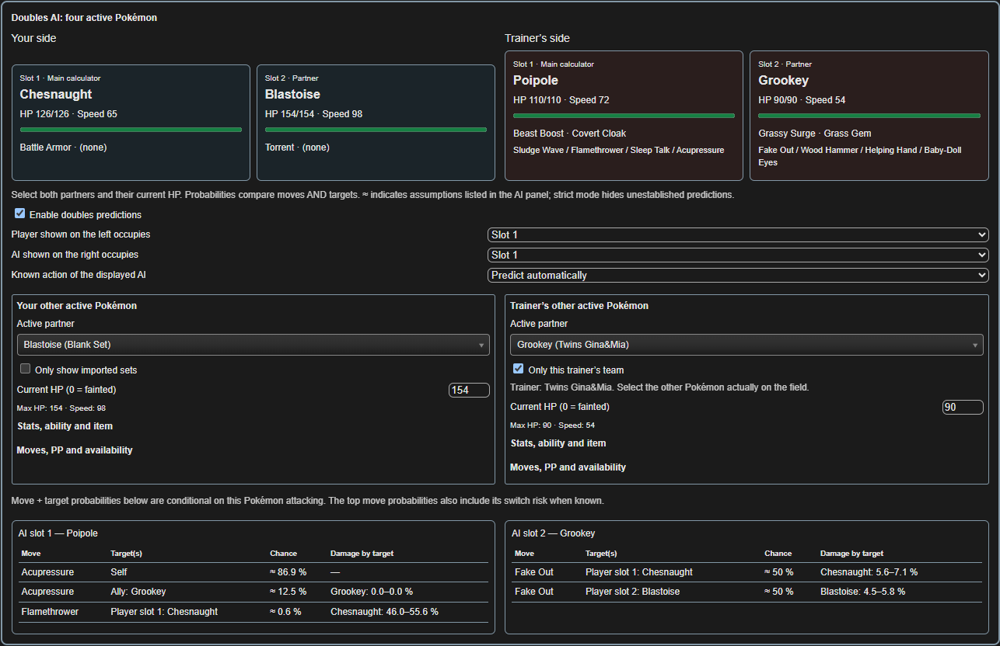

# 🇬🇧 Pokémon Null Calculator — user guide

**Target game: Pokémon Null 1.2.6.** This guide accompanies the French [TUTORIEL_SOURCE.txt](TUTORIEL_SOURCE.txt) and the downloadable calculator.

## 1. Download and open

Download the complete ZIP from the repository's Releases page, extract it, then open **CALCULATEUR.html** in Chrome, Edge or another compatible browser. Keep the **docs** folder beside it. Opening the HTML inside a ZIP preview will not load the resources correctly.

No ROM, emulator, Python or Node installation is needed for normal use. Core calculations and data work offline. Optional Pokédex animations, cries and links to external websites need Internet.

## 2. Enter the real battle

Select your Pokémon on the left and the trainer's set on the right. Verify level, IVs, EVs, nature, ability, item, current HP, status and stat stages. Set weather, terrain, hazards, screens and other relevant field effects. A trainer set does not automatically supply the history of the battle you are playing.

The settings wheel offers **AI panel language**: English or French. The AI panel defaults to English.

## 3. Read move probabilities

The four right-side move rows show AI predictions when the required context is available. Expand **AI: probabilities, switching and battle state** to enter PP, move availability, locks, history and temporary effects, and to inspect assumptions and applied rules.

- **Blue**: established probability in the model for the entered context.
- **Gold/orange**: estimated or unknown, as the label specifies.
- **≈**: estimate based on the displayed assumptions.
- **Indeterminate**: the model cannot quantify this choice; it is not a zero probability.

**Documented estimate** displays supported estimates. **Strict** withholds predictions that require unsupported assumptions. A modelled 100% is conditional on the entered context and implemented rules.

## 4. Predict the replacement after a KO

The bottom-right **Next Pokémon after KO** panel previews the displayed right-side opponent fainting against the Pokémon currently shown on the left. It ranks available reserves from that trainer's team. This preview does not change current battle HP.

Use **KO**, or right-click a trainer-team icon, to mark an opponent already defeated. **Restore** removes that mark. Check reserve HP and PP in the AI panel when needed.

- **Green**: highest entry probability in the model; ties can occur.
- **Blue**: another possible replacement.
- **Gold/orange**: unresolved or estimated information, according to its label.
- **Red cross**: already fainted and excluded.
- **0%**: not selected in this scenario, not impossible in every battle.

Reserve scoring uses the form stored in the native party before entry transformations. The active Pokémon uses its selected battle form. The UI identifies reserve-form differences, including supported Mega cases.

## 5. Switching during battle

Inside the AI panel, the switching section combines trainer rules with the battle context you enter. **Automatic: trainer rules** uses the implemented automatic routines.

Other choices deliberately override the scenario:

| Setting | Meaning |
| --- | --- |
| No switch | Assume the opponent stays in. |
| Guaranteed switch-in | Assume the opponent must switch. |
| Post-KO | Evaluate a forced replacement. |
| Probably switch | Supply an assumed switch probability. |

These overrides are user assumptions, not observations from the game. Availability, trapping, Perish Song, last move, reserve abilities, entry damage and other supported context can affect switching. Read the applied rules when the destination is uncertain.

## 6. Preview your own switch with “Switch into”

1. Keep your current active Pokémon displayed on the left.
2. Choose **Switch into: Pokémon I am sending in** in the AI panel.
3. Select your incoming Pokémon on the left.
4. Read damage against that incoming Pokémon. AI decisions remain based on the remembered active Pokémon identified in the panel.
5. Return to **Currently active Pokémon** when the incoming Pokémon becomes your real active reference.

If another change invalidates a remembered reference, the panel explains it. Recapture the intended scenario instead of assuming the previous reference still applies.

## 7. Double battles

Click **Doubles** in **Field**. The upper panel shows four active Pokémon: two on your side and two on the trainer's side.

Select both partners, check current HP and assign the correct slots to the two main calculator Pokémon. The player-side **Only show imported sets** filter finds your customs; the opponent-side filter proposes the current trainer's team.

The model considers move choices and targets. Active battlers cannot simultaneously be reserve candidates. For verified multi-trainer teams, the panel identifies reserve ownership and excludes the other owner's reserves where appropriate.

All four battlers and their slots are needed for a complete doubles context. Choose the real partner rather than treating an unselected partner as absent.

## 8. History, Trick Room and conditional moves

Toggle **Trick Room** in Field when active. It reverses ordering at equal priority, not the numerical Speed stats or move priorities. Gyro Ball and Electro Ball still use actual speeds. Toggle it off when its effect ends; there is no automatic turn counter.

For **Last Resort**, mark the other moves attempted since entry. A failed Sucker Punch attempt still counts. Reset attempts after a new entry.

The post-KO reserve preview accounts for supported faint-dependent effects such as boosted Retaliate, Last Respects and Supreme Overlord. For an active Pokémon's boosted **Retaliate**, enter **140** base power for the relevant turn, then return it to **70**. Do not infer all move history from KO marks alone.

If revivals matter, supply **Total allied faints** rather than relying only on current KO marks. Rage Fist and other use-/failure-dependent moves need their own appropriate history or manual input.

## 9. Import and manage custom sets

Paste standard text sets into **Import / Export**, then click **Import**. Multiple Pokémon of the same species are retained as separate numbered custom sets.

**Remove Pokémon from all boxes** clears previous customs after confirmation, including the related normal/doubles lists and boxes. Trainer data and preferences remain. Export anything you want to keep before using a complete custom reset.

## 10. Pokédex and troubleshooting

Left-click **Pokédex** for the embedded view. Middle-click or Ctrl/Cmd-click opens it in another tab. **Calculator** inside the embedded dex returns to the current battle. The dex has its own Light/Dark theme.

Use **Encounters** to browse locations, methods, levels and rates. A Pokémon opened from a location retains a contextual back button.

If a prediction differs from the game, check HP **after** the preceding move, current field effects, available reserves, forms, PP and history. Report the full battle context and a screenshot. The calculator does not read emulator memory, know the next RNG draw or certify full native parity.

## Updates and development

Future updates may support new game versions, fix verified discrepancies or improve the interface. Developer instructions and audit coverage are in [GUIDE_AGENTS.md](GUIDE_AGENTS.md), [DOCUMENTATION_COMPLETE.md](DOCUMENTATION_COMPLETE.md) and [MISE_A_JOUR_1.2.6.md](MISE_A_JOUR_1.2.6.md).
